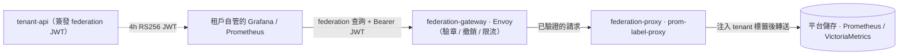

# ADR-020: 租戶把自己的指標拉回自家系統 — 用現成的標籤注入代理，不自寫端點

## 狀態

✅ **Accepted**（v2.9.0）。

- 2026-05-17 修訂：撤銷集取代本 ADR 起初「不做伺服器端撤銷清單、只靠短效期與限流」的決定。`DELETE` token 把 `token_id` 寫進 token store 的撤銷集，gateway 定期重讀並拒絕清單內的 token；限流仍是必備的補償控制。見「Token」。
- 2026-10-11 修訂：白名單與租戶子集移出 conf.d（平台存放租戶設定的 git 目錄），改存 tenant-api 的 state store（Kubernetes 上是 `tenant-api-state` ConfigMap），不再 commit。強制通過收錄檢查的紀錄因此只在 tenant-api 的日誌裡，見「已知限制」。
- 2026-11-22 修訂：每個 token 的並發上限已在 gateway 實作（每實例預設 4，計數在每個 Envoy worker 各自進行），不再列為「已決定、尚未實作」。行為與實際限制見「Gateway 驗章、撤銷與限流」與「已知限制」。

> 依語言政策，本 ADR 不另製 `.en.md`。

## 決策摘要

租戶要把**自己**的指標從平台拉回自家的 Prometheus／VictoriaMetrics（下稱 federation，聯邦查詢）。平台**不自寫查詢端點**，而是在儲存後端前面放開源的 [prom-label-proxy](https://github.com/prometheus-community/prom-label-proxy)：它解析每個 PromQL（Prometheus 的查詢語言）查詢，把 `{tenant="<租戶>"}` 強制加進每個 selector（查詢裡挑選時間序列的條件），租戶因此只查得到帶自己 `tenant` 標籤的 series（時間序列）。

proxy 前面再放一個 Envoy gateway，負責驗 JWT（JSON Web Token，tenant-api 簽過章的短效憑證）、查撤銷清單、限流；儲存後端自己設單次查詢的資源上限。三層各做自己擅長的事，沒有一層是自寫的查詢引擎。

本 ADR 與 [ADR-004](./004-federation-central-exporter-first.md) 是兩件事：ADR-004 是**平台內部**的多叢集 federation（中央 exporter 服務邊緣叢集）；本 ADR 是**跨出平台邊界**，租戶把資料拉走。

## 背景

### 租戶要什麼

已有自建 Prometheus／VictoriaMetrics 的租戶，想把屬於自己的指標子集拉回去，用來：

- 由自己的 SRE 團隊做長期保留（平台的預設保留期可能不符合合規要求）；
- 接進既有的 Grafana 看板與值班流程；
- 自己評估告警，不依賴平台的 Alertmanager。

資料流向與 ADR-004 相反：被拉走的資料離開平台的控制範圍後，可能被租戶再轉送、再保存。所以租戶隔離與稽核要求比平台內部更嚴。

### 難在哪裡

「給租戶開一個讀取端點」表面簡單，實際有四個交叉約束：

1. **租戶隔離**（強制）：租戶 A 絕不能讀到租戶 B 的資料。儲存後端（Prometheus／VictoriaMetrics）本身沒有強制的標籤過濾；自寫端點很容易在某個維度上漏掉過濾（有些指標以 cluster、node、namespace 為鍵，不帶租戶），變成跨租戶外洩。
2. **爆炸半徑**（強制）：一個沒有上限的查詢可以拖垮儲存後端，波及其他租戶與平台自己的告警評估。
3. **Token 的生命週期**（強制）：簽發、到期、撤銷都要有明確的做法。
4. **工程成本**（限制）：自寫端點加上多租戶的查詢改寫引擎，是數個月的工作量。

## 決策

### 請求路徑



平台負責四件事：

1. **部署 proxy 與 gateway**：`helm/federation-proxy`（prom-label-proxy，可放在 Prometheus、Thanos 或單機 VictoriaMetrics 前面）與 `helm/federation-gateway`（Envoy）。
2. **tenant-api 的 token 端點**：`POST`／`GET`／`DELETE /api/v1/federation/tokens`，簽發、列舉、撤銷租戶的 federation token。
3. **白名單**：平台維護可被拉走的指標白名單，租戶從中選自己的子集（見下）。
4. **稽核日誌與指標**：誰拉了什麼、多少、有沒有被拒。

VictoriaMetrics **叢集版**不經 prom-label-proxy：它本身以 URL 路徑上的 `accountID` 分租戶，gateway 的 `vm-cluster` 模式直接把路徑改寫成 `/select/<tenant_id>/prometheus/`（`tenant_id` 取自已驗證的 JWT）。

### 隔離與治理的分界

- **安全邊界（資料面）**：跨租戶隔離完全來自 proxy 注入的 `{tenant="<X>"}`。租戶查得到的，恆等於帶它自己 `tenant` 標籤的 series。某個指標若在資料層沒帶 `tenant` 標籤，結果是空的，不是外洩（見下一節）。
- **治理邊界（控制面）**：白名單與租戶子集是目錄、收錄檢查的對象、子集挑選的依據，**不在查詢路徑上擋任何東西**。

```
平台白名單（平台維護）：允許租戶拉的指標
            ↓ 取交集
租戶子集（租戶經 API 自管）：從白名單中挑自己要的
            ↓ 僅供參考，不強制
prom-label-proxy：對每個查詢強制注入 tenant="<X>"
```

白名單無法在查詢路徑上強制：prom-label-proxy 只做標籤注入，沒有指標名稱的允許清單；gateway 也無法可靠地從 PromQL 裡辨認指標名稱。租戶查白名單外的指標，proxy 一樣注入它自己的 `tenant`，它只拿得到自己的資料，所以「查自己的自訂指標」是功能，不是漏洞。「租戶子集 ⊆ 白名單」只是治理上的一致性：白名單移除了某個指標、而租戶子集還留著時，讀取端取交集修正（read-repair），不回頭改租戶的紀錄。

> ⚠️ **從白名單移除指標，擋不住對它的查詢。** 白名單移除只讓它不再出現在列表裡，知道名稱的租戶仍可直接送那個 PromQL，拿到自己的資料。若要緊急阻斷某個指標被拉走（例如發現它夾帶個資），必須在**寫入階段**處理：Prometheus／VictoriaMetrics 的 `relabel_configs` 以 `drop` 丟掉該指標，或調整底層存取權限。federation 的 proxy 沒有阻擋特定指標的能力。

### 資料層的租戶標籤

平台資料層的租戶標籤名是 **`tenant`**（Prometheus relabel 的 `target_label: tenant`、threshold-exporter、rule pack 一律用它）；proxy 注入的就是這個標籤（`helm/federation-proxy` 的 `tenant.label`，預設 `tenant`）。JWT 裡的租戶 claim 名是 `tenant_id`，與指標標籤是兩個獨立的命名空間，不要求一致。資料層的租戶標籤盤點見 [`federation-label-enrichment-audit.md`](../internal/federation-label-enrichment-audit.md)。

白名單裡的每個指標，平台**必須**確保在抓取或寫入階段就帶上 `tenant` 標籤。否則 proxy 注入 `{tenant="<X>"}` 後查詢結果是空的：租戶看到看板一片空白、回報「federation 壞了」，SRE 得從 token 一路查到 scrape 設定才找得到原因。容易踩到的來源是原生不帶 `tenant` 的指標，例如 cAdvisor 的 `container_*`、node-exporter 的 `node_*`、kube-state-metrics 的 `kube_*`，以及從上游 Prometheus 轉進來、上游沒打標籤的指標。

### 白名單收錄檢查

平台把新指標加進白名單時（`PUT` 白名單），tenant-api 對每個**新加入**的指標問後端：過去 24 小時有沒有帶 `tenant` 標籤的 series。

- **只用 series metadata API**（`GET /api/v1/series`），不用 range query。後者會把 24 小時的原始樣本載進記憶體，高基數指標可能讓 Prometheus 記憶體耗盡。
- **先問 `metric{tenant!=""}`**，過濾由 TSDB（Prometheus 的時間序列資料庫）的索引完成，幾乎不花成本；非空就通過。空的再問 `metric` 本身有沒有 series。
- 每次呼叫三重限制：`limit=1`、回應本文最多讀 1 MiB、單次 5 秒逾時，檢查本身不會變成資源黑洞。一次 `PUT` 最多新增 30 個指標，最多 8 個並行檢查。
- 擋下的判準是「**沒有任何** series 帶 `tenant`」，不是「有 series 缺 `tenant`」。共享的 Kubernetes 叢集裡，`up`、`container_*` 這類指標在租戶 pod 上帶 `tenant`、在平台 pod（kube-system、API server）上不帶；proxy 注入後每個租戶只看得到自己的 series，那些沒標籤的平台 series 無害。若以「任一 series 缺標籤」為準，所有 Kubernetes 原生指標都會永遠進不了白名單。

| 觀察結果 | 處置 | 理由 |
|---|---|---|
| 有帶 `tenant` 的 series | 通過 | 可以 federate；同一指標上沒帶 `tenant` 的平台 series 不影響 |
| 有 series，但**沒有任何**帶 `tenant` | 擋下（400），不可強制 | scrape 設定沒打標籤，federate 之後對每個租戶都是空的 |
| 過去 24 小時完全沒有 series | 警告：沒帶 `force` 回 400，帶 `force` 加理由才通過 | 剛上線的服務、一週才出現一次的稀疏指標都是合法情況；硬擋會卡死合法的白名單更新 |
| 後端連不上或逾時 | 同上一列 | 查不到不能證明指標壞了 |
| 標籤**名稱**像個資（`email`、`customer`、`user_ip` 等） | 同上一列 | 名稱推測必然不精準，交給人判斷 |

區分「結構性錯誤（擋下）」與「資料時序上的缺漏（警告、人工確認）」是平台防護的一貫做法，例如 [ADR-017](./017-defaults-yaml-inheritance-dual-hash.md) 的基數防護；全部硬擋會讓誤判鎖死合法操作。

強制通過時，tenant-api 寫一行警告日誌（操作者、理由、指標），並把同樣內容寫進這次 state store 寫入的稽核事件（`state_write` 的 `notes` 欄位）。白名單與租戶子集存在 tenant-api 的 state store（Kubernetes 上是 `tenant-api-state` ConfigMap），不在 git 裡。

### Token

| 項目 | 做法 | 理由 |
|---|---|---|
| 簽發 | tenant-api `POST /api/v1/federation/tokens` | 沿用既有的 tenant-api 認證流程，不另起服務 |
| 效期 | 預設 4 小時（`--federation-token-ttl` 或 `TA_FEDERATION_TOKEN_TTL` 可調） | 短到撤銷不再那麼關鍵，長到重簽不擾人 |
| 範圍綁定 | JWT 內含 `tenant_id` claim；gateway 只用驗證過的 claim 設定租戶，不信請求裡帶的值 | 查詢字串或 header 裡的租戶 id 都可以偽造 |
| 撤銷 | `DELETE /api/v1/federation/tokens/{id}` 把 `token_id` 寫進 `tenant-federation-store` ConfigMap 的撤銷集；gateway 掛載衍生的 `revoked.txt`，每 30 秒重讀一次，清單內的 token 回 403 | 撤銷要經 ConfigMap 同步與重讀，不是即時生效；撤銷紀錄被竄改的偵測見 [ADR-028](028-federation-revocation-tamper-evidence.md) |
| 續期 | 到期前由租戶自己重新簽發；不做滑動續期 | 實作簡單；每 4 小時重簽對自助的租戶不痛 |
| 每租戶上限 | 同時有效的 token 最多 16 個 | 讓「輪流用多個 token 放大配額」有上限（見 gateway 的每租戶限流） |

**gateway 的限流是撤銷之外必備的補償控制**：撤銷生效前、或撤銷機制失效時，外洩的 token 在剩餘效期內仍可使用，限流保證它即使被並發濫用，也打不滿後端的 CPU。缺了限流，4 小時的曝險就變成 4 小時的阻斷服務窗口。

**簽章金鑰**：RS256 金鑰由 `da-tools fed-key` 產生與輪替。私鑰直接輸出成 Kubernetes Secret manifest 到 stdout（不落地），公鑰寫成 JWKS（公鑰集合的 JSON 格式）給 gateway。每把公鑰的 `kid` 是它的 RFC 7638 thumbprint（公鑰的確定性指紋）；tenant-api 簽 token 時對載入的金鑰算同一個 thumbprint 填進 `kid`，gateway 的 `jwt_authn` 因此可以直接按 `kid` 選鑰，輪替期間 JWKS 裡有多把鑰也不會讓偽造簽章的洪水放大 RSA 驗章成本。計畫性輪替與私鑰外洩的處理見 [`federation-key-rotation-runbook.md`](../internal/federation-key-rotation-runbook.md)。

### 三層資源防護

prom-label-proxy 是很輕的中介層：解析 PromQL、注入標籤、把請求原樣轉給後端。它不解析回應、不追蹤每個 token 的狀態，扛不了 series 上限或並發控制。所以資源防護分在三層：

- **儲存後端**：單次查詢的資源上限，防止一個查詢耗盡記憶體。
- **gateway（Envoy）**：每個 IP、每個 token、每個租戶的限流，加上每個 token 同時進行的查詢數上限，防止 token 層級的濫用。
- **proxy（prom-label-proxy）**：強制注入 `{tenant="<X>"}`，租戶隔離的核心。

請求實際的流向是 gateway → proxy → 儲存後端。三層缺一不可，職責也不能錯放：指望 proxy 擋 series 上限，最後還是得自寫中介層，違背不自寫端點的初衷。

#### 儲存後端的查詢上限

| 後端 | 設定 | 起始值（上線後依實際查詢調整） | 說明 |
|---|---|---|---|
| Prometheus | `--query.max-samples` | 5M（可調 5M–50M；原生預設 50M） | 「1000 series × 1 天 × 30 秒抓取 ≈ 3M」之上的保守起點 |
| Prometheus | `--query.timeout` | 25s | 見下方逾時說明 |
| VictoriaMetrics | `-search.maxUniqueTimeseries` | 100k（可調 50k–300k；原生預設 300k） | 撐得起叢集層級的看板面板，擋住 `count by (instance) (...)` 這類意外的高基數查詢 |
| VictoriaMetrics | `-search.maxSamplesPerQuery`、`-search.maxQueryDuration` | 25s（後者） | 同上 |

平台自帶的 Prometheus（`k8s/03-monitoring/deployment-prometheus.yaml`）已設 `--query.max-samples=5000000` 與 `--query.timeout=25s`。VictoriaMetrics 不是平台部署的元件，由使用它的人照上表設定（`helm/federation-gateway/README.md` 有說明）。超過 `--query.max-samples` 時 Prometheus 回 422。

**逾時要內短外長，不能相等**：儲存後端 25 秒、gateway 路由 30 秒。內層先逾時，才能砍掉查詢、釋放記憶體，並把精確的錯誤碼回給 gateway 記錄。兩層相等會互搶：gateway 的計時從請求抵達就開始，會先回 504，而 Prometheus 還在跑，乾淨的錯誤無處可回。

#### Gateway 驗章、撤銷與限流

gateway 是 Envoy（distroless 映像：只含執行檔與必要函式庫、沒有 shell 與套件管理器的容器映像），交付為 `helm/federation-gateway`。選 Envoy 的關鍵：最不能錯的 RS256 驗章交給原生的 `jwt_authn` filter，純設定、不必自己寫驗章邏輯。

filter 依「便宜的先做」排序：

```
每 IP 限流
  → jwt_authn（RS256 驗章，按 kid 選鑰）
  → Lua（Envoy 內嵌的腳本 filter：查撤銷集；以驗證過的 claim 覆寫租戶 header）
  → 每 token 限流 → 每租戶限流
  → buffer → 稽核用 Lua
  → 並發上限用 Lua
  → router
```

- 每 IP 限流在驗章之前，偽造 token 的洪水在花掉任何 RSA 運算之前就被丟掉。
- 限流以驗證過的 `token_id`、`tenant_id` 為鍵，不以 IP 為鍵：否則同一個公司 NAT 後面的租戶會互相影響。每 token 限流擋單一外洩 token 的濫用；每租戶限流擋「輪流使用最多 16 個 token 來放大配額」。
- chart 預設值：每 token 突發 10 次、持續每分鐘 15 次；每租戶突發 20 次、持續每分鐘 60 次；每 IP 突發 200、持續每秒 100 次。每 token 的可調範圍是每分鐘 15 到 60 次。
- 刻意不用一般 Web API 的量級（例如每秒 10 次）：PromQL 查詢很耗 CPU 與記憶體，一個外洩 token 以每秒 10 次打 4 小時是十四萬多次查詢，足以打滿後端。
- 所有限流都是每個 Envoy 實例各算各的：N 個副本時實際上限是 N 倍。限流是軟性、近似的控制，硬上限在儲存後端。
- **每個 token 的並發上限**：限流管的是每分鐘「開始」幾個查詢，管不到一個外洩 token 同時掛著好幾個慢查詢。gateway 因此另外限制每個 token 同時進行的查詢數，chart 預設每個實例 4 個（`inflightLimit.maxPerToken`；一個租戶的 Grafana、自管告警評估、值班查詢並行通常不超過 3）。超過的請求回 429，稽核日誌與指標記成 `rate_limited`，與限流同一桶。這道檢查排在 router 之前的最後一個 filter：名額在請求真正轉出去的那一刻才佔用，被拒的請求已經走過稽核用 Lua，日誌裡看得到它查的是什麼。
  - **它限制的是每個實例**，與限流相同：預設 2 個副本合計 8 個，自動擴展到 8 個副本時合計 32 個。
  - **計數在每個 Envoy worker（處理請求的執行緒）各自進行**：Envoy 的 Lua filter 在 worker 之間沒有共用記憶體，同一個 token 的連線會被分到不同 worker。chart 把上限平均分給各 worker（每 worker `maxPerToken ÷ concurrency` 個），所以各 worker 加總不會超過上限；代價是同一個 token 的連線剛好落在同一個 worker 時，會在 `maxPerToken ÷ concurrency` 個就被拒（預設 2 個 worker，即 2 個）。上限不是 worker 數的倍數時 chart 拒絕 render，不讓實際生效的上限悄悄低於設定值。
  - **名額在回應結束時釋放**，包括 gateway 自己產生的回應（路由逾時的 504、上游斷線的 503）。**client 中途斷線**（例如 Grafana 取消查詢）時，Envoy 的 Lua filter 收不到任何通知，名額改由租約到期釋放：每個名額在佔用 35 秒後失效（路由逾時 30 秒加 5 秒）。路由逾時涵蓋整個上游回應，超過 35 秒的名額不可能還對應一個在跑的查詢，所以計數不會洩漏；代價是 client 一次取消滿額的查詢後，這個 token 最多有 35 秒會被誤拒。
- `prom-label-proxy` 模式下，Prometheus 的 `remote_read`（`/api/v1/read`）回 403：prom-label-proxy 無法對它注入標籤。路由前先把路徑正規化（合併重複斜線、解析 `.`／`..`、解碼 `%2F`），`/api/v1//read`、`/api/v1%2Fread` 這類變形也擋得住。

#### 代理注入租戶標籤

prom-label-proxy 在這一層只做一件事：把 `{tenant="<X>"}` 強制注入每個 selector。`<X>` 來自 gateway 設定的 `X-Tenant-Id` header，不來自租戶。

注入必須同時涵蓋**查詢 API** 與 **metadata API**。Grafana 的變數下拉選單（例如 `label_values(pod)`）走的是 `/api/v1/series`、`/api/v1/labels`、`/api/v1/label/<name>/values`；沒擋住，租戶 A 會在自家 Grafana 的下拉選單裡看到租戶 B 的 pod 名稱、instance、主機名。chart 寫死 `-enable-label-apis`，把注入延伸到 `/api/v1/labels` 與 `/api/v1/label/<name>/values`（`/api/v1/series` 不論這個旗標都會注入），而且不開放覆寫。

上面三個是最常用的，不是全部。完整的 HTTP API 面由 federation E2E（`tests/federation-e2e/test_federation_e2e.py` 的 metadata API 情境）守住：proxy 服務的端點（查詢、metadata、rules、alerts）都限縮到該租戶；它不服務的端點（`/api/v1/targets`、`/api/v1/metadata`、`/api/v1/status/config` 與 `/api/v1/status/tsdb`、admin API、`/api/v1/write`）一律不回 200。

### 稽核日誌與指標

稽核分兩個維度，存放的地方也不同。

**資料面：誰查了什麼。** 由 gateway 產出，因為只有 gateway 持有 `jwt_authn` 驗證過的 claim（proxy 看不到 token）。每個請求一行 JSON，欄位：`ts`、`tenant_id`、`token_id`、`account_id`（只在 [ADR-021](021-tenant-log-query-federation.md) 的日誌查詢模式有值）、`method`、`path`（不含查詢字串，避免把放在 URL 裡的 token 寫進日誌；截斷 2048 字元）、`query`、`status`（原始 HTTP 碼）、`duration_ms`、`upstream`、`response_flags`。

- `query`：Envoy 的存取日誌沒有讀取請求本文的變數，所以由稽核用的 Lua 統一抽出 PromQL：GET 取自查詢字串、POST 取自表單本文，格式一致。buffer 與稽核 Lua 排在限流**之後**，被限流拒絕的請求不會被緩衝進 Envoy 記憶體。
- 刻意不記「回傳了幾條 series」：那要 Envoy 緩衝並解析回應本文，成本太高；資源上限靠儲存後端執行，不靠日誌統計。也沒有「命中哪條白名單規則」：白名單不在查詢路徑上執行。

日誌寫兩份：一份到 stdout（給日誌採集器，持久度等同節點的容器日誌輪替）；一份到 pod 內的 emptyDir（隨 pod 建立、隨 pod 刪除的暫存目錄），給 gateway pod 裡的 audit-metrics sidecar（與 gateway 同 pod 執行的輔助容器，這裡是 Vector）讀取並產生指標，這份是暫存的指標來源，不是正式紀錄。裝了平台的 Vector 與 VictoriaLogs chart 後，stdout 那份會被收進中央日誌庫的平台分區（`0:0`），可以查詢超過 pod 生命週期的歷史。

指標 **`tenant_federation_requests_total{tenant,status}`** 由 sidecar 產生（Envoy 原生的 stats 產生不了每租戶的高基數標籤）。`status` 是 HTTP 碼的分桶：

| 值 | HTTP | 意義 |
|---|---|---|
| `ok` | 2xx | 成功 |
| `client_aborted` | 0 / 499 | client 在收到回應前中斷（例如 Grafana 切換時間範圍時取消查詢）；不是平台拒絕 |
| `rate_limited` | 429 | gateway 限流，或超過每 token 並發上限 |
| `auth_failed` | 401 / 403 | JWT 驗證失敗或 token 已撤銷 |
| `bad_request` | 其他 4xx（含 422） | 錯誤請求；422 是儲存後端的查詢上限觸發 |
| `backend_error` | 5xx | 平台故障 |

**指標的邊界**：只計有 `tenant_id` 的請求。偽造或過期的 JWT 在 claim 注入前就被 `jwt_authn` 以 401 擋下，日誌裡沒有 `tenant_id`，不計入（它們沒有租戶，屬攻擊噪音，看 Envoy `jwt_authn` 自己的 stats）。被撤銷的 token 不同：它是合法 JWT，由撤銷集擋下回 403，計入 `auth_failed`。

告警 **`FederationRejectionRateAnomaly`**（`warning`，通知平台維運）：某租戶 10 分鐘內被拒（`rate_limited`、`auth_failed`、`bad_request`）的比例超過 50%、且被拒速率超過約每分鐘 1 次，持續 15 分鐘。規則以 `and on (tenant) tenant_metadata_info` 只評估仍在 conf.d 的租戶：已退租租戶的殘留 token 在到期前持續被 403 擋下，不會誤報。看板 `k8s/03-monitoring/federation-audit-dashboard.json` 有請求量、拒絕率與三層拒絕率的面板。

**控制面：誰授權了什麼。** 不另建儲存，用既有的兩處：

- token 的簽發與撤銷：`tenant-federation-store` ConfigMap 裡的 token 紀錄（`token_id`、`tenant_id`、`issued_by`、`issued_at`、`expires_at`）與撤銷集。
- 白名單與子集的變更：tenant-api 每次寫 state store 的 `state_write` 稽核事件（作者、寫入的鍵；強制通過時含理由）。

這兩處加上 tenant-api 的請求日誌，都只是日誌層級的紀錄；**它們不能當計費依據**：稽核日誌記的是請求**次數**，不是查詢**成本**（掃了幾條 series、花了多少 CPU）。

### 範例

**proxy 注入的標籤。** 預設值渲染 `helm/federation-proxy`：

```text
$ helm template f helm/federation-proxy | grep -A6 'args:'
          args:
            - -label=tenant
            # Per-tenant value comes from a gateway-set header, never the
            # client — the gateway verifies the JWT first (ADR-020 §代理注入租戶標籤).
            - -header-name=X-Tenant-Id
            - -upstream=http://prometheus.monitoring.svc:9090
            - -insecure-listen-address=0.0.0.0:8080
```

注入本身用 chart 釘的同一版 prom-label-proxy（v0.16.2）的 `injectproxy.NewPromQLEnforcer` 跑（chart 沒設 `-error-on-replace`，所以租戶自帶的 `tenant` 條件被覆寫而不是報錯）：

```text
rate(http_requests_total[5m])
  -> rate(http_requests_total{tenant="tenant-a"}[5m]) err=<nil>
count by (tenant) (up{tenant="tenant-b"})
  -> count by (tenant) (up{tenant="tenant-a"}) err=<nil>
```

第二個查詢是試探別的租戶：要求 `tenant-b` 的條件被換成自己的 `tenant-a`。

**白名單收錄檢查。** 對一個假後端呼叫收錄檢查（`fedpolicy.AdmissionValidator.Check`）：後端裡 `http_requests_total` 有帶 `tenant` 與 `customer_email` 標籤的 series；`node_load1` 只有不帶 `tenant` 的 series；`batch_job_failures` 過去 24 小時沒有任何 series。結果：

```text
http_requests_total -> state=pass pii=[customer_email] err=<nil>
  reason: metric "http_requests_total" has series carrying the "tenant" label
node_load1 -> state=hard_block pii=[] err=<nil>
  reason: metric "node_load1" has samples but no series carries a "tenant" label; federating it would return an empty vector for every tenant — fix the scrape/relabel config first
batch_job_failures -> state=warn pii=[] err=<nil>
  reason: metric "batch_job_failures" has no samples in the last 24h0m0s — legitimate for a cold-start or sparse metric, but unverifiable; re-submit with force to proceed
```

`http_requests_total` 雖然通過，標籤名 `customer_email` 命中個資推測，所以與 `batch_job_failures` 一樣，要帶 `force` 與理由才能加進白名單；`node_load1` 不論是否帶 `force` 都會被擋。

## 後果與已知限制

**得到的**

- 租戶拿到標準的 Prometheus 查詢介面，接進既有的 Grafana 與值班流程沒有摩擦。
- 標籤層級的隔離由長期在正式環境使用的開源 proxy 保證；資源隔離由儲存後端執行；限流由 gateway 執行。三層用的都是成熟的元件，不是自寫。
- proxy 抽象掉了後端，儲存後端換成什麼（Prometheus／Thanos／VictoriaMetrics）不影響 federation 介面。

**代價**

- 三個元件（proxy、gateway、儲存後端）要一起協調：每次上游升級都要跨層回歸測試，任一層設錯都可能造成靜默失效或安全破口。prom-label-proxy 上游有不相容變更時，chart 要跟著改。
- VictoriaMetrics 叢集版的隔離不走 proxy，而是 gateway 的路徑改寫，架構上多一條分支。
- 撤銷要經 ConfigMap 同步與 gateway 每 30 秒的重讀才生效；在那之前，以及撤銷機制本身失效時，外洩 token 的曝險只靠限流收斂。
- 資料層前提：白名單裡的每個指標都必須在抓取或寫入階段帶 `tenant` 標籤，收錄檢查是必需的，不是加分項。
- metadata API 的覆蓋是不顯眼的風險：容易只想到 `/api/v1/query` 而漏掉 `/series`、`/labels`；E2E 的 metadata 情境是這個風險的安全網。
- 收錄檢查的強制通過留了人為判斷的空間：稽核紀錄只能事後追蹤，誤用仍可能埋雷。
- 每個請求都寫一行稽核日誌，高頻拉取的租戶會產生不小的日誌量。

**已知限制**

- **每 token 並發上限是每個實例、每個 worker 各自計算。** chart 的設定是每個實例 4 個：預設 2 個副本時一個 token 合計最多 8 個查詢同時進行，擴到 8 個副本時 32 個。實例內分給 2 個 worker 各 2 個，同一個 token 的連線都落在同一個 worker 時，第 3 個就會被拒；把 `concurrency` 設成 1 才是每實例精確的 4 個。要叢集層級的精確上限，得有跨實例共用的計數（例如外部的計數服務或 Redis），目前沒有。
- **client 中途斷線的查詢，名額最多 35 秒後才釋放。** Envoy 的 Lua filter 收不到 client 斷線的通知，只能靠租約到期回收。Grafana 一次取消滿額的查詢，這個 token 會被誤拒到租約到期為止；方向是多拒，不是漏擋。
- **每 token 限流的實際上限隨 gateway 副本數變動。** 本 ADR 決定每 token 持續約每分鐘 30 次（對應 Grafana 預設 30 秒刷新、多面板的看板），可調範圍每分鐘 15 到 60 次。chart 的設定是每個 Envoy 實例每分鐘 15 次：預設 2 個副本時合計約每分鐘 30 次，與決定相符；自動擴展到上限 8 個副本時約每分鐘 120 次，超出 15 到 60 的範圍。要固定上限，得改用全域限流（例如以 Redis 為後端），目前沒有。
- **強制通過收錄檢查的稽核只在 tenant-api 的日誌裡。** 操作者、理由、指標寫在 tenant-api 的警告日誌與 `state_write` 稽核事件；白名單存在 state store，沒有 git 歷史。這份紀錄能保留多久，等於 tenant-api 日誌的保留期。
- **稽核日誌沒有中央、可長期查詢的合規儲存。** stdout 那份的保留等同節點的容器日誌輪替；裝了平台的 Vector 與 VictoriaLogs 才收進中央日誌庫，但它的保留期與合規查詢需求沒有在本 ADR 定義。不寫每個 pod 自己的 PVC：ReadWriteOnce 的 PVC 在 gateway 多副本時無法同時掛載，ReadWriteMany 又引入 NFS／EFS 依賴。
- **租戶內不再細分。** 白名單與子集只有兩層，沒有「租戶內的子團隊範圍」。需要時 schema 要從 `{平台白名單, 租戶子集}` 擴成三層，等有租戶提出再做。
- **沒有合規角色分離。** 合規、稽核、操作者的權限沒有分開，等有合規客戶（SOX、ISO 27001、SOC 2）要求時再做。
- **series 上限一刀切。** 每個租戶套同樣的上限，沒有依歷史流量自動調整。
- **不能依 federation 流量計費。** 稽核日誌只有請求次數，分不出一次拉 10 條 series 還是 10 萬條。要計費得開儲存後端的查詢日誌（Prometheus 的 `query_log_file`、VictoriaMetrics 的查詢日誌），送進中央日誌庫，由離線管線算每個 `tenant_id` 實際掃描的 series 數與 CPU 時間。
- **新租戶的冷啟動。** 剛上線、還沒有資料的租戶查到的是空結果，不是錯誤；租戶指南要說明。

## 考慮過的替代方案

### 自寫聯邦端點

在 tenant-api 加一個端點直接轉給儲存後端，自己改寫查詢。不採用：

1. 標籤過濾是地雷：不同指標的標籤組合不一致（有的帶 `tenant`，有的只帶 `cluster_id` 再反查），自寫的過濾漏一個維度就是跨租戶外洩。prom-label-proxy 已在大量正式環境處理過這類邊角情況。
2. 工程成本：花數個月寫一個比現成開源 proxy 還弱的東西，沒有附加價值。
3. 維護成本：自寫元件的安全修補要自己追。

### 只靠儲存端的權限控管

給租戶開後端的唯讀帳號，靠儲存層的權限做隔離。不採用：

1. VictoriaMetrics 沒有原生的多租戶權限控管；Prometheus 本身也沒有，要靠 Cortex／Mimir 這類第三方層，而平台不強制客戶用特定後端（見 [`byo-prometheus-integration.md`](../integration/byo-prometheus-integration.md)）。
2. 擋不住查詢層的資訊外洩：租戶可以寫 `count by (tenant) (up)` 探測其他租戶是否存在；檔案權限或 basic auth 擋不住這種查詢。要在查詢路徑上注入 `{tenant="<X>"}` 才擋得住，這正是 proxy 存在的原因。
3. 稽核缺口：權限控管只記「誰連線」，不記「誰查了什麼」。

### 平台主動推送

平台用 `remote_write` 主動把租戶的指標推到租戶端。不採用：

1. 信任方向反過來：平台要主動連進租戶內網，網路與防火牆規則複雜度暴增。
2. 租戶失去控制權：拉什麼、何時拉、拉多少都只能照平台的排程。
3. 背壓：租戶端儲存滿了或變慢，會反壓回平台的 `remote_write` 佇列。
4. N 個租戶就要維護 N 條外送 `remote_write`，維運極差。

拉取是 Prometheus 生態的基本模式，不要違背它。

### 代理選型：prom-label-proxy 而非 vmauth

曾考慮「VictoriaMetrics 客戶走 vmauth、Prometheus 客戶走 prom-label-proxy」。不可行：

1. vmauth 是認證路由器，不解析 PromQL、不注入標籤；它的多租戶只靠把使用者路由到 VictoriaMetrics 叢集版的 `accountID` 路徑，對單機版沒有隔離能力。
2. vmauth 依靠**靜態** `auth.yml` 的帳號或 bearer token 路由，消化不了 tenant-api 動態簽發、4 小時到期的 RS256 JWT；每次簽發都重寫 `auth.yml` 不可行。

所以統一採 prom-label-proxy；VictoriaMetrics 叢集版由 gateway 改寫路徑處理。

## 相關

- [ADR-004](./004-federation-central-exporter-first.md)：平台內部的多叢集 federation，與本 ADR 互補，不是取代。
- [ADR-009](./009-tenant-manager-crud-api.md)：tenant-api 既有的端點慣例，token 端點沿用。
- [ADR-021](021-tenant-log-query-federation.md)：租戶在平台上查自己的日誌，沿用本 ADR 的 gateway 與 token。
- [ADR-028](028-federation-revocation-tamper-evidence.md)：撤銷紀錄被竄改的偵測。
- [`tenant-federation.md`](../integration/tenant-federation.md)：租戶上手指南；[`victoriametrics-integration.md`](../integration/victoriametrics-integration.md)：VictoriaMetrics 整合。
- [`tenant-offboarding-runbook.md`](../internal/tenant-offboarding-runbook.md)：退租時清掉 federation token 與子集紀錄。
- 實作位置：`helm/federation-proxy/`、`helm/federation-gateway/`（`files/envoy.yaml`、`files/revoked_check.lua`、`files/audit_extract.lua`、`files/audit-metrics.vector.yaml`）、`components/tenant-api/internal/federation/`（`token/`、`fedpolicy/`）、`components/tenant-api/internal/handler/federation/`、`scripts/tools/ops/federation_keygen.py`、`tests/federation-e2e/`。
