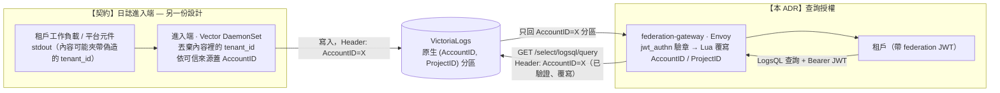

# ADR-021: 租戶在平台上查自己的日誌 — 平台只管查詢授權，日誌進入端另以契約約束

## 狀態

✅ **Accepted**（v2.9.0）。

- 2026-10-11 修訂：AccountID 帳本與 federation 白名單、子集移出 conf.d 的 git 樹，改存 tenant-api 的 state store（Kubernetes 上是 `tenant-api-state` ConfigMap，單機是一個目錄），寫入改為 compare-and-swap（先比對版本、相同才寫入），不再 commit。原因：那些 commit 從不 push，chart 預設的 emptyDir 一重啟就沒了，帳本遺失正是本 ADR 要防的 AccountID 重發。同日另一項修訂：開機時比對仍有效的日誌 token 與帳本，不一致就拒絕啟動；備份改經 `tenant-api state restore` 合併還原，不再直接覆蓋。
- 2026-10-13 修訂：AccountID 的高水位另記在 federation token store ConfigMap，運行中被蓋回的舊帳本會被擋下；`state restore` 的計數器加上安全邊際。見「單調性靠什麼守」。
- 2026-11-07 修訂：日誌庫前方加上依消費端授權的 vmauth，gateway 以自己的帳密連線；它不做租戶路由，與「不用 vmauth 做租戶路由」的決定不衝突，見替代方案。
- 2026-11-22 修訂：實作「該蓋章卻落進 `0:0`」的偵測：Vector 計數帶已驗證 AccountID 卻沒進租戶分區的 audit 列，rule pack 以 `TenantProjectionStampMissing` 告警。見「日誌進入端的契約」。

**範圍**：租戶查「平台**關於它**的營運日誌」（目前是它自己的 federation 查詢稽核紀錄）已實作。租戶查**自己工作負載的應用日誌**延後，要等日誌進入端的另一份設計（見「已知限制」）。

> 依語言政策，本 ADR 不另製 `.en.md`。

## 決策摘要

租戶在平台上就地查詢屬於自己的日誌，不拉回自家系統。平台只負責**查詢授權**：解析租戶身分、在查詢路徑上強制隔離、決定哪些內容可見。

隔離用日誌庫 VictoriaLogs 原生的租戶分區：每筆日誌寫入與查詢都帶 `(AccountID, ProjectID)` 兩個 header，查詢只看得到該分區。[ADR-020](./020-tenant-federation.md) 的 federation-gateway 新增 `victorialogs` 模式，從驗證過的 JWT 取出數值 claim `account_id`，覆寫成 `AccountID` header。平台不自寫查詢端點，也不自寫 LogsQL（VictoriaLogs 的查詢語言）過濾。

日誌如何送進平台、如何蓋上可信的租戶身分，是另一份設計；本 ADR 以一份可驗證的契約約束它。

與 ADR-020 的關係：ADR-020 讓租戶把指標**拉回**自家系統（prom-label-proxy 注入 `{tenant="X"}`）；本 ADR 讓租戶在平台上**就地查**日誌。資料流向與隔離機制都不同，但共用同一套 gateway 與 token。

## 背景

### 租戶要什麼

客戶實際想要的是查自己工作負載的應用日誌，就地在平台查即可，不一定要拉回去。平台另外判斷，讓租戶看「平台關於它的營運紀錄」（例如它的 federation 查詢為何被拒）是必要的，而且同一套授權機制之後可以延伸到應用日誌。客戶端的訊號還不是硬性的合約要求，所以先做平台營運日誌，應用日誌延後。

這是平台對客戶、跨組織的讀取，信任邊界與稽核需求等同 ADR-020。

### 難在哪裡

1. **隔離必須由後端強制。** Grafana 層的過濾是信任 client，不是安全邊界。
2. **隔離是兩端共同的性質。** 寫入時蓋的租戶身分、查詢時強制的分區，任一端弱就外洩。本 ADR 只擁有查詢端，所以寫入端的蓋章必須以明確的契約約束，不能假設別人做對。
3. **日誌庫是 VictoriaLogs（LogsQL），不是 Prometheus（PromQL）。** 直覺上「沿用 ADR-020 的 prom-label-proxy」不成立（見替代方案）。
4. **平台營運日誌含基礎設施拓樸**（節點名、內部 IP、其他租戶的 namespace 命名），直接開給租戶會洩漏基礎設施。

## 決策

### 租戶分區隔離



gateway 本來就有多種模式：`prom-label-proxy`（注入指標標籤）、`vm-cluster`（改寫 `/select/<id>/` 路徑）。日誌是第三種 `victorialogs`，注入的是 **header**，不是標籤也不是路徑。`jwt_authn` 驗章、撤銷集檢查、每 IP／每 token／每租戶三層限流、稽核日誌全部沿用。

`victorialogs` 模式只接受 audience 為 `tenant-federation-logs` 的 token（chart 在渲染時強制）；`ProjectID` 固定為 0，代表平台營運日誌。

平台負責：

1. **gateway 的 `victorialogs` 模式**：驗章 → 覆寫租戶 header → 只轉送列名的查詢端點。
2. **tenant-api**：為租戶配發穩定的 uint32 AccountID；簽日誌 token 時把它放進數值 claim；列舉與撤銷沿用 ADR-020 的 token 機制。
3. **可見度**：只有特定類別的日誌、特定欄位會進租戶分區（見下）。
4. **稽核與指標**：誰查了哪些日誌、有沒有異常。

### 注入前驗證 AccountID

VictoriaLogs 對**沒有** `AccountID` header 的請求，預設當成分區 0，也就是平台自己的分區。所以一個缺 `account_id` claim 的 token（tenant-api 的 bug、空字串），若讓請求照樣過去，租戶會讀到平台日誌，這是越權。

做法：gateway 的 Lua（`revoked_check.lua`）在注入**之前**檢查 claim，缺少、非數字、非整數、小於 1000（0–999 是保留區，0 是平台分區）或大於 2³²−1 的一律回 403。合法才用 `replace()` 寫入 `AccountID` 與 `ProjectID`；`replace()` 無條件覆寫 client 自己帶的同名 header，偽造在注入點就被關死。

> ⚠️ **不要**把 `AccountID`／`ProjectID` 列進 route 或 vhost 的 `request_headers_to_remove`。那個動作由 router filter 執行，排在注入 header 的 Lua **之後**：列進去會刪掉 Lua 剛寫入的已驗證值，請求到 VictoriaLogs 時沒有 `AccountID`，正好落進平台分區。理由寫在 `helm/federation-gateway/files/revoked_check.lua` 與 `files/envoy.yaml` 的註解裡。

gateway 轉送時，`Authorization` header 換成 gateway 自己連日誌庫的帳密（見替代方案的 vmauth 一段）。

### 日誌進入端的契約

> **本 ADR 的隔離保證，上限等於進入端蓋章的誠實度。** 這份契約把責任切出去，但不甩鍋：以明確、可驗證的形式約束另一份設計。

日誌進入端（不論是平台元件的 stdout，還是將來租戶工作負載的日誌）**必須**：

1. **不信任日誌內容**：內容裡自帶的 `tenant_id` 或任何租戶身分欄位，一律視為不可信。
2. **由基礎設施蓋章**：租戶身分（換算成 uint32 AccountID）由節點上的 Vector DaemonSet 依可信來源決定（認證過的連線、Kubernetes namespace、GitOps 管控的標籤），寫成 VictoriaLogs 的 `AccountID` header。這對應 ADR-020 的「proxy 不信查詢字串裡的 `tenant_id`」與「資料層必須帶 `tenant` 標籤」。

gateway 在查詢路徑上強制 `AccountID=X`，若寫入端蓋錯或可被偽造，查詢端會「忠實地」把錯租戶的日誌送出去，而且沒有任何錯誤訊號。

**蓋章失效的偵測。** 平台保留一個結構性的檢查：本該帶租戶身分、卻只落進平台分區 `0:0` 的日誌，發標準的 Alertmanager 告警（`warning`，通知平台維運）。它**不**自動切斷租戶的查詢（誤判會切斷合法租戶、引發 SLA 事故），也不做依內容的異常偵測或自動斷流。

「本該帶租戶身分」要有一個不靠猜的判準。目前會進租戶分區的只有 gateway 的 `federation_audit` 列，而這些列有一個欄位就是判準：`account_id`。gateway 的 Envoy 把它從 logs token **已驗章**的 claim 寫進稽核 JSON；tenant-api 只為配發過 AccountID 的租戶簽這個 claim；指標 token 沒有這個 claim，那一欄是空的。所以一列帶著合法 `account_id`（與 gateway 注入前的檢查同一規則：1000 到 2³²−1 的整數）就表示「這個租戶有分區」，這列沒進分區每一次都是錯，不必跟歷史量比較。

做法是在 Vector 的寫入管線上，從分流後的同一份事件旁接一個只讀不寫的檢查，數出兩種情況，交給 rule pack：

| `reason` | 條件 | 常見原因 |
|---|---|---|
| `not_projected` | `federation_audit` 列，`tenant_id` 空白或不在 `tenantProjections` | 租戶已拿到 logs token，`tenantProjections` 還沒加上它 |
| `origin_rejected` | 列因來源 pod 不符 gateway 的 workload 名而被改判為 `suspicious_audit` | 偽造的列；或名稱前綴設錯，連真 gateway 也被擋，所有租戶分區都會變空 |

輸入與輸出的對照（`tenantProjections` 只有 `tenant-alpha → 1000`，三列 gateway 稽核 JSON 依序送進渲染出的 Vector 設定）：

```text
{"tenant_id":"tenant-alpha","account_id":"1000","status":200}   → 進 AccountID 1000，不計
{"tenant_id":"tenant-gamma","account_id":"1002","status":200}   → 只在 0:0，計為 not_projected
{"tenant_id":"tenant-gamma","account_id":"","status":200}       → 指標 token 的列，不計

vector_tenant_projection_stamp_missed_events_total{reason="not_projected"} 1
```

rule pack 的 `TenantProjectionStampMissing` 在一小時內出現任何一列就告警，一列就維持一小時，所以少查日誌的租戶不會在兩次查詢之間時響時停。處置寫在 [`platform-log-aggregation-runbook.md`](../internal/platform-log-aggregation-runbook.md) §8.7。它看不到的範圍列在「已知限制」。

開放租戶應用日誌之前，還要先硬化節點隔離：依 namespace 蓋章的前提是 Kubernetes 的 pod 邊界可信。租戶工作負載若逃出容器（特權逃逸、掛載節點 socket），可以在節點層干擾 Vector 或偽造別的 namespace 的標籤。所以先決條件包含對租戶工作負載強制 Pod Security Standards（Kubernetes 內建的 pod 權限分級，例如禁止特權容器與掛載節點路徑）與 AppArmor／Seccomp（Linux 核心限制程序能存取哪些檔案、能呼叫哪些系統呼叫的機制）。這與既有的殘餘風險相關：Vector DaemonSet 以 root 加 `DAC_READ_SEARCH`（略過檔案讀取權限檢查的 Linux capability）讀取整個節點的 pod 日誌。

### AccountID 配發規則

| 規則 | 理由 |
|---|---|
| **單調配發、永不回收** | 退租後若把同一個 AccountID 配給新租戶，而舊日誌還在保留期內，新租戶就讀得到前租戶的日誌 |
| **配發紀錄在 tenant-api state store 的帳本** | 帳本 `_account_registry.yaml` 對映 `tenant_id`（字串）與 `account_id`（uint32），存在 `tenant-api-state` ConfigMap。每次配發在 compare-and-swap 內對最新帳本計算，並行配發不重號也不掉號；每次寫入記一筆 `state_write` 稽核日誌。帳本沒有 git 歷史 |
| **JWT 放數值 claim** | gateway 直接讀數值 claim 寫成 header |
| **不用雜湊映射** | 把字串 `tenant_id` 雜湊成 uint32（例如 FNV-1a）有生日悖論碰撞，兩個租戶撞到同一個 AccountID 就是外洩。一律由帳本單調發號；不引入外部有狀態資料庫，ConfigMap 是叢集原生物件，uint32 的約 40 億個值也夠用 |

既有租戶可由平台管理員一次性補配發（`POST /api/v1/federation/accounts/backfill`）。

### 單調性靠什麼守

配發只會讓計數器往上；讀帳本時，任何已配發的 id 大於等於計數器就拒絕；帳本空白或遺失、而 conf.d 已有租戶時，拒絕配發。但帳本和它的備份同在 `tenant-api-state`：把舊備份蓋回去，計數器與配發表會一起倒退，而且彼此一致，帳本本身看不出來。所以另有一個不跟帳本一起還原的見證者：

- **高水位**：配發過的最大 AccountID，記在 federation token store ConfigMap（`tenant-federation-store`）的 annotation `tenant-api.vibe/account-id-high-water`，旁邊的 `…-base` 記下預留當時帳本的 `next_account_id`。用 annotation 而不用 data key，是因為 federation-gateway 把這份 ConfigMap 的 data 整份掛進 pod，annotation 不會被掛進去。
- **先預留高水位、再寫帳本**。兩個寫入落在不同物件，無法一次原子寫完；先寫高水位，中途失敗時高水位只會領先、不會落後，任何寫進帳本的 id 都已被它涵蓋。反過來先寫帳本，高水位寫入失敗後若再發生倒退，倒退會被誤認成「高水位落後」而放過。
- **每次配發前、以及開機時比對**帳本的 `next_account_id`：

  | 狀況 | 意思 | 處置 |
  |---|---|---|
  | 高於高水位 | 帳本涵蓋所有已配發的 id | 照常；高水位若落後（例如升級後第一次啟動）就補齊 |
  | 介於 base 與高水位之間 | 上一次預留沒寫進帳本：寫入失敗，或剛好那次寫入被蓋回。一次補配發算一次預留 | 跳過整段再配發；跳號不會重發任何 id |
  | 低於 base | 帳本倒退到更早的狀態 | 拒絕配發，開機時拒絕啟動，直到經 `tenant-api state restore` 合併 |

  已有 id 的租戶照常取得原 id：它在帳本裡的配發不是倒退弄丟的那部分。
- **開機另比對仍有效的日誌 token**：token 的 `account_id` 大於等於計數器、或與帳本對該租戶的配發不一致，就拒絕啟動。

還原備份一律經 `tenant-api state restore`，帳本只合併、不覆蓋：配發取現行帳本、備份、有效日誌 token 三者的聯集，同一租戶在兩處的 id 不同、或同一個 id 屬於兩個租戶時，整次拒絕、不寫入。計數器取下列最大值，只升不降：現行計數器、備份計數器加上安全邊際、聯集中最大 id + 1、高水位 + 1。安全邊際預設是 conf.d 租戶數的兩倍、至少 10000，可用 `--account-id-margin` 指定。它涵蓋「兩份 ConfigMap 一起從同一份備份還原」的情況：這時高水位與 token 紀錄也一樣舊，備份之後配發的 id 沒有任何地方記得，只能整段跳過（etcd 還原快照時用 `--bump-revision` 把版本號往前跳一大段，處理的是同一個問題）。邊際加在備份的計數器上，所以同一份備份以同樣的邊際還原兩次，第二次不會再變。帳本空白但高水位還在（重新安裝）時，用 `state restore --no-backup` 只合併現行帳本、token 與高水位。

**範例**：

```text
# 現行帳本                  # 一週前的備份
next_account_id: 1002      next_account_id: 1001
allocations:               allocations:
  t-a: 1000                  t-a: 1000
  t-b: 1001
# 高水位：1001（預留時帳本 next 為 1001）
```

- 用 `kubectl apply` 把備份蓋回後，帳本 `next_account_id` 變成 1001，等於高水位的 base，屬「上一次預留沒寫進帳本」：下一個要日誌 token 的租戶 `t-c` 拿到 1002，跳過 1001，不會讀到 `t-b` 的日誌。若備份更舊（計數器低於 base），配發一律拒絕，直到還原。
- 經 `state restore`（預設邊際 10000）合併：帳本保有 `t-b: 1001`，`next_account_id` 變成 11001，`t-c` 拿到 11001。

這組數字由 `components/tenant-api/internal/federation/account/highwater_test.go` 的 `TestADR021Example` 逐一驗證：

```text
$ cd components/tenant-api && go test ./internal/federation/account/ -run TestADR021Example -count=1 -v
=== RUN   TestADR021Example
=== PAUSE TestADR021Example
=== CONT  TestADR021Example
2026/11/21 23:36:45 WARN account: skipping AccountIDs the high-water mark reserved but the registry never received event=account_id_high_water_skip next_account_id=1001 high_water=1001 skipped_through=1001
--- PASS: TestADR021Example (0.00s)
PASS
ok  	github.com/vencil/tenant-api/internal/federation/account	0.019s
```

這套檢查有四個已知的缺口，列在「已知限制」。

### 寫入時只留白名單欄位

平台營運日誌含基礎設施拓樸，**預設不對租戶可見**。

- Vector 在寫入租戶分區**之前**，只照白名單 `tenantProjectionKeepFields`（`helm/vector/values.yaml`）從零重建每一列，不在清單上的欄位一律不帶。這裡用黑名單會失效：gateway 的稽核 JSON 被整份合併進事件，原始 `.message` 字串也還帶著每個欄位（包括後端 IP:port），將來新增的欄位也會默默跟進來。白名單由 `helm/vector/tests/projection_tests.yaml` 的 `vector test` 在 CI 驗證：餵進帶有各種拓樸欄位的列，斷言這些欄位在租戶副本中**不存在**。
- **可見的只是一部分**：只有 `log_type=federation_audit`、且 `tenant_id` 非空並對應得到 AccountID 的列會進租戶分區。`gateway_operational`（Envoy 操作層錯誤，不屬於任何租戶）、JWT 驗證失敗的列等其他類別永遠只在平台分區（`0:0`）。哪些類別、哪些欄位對租戶可見的目錄見 [`log-visibility-2tier-catalogue.md`](../internal/log-visibility-2tier-catalogue.md)。
- 寫入時就丟掉，代表**事後無法復原**：改白名單只影響之後寫入的列。對「本來就不該給租戶看」的拓樸欄位可以接受。可見度規則若需要頻繁調整，替代做法是在查詢時才剝除欄位（可隨時改、但漏濾的風險落到查詢路徑上），目前延後。

這份白名單與目錄是**治理**，不是安全邊界：跨租戶隔離完全來自 VictoriaLogs 的 `(AccountID, ProjectID)` 分區，租戶查得到的恆等於自己分區裡的列。

### 平台副本與租戶副本

租戶分區不是把 `0:0` 的資料搬過去，而是**同時寫兩份**：平台仍需要跨租戶的完整稽核視角。

- **平台完整副本**：所有類別、全部欄位照舊寫進 `0:0`，平台維運的跨租戶查詢不變。
- **租戶淨化副本**：Vector 對符合條件的稽核列，淨化後寫進對應的 `AccountID:X`（`ProjectID=0`）。租戶只有開始投影之後的歷史，不回填舊資料。
- **關聯鍵**：淨化**之前**，Vector 為每一列注入全域唯一、無語意的 `log_event_id`（UUIDv7，帶時間序的隨機識別碼），兩份副本都帶它。值班拿到租戶的截圖時，可以用它回 `0:0` 找到含節點資訊的完整那一列。
- **`tenant_id` 到 AccountID 的對映**：不能直接拿字串當 AccountID。Helm 值 `tenantProjections` 列出每個租戶的對映（從帳本抄過來）；查不到的 `tenant_id` 不進任何租戶分區，只留在 `0:0`。Vector 啟動前由 init container（主容器啟動前先跑完的容器；這裡稱投影閘門）比對 `tenantProjections` 與 tenant-api 的帳本，不一致時預設不啟用租戶投影（只寫 `0:0`），可設成直接讓 pod 啟動失敗。
- **為什麼每個租戶一個固定的 sink**（sink 是 Vector 把事件送出去的輸出端）：Vector 的 `http` sink 一個 batch 一個請求，header 是請求層級的屬性；用每筆事件的模板設 header，混了多個租戶的 batch 會互相污染（[vectordotdev/vector#21402](https://github.com/vectordotdev/vector/issues/21402) 是同構的失敗），而它不支援依鍵分批。所以用 `route` 分流到 N 個 sink，各帶固定的 `AccountID` header。
- **退回**：投影是疊加層，移除 `tenantProjections` 就停止寫租戶分區，`0:0` 不受影響；已寫進租戶分區的零星資料等保留期回收（VictoriaLogs 不支援刪單筆）。

### Token

沿用 ADR-020 的 federation JWT（RS256、預設 4 小時效期、撤銷集、gateway 限流為補償控制），新增數值 claim `account_id`。

| 項目 | 做法 | 理由 |
|---|---|---|
| 簽發 | tenant-api `POST /api/v1/federation/tokens`，帶 `capability=logs` | 不另起服務；未帶 `capability` 時簽的是指標 token，與 ADR-020 相同 |
| `account_id` claim | 配發給該租戶的 uint32 | gateway 的 Lua 讀已驗證的 claim 後用 `replace()` 寫成 header（見「注入前驗證 AccountID」） |
| 能力分離 | 日誌 token 的 `aud` 是 `tenant-federation-logs`，指標 token 維持 `tenant-federation` | 以 audience 區分，由 Envoy `jwt_authn` 原生強制：指標 token 打日誌端點回 401。不採「同一個 token 帶多個 scope claim」：`jwt_authn` 不認得那種 claim，要手寫檢查，防護點更弱 |

### 三層資源防護

沿用 ADR-020 的三層分工，但日誌的資源模型不同於 Prometheus：沒有 sample／series 上限，主要靠**時間範圍上限**。

#### 儲存後端的查詢上限

`helm/victorialogs` 的預設值：

| 設定 | 防護對象 | 預設 |
|---|---|---|
| `-search.maxQueryTimeRange` | 沒有時間過濾或範圍過寬的查詢（日誌的主要防護） | `7d` |
| `-search.maxQueryDuration` | 單次查詢執行時間；短於 gateway 的 30 秒，內層先逾時 | `25s` |
| `-search.maxConcurrentRequests` | 同時執行的查詢數（保護記憶體） | `6` |
| `-search.maxQueueDuration` | 並發滿時排隊等待的上限 | `10s` |

#### Gateway 限流

完全沿用 ADR-020 的每 IP、每 token、每租戶限流。gateway 的 audit-metrics sidecar 另產生 `tenant_log_query_requests_total{account_id,project_id,status}`，與 ADR-020 的 `tenant_federation_requests_total` 對稱。

限流是每個 Envoy 實例各算各的：gateway 自動擴展到 2–8 個副本時，單一 token 實際放行的量約是設定值乘上副本數，惡意租戶平行傾倒歷史日誌時可能放大。後盾是儲存後端的 `-search.maxConcurrentRequests`：不論 gateway 有幾個副本，實際同時執行的查詢數都有上限。這是緩解，不是根治。

#### 查詢端點白名單

VictoriaLogs 的查詢端點逐一列名放行，不用前綴比對。`helm/federation-gateway` 的 `victorialogs.allowedEndpoints` 預設放行 `/select/logsql/` 下的 `query`、`hits`、`facets`、`stats_query`、`stats_query_range`、`streams`、`stream_ids`、`stream_field_names`、`stream_field_values`、`field_names`、`field_values`，其餘（包括 `/select/logsql/tail`、`/insert/*` 與任何新端點）一律 403。比對時只容許結尾多一個斜線，子路徑與相似名稱的兄弟端點都擋。

- 刻意不放行 `/tail`：它是即時的長連線，`-search.maxQueryDuration` 管的是查詢執行、不管串流連線的壽命，它會長期佔住並發名額；查稽核日誌也不需要即時追蹤。
- `/query` 是串流回應，風險在於沒帶 `limit` 時回傳量沒有上限；它靠 `-search.maxQueryTimeRange` 收斂。租戶指南要求查詢帶時間過濾與 `limit`。
- 路由前先把路徑正規化（包括解碼 `%2F`），`/select/logsql%2Fquery` 這類變形無法繞過白名單。

### 稽核

- **資料面（誰查了哪些日誌）**：gateway 的存取日誌 JSON，與 ADR-020 同一份格式，`account_id` 欄位有值（以及 `token_id`、LogsQL 查詢、狀態碼、耗時）。聚合層是 `tenant_log_query_requests_total`。
- **控制面（誰授權、改了什麼）**：token 的生命週期在 ConfigMap 的 token store；AccountID 配發寫 tenant-api 的 `state_write` 稽核日誌。
- 告警 `TenantLogQueryRejectionRateAnomaly`（`warning`）：某個 AccountID 10 分鐘內被拒的比例超過 50%、且被拒速率超過約每分鐘 1 次，持續 15 分鐘。日誌查詢的稽核列只有數值 `account_id`、沒有租戶名稱，所以不像 ADR-020 的告警那樣以 `tenant_metadata_info` 限縮到仍存在的租戶，改用速率下限避免閒置租戶的單次異常觸發。
- 投影管線的異常另有告警：`TenantProjectionMappingErrors`（淨化時發生執行錯誤而丟列）、`TenantProjectionStampMissing`（帶已驗證 AccountID 的列只落進 `0:0`）等，處置見 [`platform-log-aggregation-runbook.md`](../internal/platform-log-aggregation-runbook.md) §8。

## 後果與已知限制

**得到的**

- 沿用既有的資料、Envoy `jwt_authn` 與可切換模式的 gateway，開發量小。
- 隔離靠日誌庫原生的分區加上 gateway 在邊界覆寫 header，不必承擔自寫過濾的單點資安風險。
- 平台營運日誌與將來的應用日誌共用同一個隔離單位（AccountID）與同一套查詢授權；`ProjectID` 在儲存層把兩者分開。

**代價**

- 資源防護要重新校準：LogsQL 沒有 sample 上限，改靠時間範圍。
- 客戶預期管理：目前租戶只能查平台營運日誌，查不到自己的應用日誌，產品面要講清楚。
- AccountID 永不回收是一條要長期守住的紀律，違反就是跨租戶外洩。
- 進入端的契約是硬性外部依賴：本 ADR 的隔離保證以上游蓋章的誠實度為上限。
- 剛上線、還沒有任何稽核紀錄的租戶查到的是空結果，不是錯誤；租戶指南要說明。

**已知限制**

- **蓋章失效的偵測只看得到帶已驗證 AccountID 的列。** `TenantProjectionStampMissing`（見「日誌進入端的契約」）的判準是 logs token 寫進稽核列的 `account_id`，所以：從不查日誌的租戶沒有列可數；同一租戶用指標 token 產生的列不計；列被投影到**錯的**分區（`tenantProjections` 的號碼與 claim 不符時，Vector 照對映表蓋章）不算「落進 `0:0`」，那是啟動時投影閘門比對帳本的範圍。投影 VRL 執行錯誤、閘門把租戶 sink 拿掉、租戶 sink 丟棄 batch 也不在它的範圍，各有自己的告警。目前會進租戶分區的只有 `federation_audit`，所以它涵蓋的也只有這個類別；將來開放其他類別時，判準要跟著那個類別的可信身分來源一起設計。偽造者若能在 gateway 的命名空間起 pod，可以寫出帶 `account_id` 的假列，只會造成誤報（`origin_rejected`），不會影響蓋章。沒有已驗證身分、卻對映不到 AccountID 的列（指標 token 的流量、偽造或畸形 payload）仍只由 `TenantProjectionFanoutDiscardSpike` 以「高於自己一天平均三倍」偵測，量小或長期存在的落差會被併入基準而不觸發。
- **已決定、尚未實作：租戶自選的可見度子集。** 本 ADR 決定可見度分兩層：平台策展哪些日誌類別與欄位可以給租戶看，租戶再從中選自己要看的子集。目前只有平台那一層（`tenantProjectionKeepFields` 與只投影 `federation_audit`），沒有租戶自選子集的機制。
- **已決定、尚未實作：在 gateway 強制 `/query` 帶 `limit`。** 本 ADR 決定 `/query` 除了時間範圍上限，還要強制帶 `limit` 收斂串流回傳量；gateway 目前不檢查也不補上 `limit`，只靠時間範圍上限與租戶指南。
- **VictoriaLogs 本身的分區沒有被平台測試驗證。** 選原生分區的理由之一是它同樣套在 metadata 類端點（`field_values`、`stream_field_values` 等）上，不像 ADR-020 要顯式開 `-enable-label-apis`。但 gateway 的 E2E（`tests/federation-e2e/test_victorialogs_e2e.py`）用的是模擬日誌庫，驗證的是 gateway 送出的 header，不是 VictoriaLogs 對每個端點的隔離。
- **租戶應用日誌延後。** 要先有另一份日誌進入端的設計，依 namespace 蓋章並滿足上面的契約與節點隔離硬化；屆時沿用同一個 gateway 模式，`ProjectID=1`，Vector 的對映改由帳本產生，解決固定 sink 在大量租戶下無法擴展的問題。觸發條件：合約把「應用日誌代管與合規稽核」列為必選；或客戶願意付加值授權費，足以支撐儲存擴容與節點採集架構的常態維運成本。
- **不同日誌類別無法有不同保留期。** 社群版 VictoriaLogs 的 `-retentionPeriod` 是全域單一值（`helm/victorialogs` 預設 30 天）；應用日誌若需要更長的合規保留，要另起一個 VictoriaLogs 實例或用企業版。
- **不能跨 `ProjectID` 一次查詢。** VictoriaLogs 沒有多租戶查詢（[VictoriaLogs#492](https://github.com/VictoriaMetrics/VictoriaLogs/issues/492)），租戶要同時看營運與應用日誌得分兩次查。
- **單 pod 日誌庫。** `helm/victorialogs` 預設單副本加 ReadWriteOnce PVC，容量是按寫入量估的。租戶查詢是疊上去的新讀取負載，單 pod 同時是查詢的單點故障與擴展上限；開放更多租戶前要重估容量與高可用（runbook 的容量公式只算寫入）。
- **升級後第一次啟動以當下的帳本為基準。** 高水位從那時起才存在，而且高水位落後於帳本時只會往上補齊；升級當下帳本若已經倒退，這套檢查救不回來。
- **安全邊際是估計。** 兩份 ConfigMap 一起從同一份備份還原時，只有在備份之後配發的 id 數不超過邊際時才安全。
- **直接編輯 ConfigMap 看不出來。** 能直接改 `tenant-api-state` 或 token store ConfigMap 的人，可以把計數器或高水位改小，上述檢查都察覺不到。chart 的 Role 以 `resourceNames` 只給 tenant-api 的 ServiceAccount 對這兩個物件的 get／update；其他能改 ConfigMap 的人由叢集自己的 RBAC 決定。
- **跳號後的租戶可能換 id。** 帳本剛好倒退一次寫入時，被倒退掉的租戶下次要 token 會拿到新的 id，舊 id 保留不重發。這是身分漂移（同一個租戶前後兩個 AccountID，舊分區的日誌不再查得到），不是外洩。
- **限流在多副本下會放大**，只靠儲存後端的並發上限兜底（見「Gateway 限流」）。持續觸發時再評估以 Redis 為後端的全域限流。
- 每個 AccountID 一組的查詢指標基數會隨租戶數成長；需要時以 recording rule 降維。

## 考慮過的替代方案

### 沿用 prom-label-proxy

prom-label-proxy 解析 **PromQL**、注入指標標籤條件。VictoriaLogs 的查詢 API 是 **LogsQL**（`/select/logsql/query`，語法完全不同），prom-label-proxy 不認得，放在 VictoriaLogs 前面不會運作。這是最容易踩到的直覺錯誤。

### 自寫 LogsQL 過濾注入

「在查詢字串上 AND 一個 `tenant_id:"X"`」：LogsQL 有 pipe 階段與布林邏輯（`OR`、`NOT`），字串拼接很容易被構造的語法逃逸，造成跨租戶外洩。這正是 ADR-020 拒絕自寫端點的同一個地雷。不採用。

### 用 vmauth 做租戶路由

vmauth 能注入 `AccountID` header，但它依靠**靜態** `auth.yml` 路由，消化不了 tenant-api 動態簽發、4 小時到期的 RS256 JWT（每次簽發都重寫 `auth.yml` 不可行），與 ADR-020 不用 vmauth 的理由相同。既有的 Envoy gateway 已經會驗 JWT、改寫 header，不必再引入第三方元件。不採用。

日誌庫前方現在確實有一個 vmauth，但它做的是另一件事：只決定**哪個平台元件**能連、能用哪些路徑（`helm/victorialogs` 的 `auth.consumers` 列的是固定幾個消費端，不隨 token 變動），不做租戶路由。gateway 是其中一個消費端，以自己的帳密連線、只能用 `/select/`；租戶隔離仍完全靠 gateway 注入的 `AccountID`。gateway 轉送一個租戶查詢時送出的是：

```text
GET /select/logsql/query?query=...
Authorization: Basic <federation-gateway 的帳密>   ← vmauth 驗證「是 gateway」
AccountID: 1000                                    ← VictoriaLogs 依此隔離租戶
ProjectID: 0
```

vmauth 只看第一個 header；後兩個原封轉給 VictoriaLogs。設定方式見 [`platform-log-aggregation-runbook.md`](../internal/platform-log-aggregation-runbook.md) §1.2。

## 相關

- [ADR-020](./020-tenant-federation.md)：租戶把指標拉回自家系統；本 ADR 沿用它的 gateway、token 與三層防護。
- [ADR-004](./004-federation-central-exporter-first.md)：平台內部的多叢集 federation。
- [ADR-009](./009-tenant-manager-crud-api.md)：tenant-api 的端點慣例，AccountID 配發沿用。
- [ADR-028](028-federation-revocation-tamper-evidence.md)：撤銷紀錄被竄改的偵測，同樣用 Vector 與 VictoriaLogs。
- [`platform-log-aggregation-runbook.md`](../internal/platform-log-aggregation-runbook.md)：Vector／VictoriaLogs 維運；[`log-visibility-2tier-catalogue.md`](../internal/log-visibility-2tier-catalogue.md)：租戶可見的類別與欄位；[`tenant-log-query.md`](../integration/tenant-log-query.md)：租戶上手指南。
- 實作位置：`helm/federation-gateway/`（`files/revoked_check.lua`、`files/envoy.yaml`）、`helm/vector/`（`templates/configmap.yaml` 的租戶投影與 `tenant_stamp_check` 計數、`tests/projection_tests.yaml`）、`rule-packs/rule-pack-platform.yaml`（`TenantProjectionStampMissing`）、`helm/victorialogs/`、`components/tenant-api/internal/federation/account/`、`components/tenant-api/cmd/server/state_cmd.go`。
