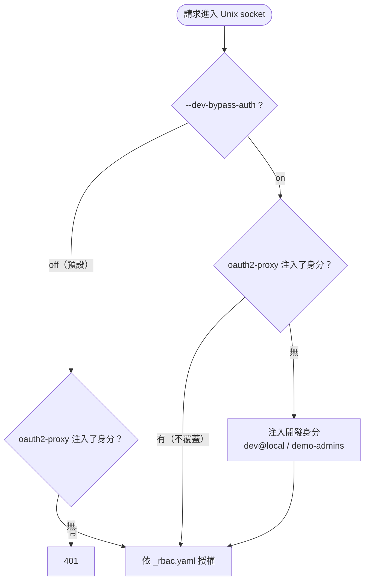

# ADR-022: tenant-api Dev-Auth Bypass — Local-Dev Identity Substitute, Four-Layer Containment

## 狀態

✅ **Accepted**（2026-05-25，v2.9.0 起草）。

2026-11-05 修訂：旁路改為注入身分物件、只作用在 tenant-api 的 Unix socket 平面；本機試用改為也經 oauth2-proxy（[ADR-027](./027-tenant-api-caller-identity.md) §2、§3）。四層防線不變。

2026-11-24 修訂：改寫為現行行為。決策不變。

## 決策

tenant-api 帶一個**預設關閉**的開發用驗證旁路：`--dev-bypass-auth`（環境變數 `TA_DEV_BYPASS_AUTH`）。開啟後，送到 Unix socket（API 所在的平面）的請求若沒有身分，tenant-api 就替它補上一個開發身分（預設 email `dev@local`、群組 `demo-admins`，用 `--dev-bypass-email`／`--dev-bypass-groups` 或 `TA_DEV_BYPASS_EMAIL`／`TA_DEV_BYPASS_GROUPS` 改）。

- **已有真實身分的請求不覆蓋。** oauth2-proxy 注入了身分，就用那個身分。
- **只補身分，不繞授權。** 補上的群組能做什麼，照常由 `_rbac.yaml` 決定。
- **補的是身分物件，不是 header。** rate limit、request log 與授權檢查（RBAC，依 `_rbac.yaml` 以群組授權）讀的都是這個物件。TCP port 只有 `/health`、`/ready`、`/metrics`，那裡沒有任何身分，旁路也不掛在那裡（[ADR-027](./027-tenant-api-caller-identity.md) §2、§3）。

把「正式發布的 binary 裡帶一個驗證旁路」的風險，用四層圍住：

| 層 | 機制 | 擋什麼 |
|---|---|---|
| 第 1 層：預設關閉 | 旗標預設 `false`；只有開啟時，middleware 才掛上 socket 平面的路由。`TA_DEV_BYPASS_AUTH` 的值不是合法布林值（例如 `yes`）時拒絕啟動，不會默默當成關閉（[ADR-034](./034-legal-value-as-fallback.md)） | 不小心開啟 |
| 第 2 層：看得見的警示 | socket 平面的每個 response 帶 `X-Dev-Auth-Bypass: active`；`/metrics` 出 `tenant_api_dev_auth_bypass_active 1`；啟動時印一行 WARN；租戶存取報告（`/api/v1/audit/tenants/{id}/access-report`）的 `completeness.not_covered` 列出 `dev_bypass_auth (ADR-022)`，狀態為 `active` | 旁路在任何環境開著，都能被監控、proxy 或 `curl` 看見，包含第 3 層偵測不到的非 Kubernetes 環境 |
| 第 3 層：在 Kubernetes 內拒絕啟動 | 旗標開啟、且環境變數 `KUBERNETES_SERVICE_HOST` 非空或 `/var/run/secrets/kubernetes.io` 存在時，啟動即 panic（程序以 exit code 2 結束） | 在 Kubernetes 叢集裡跑旁路 |
| 第 4 層：部署前的靜態檢查 | `scripts/tools/lint/check_dev_bypass_manifest.py` 掃 `helm/`、`k8s/` 底下的 `.yaml`／`.yml`，出現 `TA_DEV_BYPASS_AUTH`、`PREVIEW_DEV_BYPASS_AUTH` 或 `dev-bypass-auth`（不分大小寫；整行是 `#` 註解者不算）就擋下，沒有豁免標記。pre-commit hook `dev-bypass-manifest-guard` 與 CI 的 `Lint` job 都跑它 | 在引入它的 PR 就擋下；也涵蓋第 3 層看不到的非 Kubernetes manifest |

第 1、2 層擋誠實的意外，第 3、4 層擋誤部署。第 3 層與第 4 層互補：第 4 層在部署前擋 repo 裡的 manifest，第 3 層是執行期的最後一道，擋靜態檢查看不到的手動或極端誤設。程式碼註解、hook 名稱與 lint 訊息用 `Layer 1`–`Layer 4`（或 `L1`–`L4`）稱呼這四層，對應上表的第 1–4 層。

### 範例：本機試用裡的一個請求

本機試用（`try-local/`）的 tenant-api 這樣開啟旁路：

```yaml {.quote src="try-local/docker-compose.yaml"}
      TA_DEV_BYPASS_AUTH: "true"
      TA_DEV_BYPASS_EMAIL: dev@local
      TA_DEV_BYPASS_GROUPS: demo-admins
```

注入的群組要在 `_rbac.yaml` 有規則，否則看不到任何租戶。本機試用的種子設定把它定為平台管理員：

```yaml {.quote src="try-local/seed/conf.d/_rbac.yaml"}
groups:
  - name: demo-admins
    tenants: ["*"]
    permissions: [read, write, admin]
```

用這兩份設定啟動 tenant-api，直接對它的 Unix socket 發請求（本機試用裡，這是 oauth2-proxy 轉進來的那一跳；oauth2-proxy 對所有請求免登入、不注入身分 header）：

```console
$ curl -si --unix-socket "$SOCK" http://x/api/v1/me
HTTP/1.1 200 OK
X-Dev-Auth-Bypass: active
...
{"email":"dev@local","user":"dev","groups":["demo-admins"],"accessible_tenants":["*"],"permissions":{"demo-admins":["admin","read","write"]}}

$ curl -si --unix-socket "$SOCK" -H 'X-Forwarded-Email: real@corp.example' -H 'X-Forwarded-Groups: nobody' http://x/api/v1/me
HTTP/1.1 200 OK
X-Dev-Auth-Bypass: active
...
{"email":"real@corp.example","user":"real","groups":["nobody"],"accessible_tenants":[],"permissions":{}}
```

第二個請求帶了真實身分：旁路不覆蓋它，`nobody` 在 `_rbac.yaml` 沒有規則，於是看不到任何租戶；警示 header 照樣帶著。同時，TCP port 的 `/metrics` 與啟動日誌（JSON，省略時間欄位）是：

```text
tenant_api_dev_auth_bypass_active 1

{"level":"WARN","msg":"⚠️  DEV AUTH BYPASS ACTIVE — a dev identity is injected on the Unix-socket (API) plane for requests oauth2-proxy sent without one. LOCAL DEV ONLY; never enable in production.","inject_email":"dev@local","inject_groups":"demo-admins"}
```

旁路關閉時，同一個沒有身分的請求回 `401`（`"code":"UNAUTHORIZED"`），gauge 是 `0`，也沒有那行 WARN。

### 請求怎麼走



旁路關閉時行為與沒有這個功能完全相同；開啟時也只補身分，授權照走。

### 只補身分，不是繞過授權

注入身分後，RBAC 照常針對注入的群組執行，不給全權：注入的群組能做什麼，仍由 `_rbac.yaml` 決定；`_rbac.yaml` 沒有任何規則時，一律拒絕（[ADR-027](./027-tenant-api-caller-identity.md) §7，沒有開放模式）。所以即使旗標被開啟，影響範圍也限於「注入群組在 `_rbac.yaml` 的權限」。這個旗標繞過的是上游的身分驗證，不是授權本身。

## 背景

tenant-api 自己不做登入。它信任同一個 pod 裡 oauth2-proxy 經 Unix socket 注入的身分 header（哪幾個 header 由 oauth2-proxy 的設定檔決定，慣例是 `X-Forwarded-Email` 與 `X-Forwarded-Groups`）：

- 沒有 email，回 **401**。
- 群組拿去和 `_rbac.yaml` 比對，決定能存取哪些租戶。

正式部署時 oauth2-proxy 會先要求登入，再注入身分，所以運作正常。

本機試用與契約測試（`tests/contract/`）沿用同一個拓撲，但 oauth2-proxy 對所有請求免登入，因此不注入任何身分 header。沒有替身的話：

1. 瀏覽器打開 portal，portal 經 oauth2-proxy 呼叫 tenant-api。
2. 請求沒有身分，`/api/v1/me` 回 401，資料端點全部拒絕。
3. 旗艦的 Tenant Manager 開不出來；只跑 portal 與 tenant-api 的精簡模式（`docker compose up da-portal tenant-api`）也一樣。

所以需要一個本機開發用的身分替身。但在正式發布的 binary 裡放任何驗證旁路，本身就是資安風險：tenant-api 的映像檔與本機建出來的是同一個 binary，沒有用 build tag 把旁路拿掉。本 ADR 的重點不在「要不要做替身」，而在「怎麼把這個風險圍住」。

## 後果與已知限制

- **本機試用與契約測試不需要登入就能操作 API。** Tenant Manager 在本機試用裡直接可用。
- **正式發布的 binary 帶著這個旗標。** 四層把它圍住，但它仍是一塊要持續審視的攻擊面。
- **第 3 層只偵測兩個訊號。** 不在 Kubernetes 的正式環境（VM、bare-metal）不會觸發它；在 Kubernetes 裡，刻意把 `KUBERNETES_SERVICE_HOST` 設為空字串、又關掉 service account token 自動掛載的 pod，也不會觸發它。這些情況只剩第 2 層的警示。
- **第 4 層只掃本 repo 的 `helm/` 與 `k8s/`。** `try-local/` 刻意不掃（旁路就在那裡開啟）；部署方自己的 manifest（例如另一個 GitOps repo）不經過這道檢查。
- **第 2 層要有人看才有用。** 平台沒有隨附針對 `tenant_api_dev_auth_bypass_active` 的告警規則；要在旁路被開啟時收到通知，部署方得自己對這個 gauge 等於 `1` 設告警，或在 proxy 端檢查 `X-Dev-Auth-Bypass` header。
- **本機試用的對外 port 只綁 `127.0.0.1`，不要改成對外開放。** 旁路替每個沒有身分的請求注入的 `demo-admins` 是平台管理員（可讀、可寫、可 commit）；對區網開放等於把這些權限交給同網段的任何人。
- **注入的群組必須在 `_rbac.yaml` 有規則。** 名字對不上時（任一邊打錯字），Tenant Manager 看不到任何租戶；群組、租戶標記這類平台層級畫面還要求平台管理員。本機試用由 `tests/ops/test_trylocal_rbac_bypass_groups.py` 把 compose 的 `TA_DEV_BYPASS_GROUPS` 與種子 `_rbac.yaml` 綁在一起。
- **`--dev-bypass-email` 不可為空。** 旁路開啟而 email 是空字串時拒絕啟動：沒有 email 的身分只靠群組就能通過授權，卻沒有可記錄、可限流、可記進 commit 的呼叫者。

## 考慮過的替代方案

- **在 portal 端用 nginx 注入 header。** 要在 portal 容器掛一份 nginx 設定檔；Windows／WSL2 的單檔 bind mount 容易出現 `invalid mount config` 或檔案鎖定，本機試用的 Windows 使用者一定會踩到。由 tenant-api 自己處理旁路，就不必掛任何檔案。
- **第 2 層改成「只綁 loopback」。** API 走的是 Unix socket，由 oauth2-proxy 容器經共用 volume 連進來；TCP 埠只開 `/health`、`/ready`、`/metrics`，把 TCP 綁到 loopback 圍堵不了任何東西。看得見的警示不與 compose 衝突，還補上了第 3 層只擋 Kubernetes 留下的缺口。
- **完整繞過 RBAC。** 等於給全權；只補身分時，即使旗標被開啟，也只拿到注入群組在 `_rbac.yaml` 的權限。

## 實作位置與守住它的測試

| 部分 | 位置 | 測試 |
|---|---|---|
| 注入身分、不覆蓋真實身分、警示 header | `components/tenant-api/internal/rbac/devbypass.go`（`DevBypassMiddleware`） | `internal/rbac/devbypass_test.go`：`TestDevBypassMiddleware_InjectsWhenIdentityAbsent`、`TestDevBypassMiddleware_RespectsRealIdentity` |
| 不讀 request header | 同上 | `internal/rbac/identity_arch_test.go`：`TestRateLimitLogAndBypassReadNoRequestHeader` |
| 第 1 層：只在旗標開啟時掛上 socket 平面的路由 | `cmd/server/routes.go`（掛在身分解析之後、rate limiter 之前） | 沒有專屬測試 |
| TCP 平面不掛旁路、只有三個探測端點 | `cmd/server/tcp_router.go` | `cmd/server/tcp_router_test.go`：`TestTCPRouter_RegistersOnlyTheProbeRoutes`、`TestTCPRouter_IdentityHeaderIs400` |
| email 不可為空 | `cmd/server/main.go`（`checkDevBypassEmail`） | `cmd/server/tcp_router_test.go`：`TestCheckDevBypassEmail` |
| 第 2 層：gauge 與存取報告 | `internal/handler/metrics.go`（`SetDevBypassActive`）、`internal/rbac/reverse.go` | `internal/handler/metrics_golden_test.go`、`internal/handler/audit_reverse_test.go`：`TestAuditReverse_DevBypassRuntimeStatus` |
| 第 3 層：在 Kubernetes 內 panic | `internal/rbac/devbypass.go`（`InKubernetes`、`DevBypassK8sGuard`），於 `cmd/server/main.go` 啟動時呼叫 | `internal/rbac/devbypass_test.go`：`TestInKubernetes`、`TestDevBypassK8sGuard_PanicsInCluster`、`TestDevBypassK8sGuard_NoPanicOutsideCluster` |
| 第 4 層：manifest 靜態檢查 | `scripts/tools/lint/check_dev_bypass_manifest.py`、`.pre-commit-config.yaml`（`dev-bypass-manifest-guard`）、`.github/workflows/ci.yml`（`Lint`） | `tests/lint/test_check_dev_bypass_manifest.py` |

Go 路徑相對於 `components/tenant-api/`。

## 相關

- [ADR-027](./027-tenant-api-caller-identity.md)：呼叫者身分；旁路只掛在 Unix socket 平面（§2、§3），沒有開放模式（§7）
- [ADR-034](./034-legal-value-as-fallback.md)：開關的值不合法時拒絕啟動
- [本機試用說明](https://github.com/vencil/Dynamic-Alerting-Integrations/blob/main/try-local/README.md)：身分與 port 綁定
- [#464](https://github.com/vencil/Dynamic-Alerting-Integrations/issues/464)：本 ADR 的追蹤 issue
- [#448](https://github.com/vencil/Dynamic-Alerting-Integrations/issues/448)：IaC 靜態檢查（第 4 層所屬）
