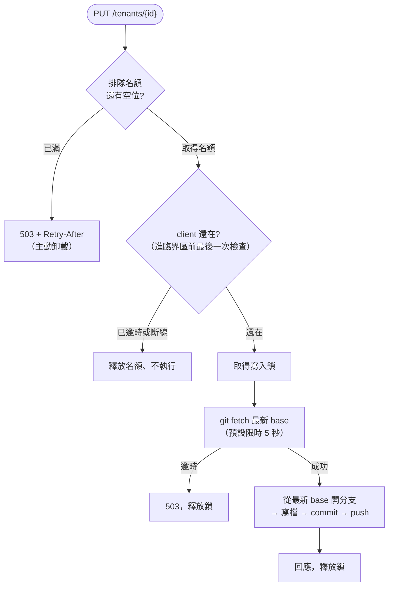

# ADR-023: tenant-api 的寫入只能有一個寫者，讀取可以水平擴展

## 狀態

✅ **Accepted**（2026-06-06）。

- 2026-10-11 修訂：群組、saved views、federation 白名單與子集、AccountID 帳本移出 conf.d，改存 tenant-api 的 state store（Kubernetes 上是 `tenant-api-state` ConfigMap）。這些寫入是對 ConfigMap `resourceVersion` 的 compare-and-swap（先比對版本、相同才寫入），不經過本文所說的寫入鎖。單一寫者的規定仍約束 conf.d 的寫入。

> 依語言政策，本 ADR 不另製 `.en.md`。

## 背景

tenant-api 把租戶設定以 GitOps 方式寫回 git（見 [ADR-009](009-tenant-manager-crud-api.md)、[ADR-011](011-pr-based-write-back.md)）。它的寫入路徑有三個結構性事實：

1. 所有寫入（直接 commit、開 PR、批次）排隊在同一把行程內的鎖上。這把鎖只在一個 pod 裡有效，不跨 pod。
2. conf.d 是單一個 git 工作目錄（working tree）；PR 模式「每個租戶同時只有一個待審 PR」的去重紀錄也只存在記憶體裡。
3. 部署是單副本（`replicaCount: 1`）；conf.d 預設是 emptyDir，可改成 ReadWriteOnce 的 PVC。本地的 base 分支只在 pod 啟動時由 init container（主容器啟動前先跑完的容器）同步一次。

所以第二個副本不是水平擴展，而是兩個寫者對同一個 git 工作目錄並發操作：各自的鎖互相看不見，結果是工作目錄損毀、同一租戶出現重複 PR，而且資料遺失時沒有任何錯誤訊號。在本 ADR 之前，唯一擋住這件事的是「沒有人去動 `replicaCount`」。

對照之下，federation 相關元件（[ADR-020](020-tenant-federation.md)）刻意做成無狀態、可多副本，和寫入路徑是兩種東西。

## 決策

- **讀取**（`GET /tenants`、`/search`、`/effective`、`/me` 等）無狀態，可以水平擴展。
- **寫入**（所有寫回與建立 PR）**只能有一個寫者**。這是刻意的讀寫分界，不是疏漏。

要在執行期安全地多副本寫入，唯一的路是 Kubernetes Lease（分散式租約，一次只讓一個 pod 持有寫入權），目前延後（見「考慮過的替代方案」）。在那之前，任何人都不要調高 `replicaCount`。

PR 模式下一筆寫入的路徑：



### 三道防線

「部署成單副本」不等於執行期只有一個寫者。防線由淺到深：

| 防線 | 擋什麼 | 機制 | 時機 |
|---|---|---|---|
| 設定守衛 | 在設定裡調大副本數、拿掉 Recreate、掛上 autoscaler | Helm 渲染時的 `fail` 守衛；commit／CI 時的 `check_single_writer_invariant.py` | 撰寫設定時 |
| Recreate 部署策略 | 滾動更新時新舊 pod 短暫並存 | `strategy: Recreate`：先停舊 pod 再起新 pod | 發版時 |
| 執行期偵測 | 執行期直接改副本數 | 告警 `TenantApiSingleWriterBreach`；真正擋住要靠延後的 Lease | 執行期 |

#### 設定守衛

Helm chart 的 Deployment 模板在 `replicaCount > 1` 時直接中止渲染（見「範例」）。`check_single_writer_invariant.py` 在 commit 與 CI 時檢查同一件事，另外三件：

- `values.yaml` 的 `replicaCount` 等於 1。
- Deployment 模板以字面寫死 `strategy: Recreate`。刻意不做成 Helm 參數：一旦可參數化，有人改回 RollingUpdate 就重新打開新舊 pod 並存的窗口。
- 模板裡仍有那個 `fail` 守衛，防止有人只拔守衛、不改值。
- chart 的模板裡沒有任何 autoscaler（原生 HPA，或 KEDA 的 `ScaledObject`／`ScaledJob`）。

#### Recreate 部署策略

預設的 RollingUpdate 會先起新 pod、等它 Ready 才停舊的，兩個 pod 短暫並存、各持自己的鎖。Recreate 先停舊再起新，沒有交疊。代價是每次發版有一段短暫的不可用，包括 SSE（伺服器持續推送事件給瀏覽器的長連線）連線被關閉（處理方式見 [`tenant-api-hardening.md`](../api/tenant-api-hardening.md) §5.6）。

#### 執行期偵測

上面兩道只管「設定怎麼寫」。下列路徑在執行期直接改副本數，靜態檢查全看不到：`kubectl scale`、KEDA 在執行期生成的 HPA、GitOps controller 把一個被手改的 `replicas` 同步上去、Argo／Flux 套用的 Kustomize overlay。

能擋住它們的只有 Lease。目前先補偵測：告警 `TenantApiSingleWriterBreach`（`critical`，`for: 2m`）在 tenant-api Deployment 的宣告副本數 `kube_deployment_spec_replicas` **或**實際副本數 `kube_deployment_status_replicas` 大於 1 時觸發，處置步驟寫在告警描述裡，細節見 [`tenant-api-hardening.md`](../api/tenant-api-hardening.md) §5.7。行為由 `tests/rulepacks/platform-single-writer-breach_test.yaml` 釘住。這個告警同時是「該做 Lease 了」的訊號。

### 寫入前抓最新 base

PR 模式從本地 base 開分支。本地 base 只在 pod 啟動時同步，長時間運行的 pod 會落後遠端：之後從它開出的 PR，會把別人已經 merge 的共用檔（例如 `_defaults.yaml`）算成要改回去，靜默地蓋掉別人的變更。

所以每筆 PR 寫入在取得寫入鎖之後、開分支之前，先 `git fetch` 一次，緊接著從 `origin/<base>` 開分支。fetch 與開分支都在同一把鎖內，中間沒有空檔讓遠端再前進。

- fetch 有自己的逾時 `TA_GIT_FETCH_TIMEOUT`（預設 5 秒），與一般 git 指令的逾時 `TENANT_API_GIT_TIMEOUT`（預設 60 秒）分開。fetch 在持鎖期間跑，遠端不穩時要在幾秒內失敗、回 503、放掉鎖，不能讓所有租戶的寫入一起等 60 秒。
- fetch 逾時回 503，絕不在舊 base 上繼續寫。逾時以外的 fetch 錯誤（例如遠端暫時連不上、`origin/<base>` 還沒推過）記一筆警告，退回本地 base 繼續，下一筆寫入會再試。
- 沒有 `origin` remote（本機開發、單元測試）時不 fetch，本地 base 就是唯一來源。

### 過載卸載

所有寫入排隊在同一把鎖上。若沒有上限，突發請求會一起卡在鎖前；client 逾時離開了，排隊的 goroutine（Go 的輕量執行緒）仍然留著，輪到時照樣執行 git，留下沒有人在等的寫入。

做法：用一組名額把「執行中＋排隊中」的總數封頂，超過就立刻回 503 與 `Retry-After`，不進入排隊。排隊深度由 `TA_WRITE_QUEUE_DEPTH` 設定，預設 5（加上執行中的 1 筆，最多收 6 筆）。

- **排隊階段**認得 client 的取消：client 逾時或斷線就釋放名額，那筆寫入永遠不會執行。取得執行權之後、進入臨界區之前再檢查一次，處理兩者同時發生的情況。
- **進入臨界區之後**一定跑完。半路砍掉 git 會留下髒的工作目錄，也會讓 client 重試而開出重複的 PR。持鎖時間的上限由每個 git 指令的逾時保證。

另外，forge（GitHub／GitLab）回應次級速率限制（secondary rate limit）時，熔斷器依它給的 `Retry-After` 暫停呼叫，不在限制期間內反覆重試。

### 範例

把副本數調成 2 再渲染 chart（其餘參數只是讓渲染能走到這一步的最小設定）：

```text
$ helm template t helm/tenant-api --set replicaCount=2 --set writeBack.mode=direct \
    --set writeBack.directAcknowledgeNotDelivered=true --set gitRepoUrl=https://example.com/r.git
Error: execution error at (tenant-api/templates/deployment.yaml:13:4): ADR-023 single-writer invariant violated: tenant-api replicaCount=2 but MUST be 1. The write plane has no cross-pod coordination; multi-replica writes corrupt the shared git tree. To scale writes, implement a K8s Lease (ADR-023 §Lease) — do not raise replicaCount.
```

chart 原樣時，lint 通過（它以 Helm 的讀法讀 `values.yaml`，需要先 `make da-crdecode-build`）：

```text
$ DA_CRDECODE_BINARY=.build/da-crdecode python3 scripts/tools/lint/check_single_writer_invariant.py --ci
✅ tenant-api single-writer invariant holds across 2 chart file(s) (replicaCount=1 + strategy: Recreate + guard).
```

## 後果與已知限制

**得到的**

- 「設定裡不小心開了第二個寫者」造成的工作目錄損毀被擋在渲染與 CI 階段。
- 擴展的路講清楚了：讀取可以擴展、寫入是單例；要擴展寫入，路徑是 Lease 或讀寫拆分，不是調大副本數。
- 寫入前抓最新 base、forge 熔斷、過載卸載三個韌性修補，都從「只有一個寫者」這個前提推導出來。

**代價與限制**

- 寫入是明確的單點故障；每次發版有一段短暫不可用，直到 Lease 落地。
- 執行期改副本數的路徑擋不住，只偵測得到。偵測也有盲區：兩個指標都讀 control plane 的狀態，網路被分割的節點上仍在跑的舊 pod 對 control plane 不可見，偵測不到。這個殘留只有 Lease 加上 push 端的隔離（fencing，見下）才封得住。
- 多一個設定旋鈕 `TA_GIT_FETCH_TIMEOUT`，要與 `TENANT_API_GIT_TIMEOUT` 分清楚：前者只管持鎖期間那次 fetch，後者管其餘每個 git 指令。

## 考慮過的替代方案

### 滾動更新期間的交疊

`replicaCount: 1` 不等於執行期只有一個寫者，因為預設的 RollingUpdate 發版時會短暫並存兩個 pod。

| 方案 | 發版時的可用性 | 程式成本 | 結論 |
|---|---|---|---|
| `strategy: Recreate` | 短暫中斷 | 一行設定 | 採用 |
| `RollingUpdate{maxSurge: 0}` | 短暫中斷 | 一行設定 | 等效，未採用 |
| Kubernetes Lease | 不中斷 | 中 | 延後，見下 |
| 讀寫拆分成兩個部署 | 讀取不中斷 | 中 | 延後，見下 |

採 Recreate：單副本時讀取本來就沒有高可用，發版短暫中斷不是新的退步，成本只有一行設定。

### 鎖外預先 fetch

「在拿鎖之前先 fetch，拿到鎖再 reset 到遠端」看似能縮短持鎖時間，但排隊期間遠端可能又前進，開分支時用的 base 仍是舊的。它只在寫入高度並發時才划算，而高度並發本身違反單一寫者的前提。所以不採用。

### Lease 分散式寫入鎖（延後）

用 Kubernetes Lease／leader election 讓多個副本中只有持有租約的那個寫入，追蹤於 [#787](https://github.com/vencil/Dynamic-Alerting-Integrations/issues/787)。

- **何時開工**：寫入部署需要不中斷發版時；或執行期多寫者成了真實風險時（`TenantApiSingleWriterBreach` 觸發就是這個訊號）。任一成立即動工。
- **怎麼做才對**：push 路徑要帶隔離（fencing），例如 git 的 `--force-with-lease` 或 ref compare-and-swap。leader election 只決定誰對外服務，擋不住 GC（垃圾回收）暫停或網路分割時舊 leader 把手上那筆 push 做完。

### 讀寫拆分部署（延後）

讀取部署多副本、用 RollingUpdate；寫入部署維持單副本、用 Recreate。要先讓 binary 支援唯讀模式並按 HTTP method 分流，目前沒有。

- **為何現在不做**：「讀取需要高可用」沒有實際數據支持，讀取路徑是低頻的管理介面。
- **何時重啟**：告警 `TenantApiReadHANeeded`（`info`，不 page）在 `tenant_api_sse_clients` 的 7 天平均同時連線數大於 2、且這 7 天至少有 150 個小時取樣點時觸發；取平均而不取峰值，是只認持續的多人讀取，不被單日尖峰觸發；取樣點下限防止剛部署、資料不滿 7 天時誤觸。行為由 `tests/rulepacks/platform-read-ha-trigger_test.yaml` 釘住。
- 它只讓**讀取**發版不中斷，寫入仍會中斷，所以要與 Lease 一起排，不要單獨做。

### 寫入優先級分流（延後）

讓真人在 Portal 上的即時操作，永遠排在機器的大量背景寫入前面（機器寫入切成小段，一發現有人要寫就讓出），追蹤於 [#746](https://github.com/vencil/Dynamic-Alerting-Integrations/issues/746)。

- **為何現在不做**：目前所有寫入都來自真人（以登入身分寫回 git），沒有背景程式會自動改租戶設定。過載卸載先到先服務、不分人或機器，對現狀已足夠。
- **何時重啟**：第一支會自動寫入、且可能長時間佔住寫入鎖的背景程式上線時（例如自動清理過期規則、批次重新編譯規則）。屆時先加指標，把每筆寫入標記為人或機器，量真人寫入的平均等待與被擋下的比例，惡化就動工。
- 先前擔心的「git push 卡住會無限佔住寫入鎖」已不成立：每個 git 指令都有逾時上限。

### 水平擴展寫入

單一寫者的吞吐量成為實測瓶頸時才考慮，而且走 Lease，不放寬單一把鎖。

## 相關

- [ADR-009](009-tenant-manager-crud-api.md)（commit-on-write GitOps）、[ADR-011](011-pr-based-write-back.md)（PR 寫回）、[ADR-020](020-tenant-federation.md)（federation 元件無狀態、可多副本）
- [`tenant-api-hardening.md`](../api/tenant-api-hardening.md) §5.6（Recreate 與 SSE 重連）、§5.7（執行期多寫者偵測）
- 實作位置：`helm/tenant-api/templates/deployment.yaml`（`fail` 守衛與 Recreate）、`scripts/tools/lint/check_single_writer_invariant.py`、`components/tenant-api/internal/gitops/`（`admission.go` 過載卸載、`writer_base.go` 寫入前 fetch、`gitcmd.go` 逾時）、`components/tenant-api/internal/platform/circuitbreaker.go`
