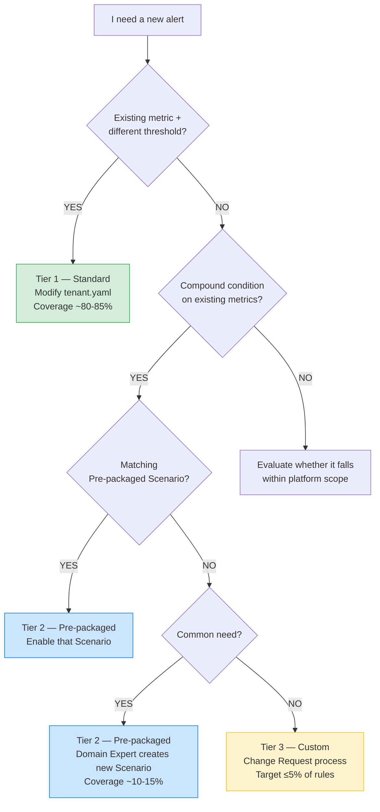
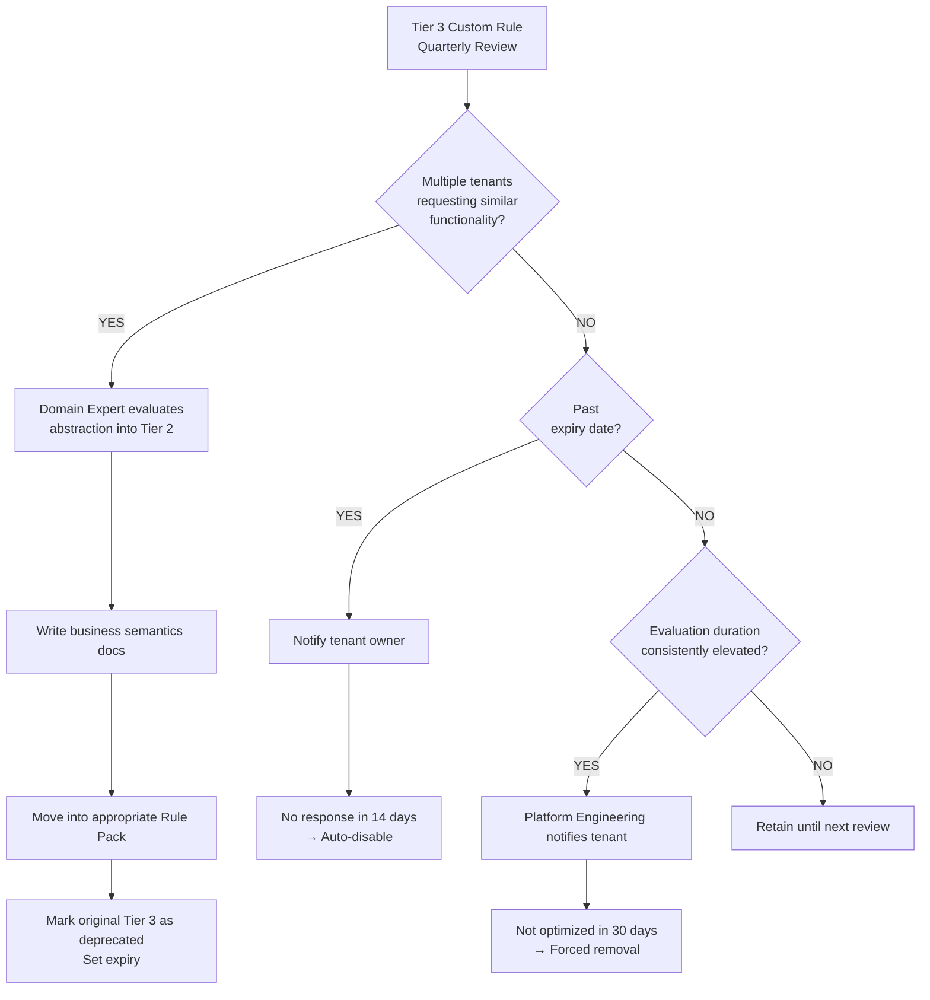

# Multi-Tenant Custom Rule Governance Model

> **Language / 語言：** **English (Current)** | [中文](./custom-rule-governance.md)

> **Audience**: Platform Engineering, Domain Experts (DBA/Infra), Tenant Tech Leads
> **Version**: v2.9.0
> **Related**: [Architecture and Design](architecture-and-design.en.md), [Rule Packs Directory](rule-packs/README.md), [Migration Guide](migration-guide.md)

---

## 1. Purpose

The core value proposition of the Dynamic Alerting platform is **O(M) complexity**: define M metric types once, and all tenants adjust thresholds via config — no per-tenant PromQL maintenance required.

In practice, however, some tenant alerting requirements go beyond simple threshold differences and may involve distinct condition combinations or business scenarios. This document defines a 3-tier governance model that provides structured customization paths while preserving the O(M) performance advantage.

---

## 2. Three-Tier Governance Model



### 2.1 Tier 1 — Standard (Config-Driven Three-State Control)

**Coverage**: ~80–85% of tenant requirements

Tenants configure thresholds via `tenant.yaml` without touching PromQL:

```yaml
# Three-state control example (key names match metric definitions in _defaults.yaml)
mysql_connection_usage_percent: "85"   # Custom: user-defined threshold (connection usage, % of max_connections)
# container_cpu:                       # Default: leave the key out to inherit the level above — a subtree _defaults.yaml's value if one sets the key, else the root platform default (an empty string is not a valid value)
mysql_replication_lag: "disable"       # Disable: turn off this alert
```

Each metric supports Warning / Critical severity levels (`_critical` suffix) and dimension label filtering. A dimension-filter key such as `"mysql_connection_usage_percent{instance='db-primary:3306'}"` is served only when every label of it is declared for its base (the part before `{`) under the root `_defaults.yaml` `dimensions:` (ADR-038 §11). The shipped Rule Packs normalise with `max by(tenant)`, so such a key sets one tenant-wide threshold rather than a per-dimension one ([#3475](https://github.com/vencil/Dynamic-Alerting-Integrations/issues/3475)).

The `_routing` channel now also delivers custom alerts (`component="custom"`): page-mode recipes are split by the tenant's `_routing` (including `routes` and per-rule overrides) but keep the custom isolation subtree's debounce (`group_wait` 30s / `group_interval` 5m, `group_by [tenant, alertname]`); the tenant's top-level `_routing` timing is not applied (timing and `group_by` a sub-route declares itself still are). Tenants without an **effective** `_routing` (no explicit `_routing` and no applicable `_routing_defaults` / profile inheritance) keep their custom alerts on the platform firehose (visible in the AM UI, no notification); to fully opt a tenant out of custom-alert notifications, use `_routing: disable` — tenants that merely inherit the defaults do receive delivery.

⚠️ In the shipped base (`k8s/03-monitoring/configmap-alertmanager.yaml`) `custom-alerts-firehose` has **no integration**, so page-mode custom alerts that land there **notify no one**. `generate-routes` reports such tenants (#1211): a tenant with page-mode custom alerts the exporter actually serves (`mode` unset or `page`) but no delivery child gets one WARN line, `custom_alert_undelivered` in `--findings-json`. `--output-configmap` / `--output-alertmanager` / `--apply` can see the firehose they write: with an integration nothing is reported; without one `--strict` escalates to ERROR, exit code 1, nothing written. A tenant's own `_routing: disable` is a deliberate opt-out: still reported, never escalated by `--strict`; `--validate` cannot see the firehose and prints the WARN saying it was not checked. Pick one fix: add a `_routing` for the tenant, set the alert to `mode: silent`, or give the firehose an integration (see that receiver's comments in the base for how, and the IM rate-limit caveat). Details in the [CLI reference](cli-reference.en.md).

**Rule complexity**: O(M) — does not grow with tenant count.

### 2.2 Tier 2 — Pre-packaged Scenarios

**Coverage**: ~10–15% of tenant requirements

Domain Experts define composite alerting scenarios with clear business semantics based on real-world experience. Tenants do not write PromQL — they simply choose whether to enable a scenario and adjust its parameters.

**Existing example — `MariaDBSystemBottleneck`**:

```yaml
# Business semantics: connection usage AND running-thread saturation both exceeded = real load bottleneck (not connection leak)
- alert: MariaDBSystemBottleneck
  expr: |
    (
      tenant:mysql_connection_usage:percent
      > on(tenant) group_left
      tenant:alert_threshold:mysql_connection_usage_percent
    )
    and on(tenant)
    (
      tenant:mysql_threads_running:avg1m
      > on(tenant) group_left
      tenant:alert_threshold:mysql_threads_running
    )
    unless on(tenant)
    (user_state_filter{filter="maintenance"} == 1)
  labels:
    severity: warning
    maintenance: mute
```

**Enable/disable mechanism**: Tier 2 scenarios are implicitly controlled through existing three-state controls — no additional toggle key is needed:

- **Enable**: As long as all metrics the scenario depends on have valid thresholds (Custom or Default), the scenario is active. ⚠️ The platform ships no default for `mysql_threads_running` (a healthy value depends on the host's CPU core count, so set it per host; #3778); either a tenant file or the deployment's defaults can set it, so `MariaDBSystemBottleneck` does not fire until a tenant or the deployment sets that key.
- **Disable a single metric**: Set that metric to `"disable"`. The corresponding recording rule produces no value, making the `>` comparison false and the scenario inactive.
- **Global maintenance mode**: Set `state_filters.maintenance` to `"true"`. The `unless ... user_state_filter{filter="maintenance"}` clause in the scenario expression takes effect, silencing all alerts. A `recurring:` window takes effect through the same clause inside the window ([#3639](https://github.com/vencil/Dynamic-Alerting-Integrations/issues/3639)). The alert must carry the `maintenance: mute` label, which declares that it holds the clause ([#3309](https://github.com/vencil/Dynamic-Alerting-Integrations/issues/3309)).

> **Design rationale**: PromQL has no native on/off switch. This mechanism leverages the propagation effect of "missing threshold → recording rule produces no value → condition is false" to achieve implicit enable/disable, avoiding an extra config key per scenario.

**Design principles**:

- Tier 2 scenarios are defined by Domain Experts, not assembled by tenants. "The platform offers curated packages; tenants decide whether to subscribe" — not "hand tenants building blocks to assemble themselves."
- Each scenario must have clear business semantics documentation (what business question it answers, why this combination is meaningful).
- Thresholds remain config-driven — tenants can adjust numbers but cannot alter the logic structure.

**Rule complexity**: O(number of scenarios) — does not grow with tenant count.

### 2.3 Tier 3 — True Custom (Strictly Governed Customization)

**Coverage**: no more than 5% of total rules

For exceptional requirements that Tier 1 + Tier 2 cannot satisfy. Must go through a formal Change Request process.

**Admission criteria**:

1. Submitter must explain why Tier 1 (threshold adjustment) and Tier 2 (pre-packaged scenarios) are insufficient
2. Domain Expert reviews and determines whether the need can be abstracted into a new Tier 2 scenario
3. Must pass CI deny-list linting (see §4)
4. Carry `owner` and `expiry` annotations (not labels, see §4.2)

**Architectural isolation**:

Tier 3 rules are placed in a dedicated Prometheus Rule Group with a longer `evaluation_interval` (e.g., 30s instead of the default 15s). This ensures:

- If a Custom Rule's PromQL is too heavy and causes evaluation delays, the blast radius is contained within that group
- Tier 1 and Tier 2 alerting timeliness is not affected by Noisy Neighbors
- Platform team can independently monitor Custom Rule Group evaluation duration

```yaml
# rule-packs/custom/db-a/special-tablespace.yaml (the directory db-a is the tenant this rule belongs to; created when the first Tier 3 Rule is submitted)
groups:
  - name: custom_tenant_rules
    interval: 30s   # Dedicated evaluation interval
    rules:
      - alert: CustomAlert_db-a_special_tablespace
        expr: |
          custom_tablespace_usage{tenant="db-a", tablespace="SPECIAL_APP"} > 95
        labels:
          tenant: "db-a"
          tier: "custom"
        annotations:
          owner: "team-db-a"
          expiry: "2026-06-30"
          ticket: "REQ-12345"
          justification: "No matching Tier 2 scenario: dedicated threshold for a specific tablespace"
```

**Rule complexity**: O(Custom Rule count). Management target is to keep this under 5% of total rules.

---

## 3. Roles and Responsibilities (RnR)

This platform involves three roles. In smaller teams, one person may wear multiple hats — the key is clear responsibility boundaries, not org chart structure.

| | Platform Engineering | Domain Expert | Tenant |
|---|---|---|---|
| **Role** | Infrastructure provider + guardrail builder | Golden Standards definer | Platform consumer + business system owner |
| **Tier 1** | Guarantee alerting engine operation | Define default thresholds, metric semantics | Self-manage Warning/Critical thresholds |
| **Tier 2** | Guarantee alerting engine operation | Design scenarios, write business semantics docs | Decide whether to enable scenarios |
| **Tier 3** | Performance monitoring + forced removal authority | Review requests, evaluate Tier 2 promotion | You build it, you run it (no SLA guarantee) |
| **CI/CD** | Maintain deny-list linting + Rule Pack structure validation | Maintain owned Rule Packs | — |
| **SLA scope** | Alerting engine operation (eval, scrape, routing) | Tier 1/2 business correctness | Tier 3 alert quality is self-owned |

> **Practical note**: Tenant teams typically lack PromQL expertise. In practice, tenants submit requirements and Domain Experts write the rules on their behalf, but SLA ownership still falls on the tenant — i.e., "Domain Expert writes it for you, but you own the alert quality."

**Responsibility quick reference**:

| Scenario | Responsible party |
|----------|-------------------|
| Prometheus down, all alerts non-functional | Platform Engineering |
| Tier 1 threshold too low, causing false positives | Tenant (thresholds are self-configured) |
| Tier 2 scenario logic flawed, causing platform-wide missed alerts | Domain Expert |
| Tier 3 Custom Rule too heavy, slowing evaluation | Platform Engineering forces removal → Tenant fixes and resubmits |
| Tier 3 Custom Rule false positive | Tenant |

---

## 4. CI Guardrails: Deny-list Linting

All rules submitted to `rule-packs/custom/` must pass automated checks.

### 4.1 Deny-list Rules

The lint tool's built-in policy **is** the file below (`.github/custom-rule-policy.yaml`, shipped in the da-tools image); it is included here as it is, not copied ([#4099](https://github.com/vencil/Dynamic-Alerting-Integrations/issues/4099)). A file given to `--policy` overrides it key by key (its comments are in Chinese, the source language of this repo):

```yaml
--8<-- ".github/custom-rule-policy.yaml"
```

- **Every value is judged when the policy is loaded** ([#4061](https://github.com/vencil/Dynamic-Alerting-Integrations/issues/4061)); a wrong one exits `2`, naming the key and why: `denied_functions` / `preserved_labels` / `required_labels` are lists (possibly empty) of non-empty strings (a single string is refused, no longer matched character by character); the two durations are positive Prometheus durations, Prometheus' `ParseDuration` grammar (`90m`, `1h30m`, `2w`; not `1.5h`, not an unquoted `5`). A group's `interval` is read with the same grammar.
- **Every `denied_functions` name must be one a rule can call** ([#4099](https://github.com/vencil/Dynamic-Alerting-Integrations/issues/4099)): a function or aggregation operator that the parser Prometheus loads rule files with knows and has enabled (answered by `da-read promql-names`. The deployed Prometheus passes no `--enable-feature` that changes the rule parser; which options do is answered by `da-read prometheus-features`, and a test fails when da-read's parser and the deployed one differ ([#4151](https://github.com/vencil/Dynamic-Alerting-Integrations/issues/4151))). A typo, `holt_winters` (gone in Prometheus 3), or an experimental function not enabled (such as `double_exponential_smoothing`, whose rules the rule loader refuses anyway) exits `2` before anything is linted — such an entry denied nothing.
- This file is lint's alone (`lint --policy`, `validate-config --lint-policy`); the webhook domain allowlist `allowed_domains` lives in the deployment policy (another file, for `--policy` of `generate-routes` / `validate-config`). Each refuses the other's keys ([#3797](https://github.com/vencil/Dynamic-Alerting-Integrations/issues/3797)).

> **Ranges and functions are judged as Prometheus reads them** ([#4080](https://github.com/vencil/Dynamic-Alerting-Integrations/issues/4080)): the expression is read by Prometheus' PromQL parser, never matched as text.
> `max_range_duration` is compared with the width of the window each selector reads: its own
> range plus the range of every subquery around it (`[1w]`, `[1h30m]` and expressions such as
> `[(30d)]` count at their value), so under a 1h maximum `max_over_time(rate(x[5m])[1h:1m])`
> reads 1h5m and is refused. `offset` only moves the window and is not counted; a selector with
> `@` counts its own range only, and a subquery with `@` drops the subqueries outside it (as
> Prometheus does); the lookback delta is the server's setting and is not counted
> either. The total a query reads across selectors is not this check's: Prometheus'
> `--query.max-samples` bounds it.
> `denied_functions` matches functions and aggregation operators by name: `topk by (a) (…)` is
> `topk`; the same text in a label value, a comment or a metric name is none. An expression
> Prometheus cannot evaluate (such as `rate(x[step()])`) is an ERROR.

> **Tenant isolation is judged on the result, not the spelling** ([#4098](https://github.com/vencil/Dynamic-Alerting-Integrations/issues/4098)):
> every alert writes `tenant: "{{ $labels.tenant }}"`, so once the expression's result loses `tenant`,
> the alert's tenant is empty and reaches no tenant. For each label in `preserved_labels`, whether the
> alert's result keeps it is judged on Prometheus' parse tree (`da-read promql-label-flow`):
> `without(tenant)`, `without(tenant, b)`, `sum by (a)`, an ungrouped `sum(x)`, a one-to-one match not on
> tenant (`ignoring(tenant)`, `on(a)`) and `vector(…)` drop it; a `label_replace` / `label_join` writing
> tenant, a `group_left(tenant)` copying it from the other side matched on other labels, a recording rule
> whose name has a colon but is neither among the files linted nor in a rule pack the tool ships, and a
> metric name matched by a regex cannot be proven — an ERROR as well. A recording rule read is followed into
> its expression and its `labels:` (the group's `labels:` included); the records followed are those of the
> files linted plus the tenant rule packs the tool ships (in the da-tools image; `rule-packs/` in the repo),
> so linting `rule-packs/custom/` alone still judges a rule reading a pack record such as `tenant:…`.
>
> What the alert itself writes as `tenant` (the rule's `labels:` over the group's, as Prometheus does) decides: nothing, or `{{ $labels.tenant }}` (the series' own
> value) is judged; a literal (`tenant: db-a` for a single-tenant rule, `tenant: ""` for a platform signal
> with no tenant on purpose) sets the value whatever the result holds and is not judged; any other template
> (such as `{{ $labels.namespace }}`) is an ERROR.
>
> Whether a raw metric has `tenant` is the scrape's business, and it is judged by the platform's scrape
> config ([#4137](https://github.com/vencil/Dynamic-Alerting-Integrations/issues/4137)): kube-state-metrics',
> Prometheus' and Alertmanager's own metrics carry no tenant, so reading one directly drops it (copy it from the
> namespace with `label_replace(…, "tenant", "$1", "namespace", "(.+)")` for KSM); series every scrape target has
> — `up`, `scrape_*`, `go_*`, `process_*` — carry it only with `job="tenant-exporters"`, drop it for another job
> or none, and cannot be proven with a regex or negative `job`; `ALERTS` cannot be proven. A selector of a raw
> metric whose own tenant matcher does not match the empty string (`tenant="db-a"`, `tenant=~".+"`,
> `tenant!=""`) keeps it, and `tenant=""` drops it; a recording rule's reference is still judged by its
> expression.
>
> ⚠️ What it cannot see: any other raw metric is taken to carry tenant (a tenant exporter scraped by the
> tenant-exporters job always does); whether a platform component's own metrics (threshold-exporter,
> tenant-api, Vector …) carry it depends on the metric, and they are taken to carry it too. It judges by
> Prometheus' semantics; vmalert's behaviour is not verified separately. A recording rule whose name has no
> colon and that is outside the records followed is taken for a raw metric (Prometheus does not require a
> colon in a record's name): a rule reading a record of its own needs the file defining it among the paths.
>
> The former key `denied_patterns` is removed (breaking): it matched text, which `=~'.*'` or
> `without(tenant, b)` walked past. Its `=~".*"` selects exactly what the selector without that matcher
> selects (a matcher matching the empty string also selects the series without the label), so it guarded
> nothing. A policy still carrying it exits `2`, pointing to `preserved_labels`.

> **A tenant's rule file reads and writes only that tenant** ([#4136](https://github.com/vencil/Dynamic-Alerting-Integrations/issues/4136)): a rule file under a scan path
> sits in `<scan dir>/<tenant>/`, and the directory's name is the tenant the rules belong to (a file given as a
> path: the name of its directory); a file directly in the scan directory, or a directory whose name is no valid
> tenant id, is an ERROR. The policy key `isolated_label` names the label isolated (`tenant` built in), and each
> of these is an ERROR:
>
> - a selector (of an alert or a recording rule) that does not match `tenant="<tenant>"` by equality. A regex
>   (even `=~"db-a"`), a negation or no matcher reads every tenant's series; another tenant's value reads
>   theirs. A metric with only a namespace, such as kube-state-metrics', is written
>   `namespace="<tenant>", tenant=""` (namespace alone also selects a series carrying both labels with
>   different values). A pack's record needs it too, such as `tenant:mysql_up:max{tenant="db-a"}`.
>   Conversely, `tenant="<tenant>"` on a metric whose series carry no `tenant` at all (kube-state-metrics', cAdvisor's,
>   the kubelet's volume stats', Prometheus' and Alertmanager's own: the jobs that scrape them write none) is an ERROR too: it selects
>   nothing, so the rule never fires (inside `absent()`, it always does). Where its series name the tenant's
>   namespace (kube-state-metrics' namespaced objects, cAdvisor, the kubelet's volume stats), write `namespace="<tenant>", tenant=""`; where they do
>   not (Prometheus' and Alertmanager's own, a node's `kube_node_*`), they are no tenant's to read. ⚠️ The lint
>   does not know which metrics carry a namespace, so a namespace form that selects nothing is not caught.
>   Which metrics are such is `_lib_metric_sources.tenant_presence()`'s answer
>   (cAdvisor and the kubelet's volume stats are among them: no scrape writes their tenant,
>   [#4178](https://github.com/vencil/Dynamic-Alerting-Integrations/issues/4178)); a name with a colon
>   (a recording rule's, by Prometheus' naming rule) and a record of the same file are not judged
>   ([#4275](https://github.com/vencil/Dynamic-Alerting-Integrations/issues/4275)).
> - `tenant` (or `namespace`) in the `labels:` of an alert, a recording rule or the group written as anything
>   but that tenant. An alert may also write the series' own `{{ $labels.tenant }}`; a recording rule's labels are
>   no template (Prometheus writes the text), so only the tenant.
> - writing `tenant` or `namespace` from anything else: `label_replace` / `label_join` into it,
>   `count_values("tenant", …)`, `group_left(tenant)` / `group_right(tenant)`. `namespace` counts because another
>   tenant reads it with `namespace="<tenant>", tenant=""`.
>
> A recording rule whose result carries no tenant is a WARN: a reference pinned to the tenant selects nothing,
> so an alert reading it never fires. Rules across tenants are not taken: by §2.3, Tier 3 is a single tenant's
> exception, and a need across tenants is a Tier 2 candidate. `--rule-pack-dir` reads the rule packs the
> platform ships (every tenant reads them) and does not judge this.
>
> ⚠️ This lint prevents mistakes; it is no security boundary: the tenant repository's CI is the customer's and
> can drop the step. Enforcing it in Prometheus would take injecting a tenant matcher into every selector as
> rules load (what prom-label-proxy does), which the platform does not do today.

> **An exemption is not a skip (four guard rails)**: (1) `path` is anchored at
> the top of the scanned tree (exact path, not a suffix), so a nested
> `rule-packs/*/rule-packs/<file>` gets no exemption; (2) the GENERATED header
> is required, else ERROR + full lint (checked when `require_generated_marker`
> is omitted or `true`; only an explicit `false` turns it off); (3) only `denied_functions` /
> `max_range_duration` may be relaxed (whitelist) — any other key (e.g.
> emptying `required_labels`) is exit `2` when the policy is loaded; (4) every
> non-overridden check still runs. An entry's shape is judged when the policy
> is loaded, whether or not a file matches it ([#3977](https://github.com/vencil/Dynamic-Alerting-Integrations/issues/3977)):
> `file_overrides` is a list; each entry has only `path` (required; no two
> alike, nor two that can match the same file such as `a.yaml` and
> `sub/a.yaml`), `require_generated_marker` (a bool) and `policy`;
> `denied_functions` is a list (it may be empty) of non-empty strings and
> `max_range_duration` a positive duration. Anything
> else is exit `2`, naming the entry and why. CI separately guards against a hand-written
> file posing as a compiled pack via the `compile_custom_alerts.py --check`
> drift gate.

### 4.2 Linting Tool

```bash
# Run in CI
python3 scripts/tools/ops/lint_custom_rules.py rule-packs/custom/

# With custom policy file
python3 scripts/tools/ops/lint_custom_rules.py rule-packs/custom/ --policy .github/custom-rule-policy.yaml

# Via da-tools container (no repo clone needed)
docker run --rm \
  -v $(pwd)/my-custom-rules:/data/rules:ro \
  ghcr.io/vencil/da-tools:v2.9.0 \
  lint /data/rules --ci

# Example output
# PASS: custom_tenant_rules.yaml - 2 rules checked
# FAIL: bad_rule.yaml:15 - denied function 'predict_linear' in expr
# FAIL: bad_rule.yaml:22 - missing required label 'tenant'
```

**Owner and expiry** ([#4275](https://github.com/vencil/Dynamic-Alerting-Integrations/issues/4275)): every alert of a tenant's rule file (a file under `<scan dir>/<tenant>/`) carries
an `owner` and an `expiry` annotation; one missing, empty, or written as a label is an ERROR. Annotations, not labels,
because a label is part of the alert's identity: renewing the expiry or handing the rule over would resolve every
firing alert of it and fire it again, its `for:` restarted. `expiry` is a real calendar date written `YYYY-MM-DD`.
⚠️ The lint does **not** compare the expiry with today: the same commit would be green one day and red the next, and
the CI that runs this lint runs only when a rule file changes — nothing goes red on the day a rule expires, the next
unrelated change does. ⚠️ Nothing acts at the date today (§5's expiry-based retirement is not implemented). A group's
`labels:` count too (Prometheus writes them on the alert). Rule packs (those `--rule-pack-dir` selects included) and
files outside a tenant directory are not checked for this. On a Tier 3 alert `owner` is the rule's owner; the
platform packs' annotation of that name carries the tenant's owner (from its metadata): both say whom to ask.

### 4.3 Why Limit "Weight" Instead of "Count"

Problems with fixed quotas (e.g., "5 rules per tenant"): waste and shortage coexist (some tenants use zero, others hit the cap at rule #6), rule explosion unsolved (50 tenants × 5 = 250 rules with different logic), and idle evaluation cost (Prometheus evaluates all rules every 15 seconds regardless).

The deny-list approach constrains each rule's "computational weight" rather than rule count. Combined with dedicated Rule Group isolation and evaluation duration monitoring, this prevents performance degradation without imposing hard limits.

---

## 5. Assimilation Cycle

Quarterly Custom Rule Review (recommended to combine with quarterly SLA review).



---

## 6. Quick Reference

### Tier Comparison Table

| | Tier 1 (Standard) | Tier 2 (Pre-packaged) | Tier 3 (Custom) |
|---|---|---|---|
| **Control method** | tenant.yaml thresholds | Threshold three-state implicit toggle + params | Full PromQL |
| **Author** | Tenant self-service | Domain Expert pre-built | Domain Expert writes on behalf |
| **SLA** | Platform-guaranteed | Platform-guaranteed | No guarantee |
| **Rule complexity** | O(M) | O(scenario count) | O(Custom count) |
| **CI checks** | Automatic (three-state validation) | Rule Pack CI | Deny-list linting |
| **Lifecycle** | Permanent | Permanent | Expiry date required |

## 7. Rule Lifecycle Governance (cross-tier lifecycle view)

> **For whom**: platform / domain owners migrating from an existing system, evaluating whether "a rule can be governed across its whole life". §1–§6 are organized by **governance tier**; this section cuts across by **the rule's life**. Each stage gives: platform guarantees, ⚠️ known limits, and a how-to link.

A rule here is not a single entity — its lifecycle mechanism differs by tier (platform Rule Pack / tenant threshold Tier 1 / Tier 3 Custom). The table cuts across "born → aging → sick → retired":

| Stage | Platform Rule Pack | Tenant threshold (Tier 1) | Tier 3 Custom | how-to |
|---|---|---|---|---|
| **Born** (define) | platform writes the PromQL pack | `tenant.yaml` sets a plain number | Domain Expert ghost-writes + deny-list lint | [Domain Expert guide](getting-started/for-domain-experts.en.md) · §2 |
| **Aging** (cut to V2) | edit the pack (CI gate) | **version-aware thresholds**: multiple versions coexist per tenant, emergent cutover on upgrade, dynamic fallback | evolves with the pack | [Version-Aware guide](scenarios/version-aware-thresholds.en.md) · [ADR-024](adr/024-version-aware-threshold-via-dimensional-label.en.md) |
| **Sick** (fix) | edit pack + promtool | edit the number + shadow value-diff validation | edit PromQL + lint | [Troubleshooting](troubleshooting.en.md) · [Shadow Monitoring cutover](scenarios/shadow-monitoring-cutover.en.md) |
| **Retired** (offboard) | remove the pack rule (Projected Volume `optional`, zero PR conflict) | remove the key → series disappears; an undeclared-version threshold = orphan, detected by the `version_orphaned` sentinel (7d/30d) | deprecate + expiry + auto-disable after 14d no-reply + force-decommission after 30d (see §5) | §5 · [ADR-024](adr/024-version-aware-threshold-via-dimensional-label.en.md) |

**⚠️ Honest maturity & limits (read before a migration evaluation)**:

- **Aging**: version-aware thresholds are currently the **kubernetes pilot only (container_cpu / memory)**; a `version` key on other packs is rejected by da-guard (non-k8s version alignment is Future).
- **Retirement**: retiring a tenant threshold / version is **detect-only today** (`version_orphaned` sentinel + portal yellow + CLI); an **auto-GC PR bot is not yet implemented** (manual cleanup); only Tier 3 custom has expiry-based auto-decommission (§5).
- **Tenant custom alerts**: the 7 parameterized recipes (threshold / rate / ratio / absence / p99_latency / forecast **shipped in v2.9.0**, epic #741, [ADR-024 §Custom Alerts](adr/024-version-aware-threshold-via-dimensional-label.en.md); slo_burn_rate added per [ADR-031](adr/031-slo-burn-rate-recipe.md)) + lifecycle (`status: active / deprecated / eol`). **Still future**: the Level 2 bounded-DSL / Level 3 raw-PromQL escape hatch, and the global rule-count budget (planned).
- **Blast radius**: platform rules rely on O(M) vectorization (one rule covers all tenants, editing one place affects all) → CI promtool gate + shadow value-diff are the safety net; per-tenant / version dimensions are capped by the Cardinality Guard (500 per tenant).

**Access governance** (who can change what at each stage, audit, break-glass) is in [governance-security.md](governance-security.en.md); the **tier model & assimilation** are in §2 / §5.

### 7.1 Runtime reconciliation boundary (#747) — detect-only, no self-healing

Rule state spans **three source-of-truth layers** that drift pairwise: (1) Git (declared intent) → (2) K8s ConfigMap / projected volume (the deployed artifact) → (3) Prometheus runtime (the rules actually loaded).

- **(1)↔(2) is already a HARD gate**: configmap↔source and operator-manifest drift are force-compared at **PR time** ([#711](https://github.com/vencil/Dynamic-Alerting-Integrations/issues/711) / [#714](https://github.com/vencil/Dynamic-Alerting-Integrations/issues/714)).
- **(1)/(2)↔(3) is the only uncovered runtime leg**: reload failure, projected-volume lag, hand-edited configmap, orphan rules surviving — none visible to PR-time gates. Covered by `da-tools runtime-audit` (**read-only**, queries `/api/v1/rules` rule identity + health), classifying MISSING / UNHEALTHY / ORPHAN (usage: [CLI Reference](cli-reference.en.md#runtime-audit)).

**Boundary decision (locked)**: runtime reconciliation is always **detect → report (exit code / metric) → a human decides**, matching the platform's established silent-failure idiom (#631 phantom reload / #643 silent parse / #652 cardinality truncation).

- ⛔ **Reject self-healing / a standing reconciliation Operator**: machine writing back to the human plane (under GitOps, Git must be the single enforceable truth) + a standing controller itself becomes a 4th drifting / OOM-prone SoT (the observer-paradox recursed one level up).
- The `version_orphaned` sentinel **remains a visibility signal** (not a config SoT, not replaced by runtime-audit); runtime-audit is its hard-comparison reinforcement.

**Defer-with-trigger (heavier continuous form)**: packaging runtime-audit as an in-cluster scheduled CronJob, or adding per-layer-pair drift metrics, is deferred until: (1) the first "Git is clean but the cluster retains stale / orphan rules" runtime drift incident; or (2) fleet scale makes "`--check`-at-PR" insufficient to guarantee runtime consistency. See [#747](https://github.com/vencil/Dynamic-Alerting-Integrations/issues/747).

## 8. Authoring Practice: Status/Error Codes Expressed as a Metric Value (value-form codes)

> **Audience**: domain experts / tenants alerting on a metric whose **value** *is* a status/error code. Canonical case: `mysql_semisync_master_last_errno`, whose **value** 1236 means "binlog position lost" when MariaDB semi-sync replication aborts.

A recipe's threshold comparison acts on the metric's **value**. For continuous quantities (CPU%, queue depth) `>`/`<` is natural; but when the value is a **discrete code**, two encodings arise:

- **label-form**: the code lives in a label, the value is a count/presence flag — `mysql_errno_total{errno="1236"}`.
- **value-form**: the code *is* the value — `mysql_semisync_master_last_errno` = 1236.

**Preferred: turn the code into a label (value → label, #810 option 1)**

Whenever feasible, **emit the code as a label**, then filter precisely with `selectors` and fire on `threshold > 0`:

```yaml
- recipe: threshold
  name: semisync_err_1236
  metric: mysql_errno_total      # value = occurrences of that errno; errno is a label
  selectors: {errno: "1236"}
  op: ">"
  window: 5m
  threshold: "0:critical"        # fire once it has occurred
```

Why preferred: (1) low, stable cardinality (one series, bounded label values); (2) **multiple codes** collapse to a single regex (below); (3) no need for one `==` recipe per code (each costs a shape + cap slot).

**When to use `==` (value-form fallback)**

When you **cannot** reshape the metric into label-form (off-the-shelf exporter, no access to the source), use the `threshold` recipe's `==`:

```yaml
- recipe: threshold
  name: semisync_errno_1236
  metric: mysql_semisync_master_last_errno   # value = the errno itself
  op: "=="
  window: 5m
  threshold: "1236:critical"
```

`==` is **threshold-recipe-only** (both validators reject it for every other recipe: float equality on a computed value is fragile, and absence compares no value at all). Its semantics are **any-match**: each replica's raw value is compared to the code *before* aggregating, so it fires if **any** instance equals the code — replicas holding different codes do not mask each other.

**Decision tree**

1. Can the exporter / a relabel put the code in a **label**? → Yes: use **label-form** (preferred).
2. No, and matching a **single** code? → use **`==`**.
3. No, but matching **multiple** codes? → still try to return to label-form + `selectors_re` regex (below); only open multiple `==` recipes when you truly cannot.

**Matching multiple codes**

label-form covers many codes with one regex:

```yaml
  selectors_re: {errno: "1236|1032|1156"}
```

value-form `==` matches a **single** code only; multiple codes need multiple recipes (each costs a shape + cap slot) — another reason to prefer label-form.

**Escape hatch when you can't reshape the exporter (SRE-mediated)**

If a tenant cannot change the exporter, the value→label reshape can be done at **scrape time** with Prometheus `metric_relabel_configs`. ⚠️ On this platform the scrape config is **platform/SRE-owned** (`k8s/03-monitoring/configmap-prometheus.yaml`), **not tenant self-serve** — the tenant surface is only `conf.d/` thresholds. So this escape hatch is "request a relabel rule from platform/SRE," not something a tenant does alone.

**Exporter liveness (general to all value-based alerts, not just `==`)**

Value-form matching has a shared blind spot: **the exporter dies → the series vanishes → nothing fires → it looks healthy**. This is **not `==`-specific** — `>`/`<` are equally blind. To add liveness detection, pair an `absence` recipe:

```yaml
- recipe: absence
  name: errno_exporter_gone
  metric: mysql_semisync_master_last_errno
  window: 10m
  threshold: "0:critical"
```

But **whether to pair depends on the exporter's shape**:

- **Continuous (emits 0 when healthy)**: a vanished series = a dead exporter → **pairing absence is meaningful**.
- **Sparse (emits only on error)**: absence = the healthy state → **do not pair**, or you false-alarm while healthy.

Two `absence` properties to know up front: (1) it **respects maintenance** mode (suppressed during maintenance); (2) it is **tenant-aggregated** — it detects **total** absence across the tenant's replicas, **not single-replica death**; for per-replica liveness, pin a stable instance via `selectors` (works for StatefulSet stable names, **not** Deployment random pod names).

**⚠️ absence evaluation cost (beware high cardinality)**

`absence` compiles to `count_over_time(<metric><selectors>[<window>])` — each evaluation scans **every series of `<metric>` matching the selectors** over the window. A **high-cardinality metric without `selectors`** scans all of them → memory/CPU spikes (pronounced on backends like VictoriaMetrics). Always scope with a **topology selector** (`instance`/`pod`) down to a specific instance. ⚠️ **An event-dimension selector alone is not enough**: on an N-pod pool, `{errno="1236"}` still matches N series (one per pod) → just as expensive; only a topology selector bounds the scan. The value of label-form is that it **encourages pinpointing the target instance via selectors**, shrinking the TSDB scan at the source.

**Staleness (a stale value)**

When the exporter is alive but the value is hours-old stale, `==` fires on the old code. Use the recipe's `for:` to require the condition to **persist**, filtering transient/stale reads.

A runnable safe-pairing example lives in `rule-packs/recipes/examples/conf.d/shop-a.yaml` (the `semisync_errno_1236` case + the `process_status_code` Shape-X pairing).

---

## Related Resources

| Resource | Relevance |
|----------|-----------|
| ["多租戶客製化規則治理規範 (Custom Rule Governance Model)"](./custom-rule-governance.md) | ⭐⭐⭐ |
| ["Governance, Audit & Security Compliance"] | ⭐⭐ |
