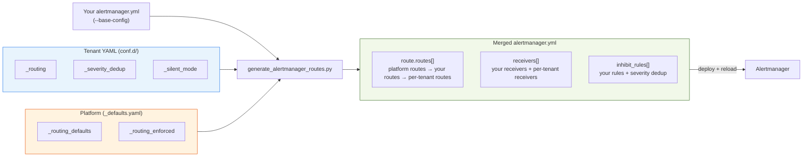
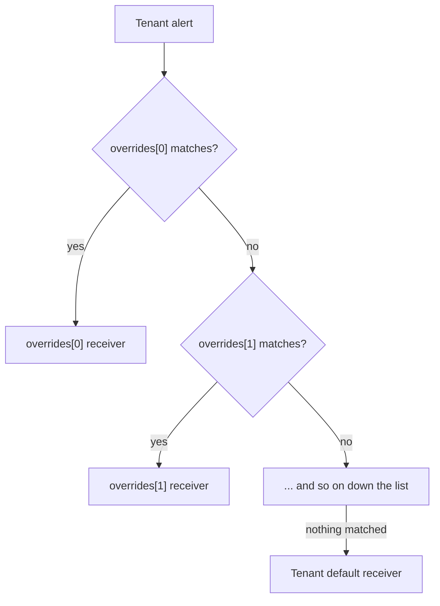

# BYO Alertmanager Integration Guide

> **Language / 語言：** **English (Current)** | [中文](byo-alertmanager-integration.md)
>
> **Version**: v2.9.0
> **Audience**: Platform Engineers, SREs
> **Prerequisites**: [BYO Prometheus Integration Guide](byo-prometheus-integration.en.md)

---

## 1. Overview

The four root causes of alert fatigue and their corresponding solutions:

| Root Cause | Solution | Mechanism | Config Source |
|------|------|------|----------|
| False positive storms during backup/maintenance | **Silent Mode** | Sentinel alert → inhibit_rules block notifications (TSDB preserves records) | `_silent_mode` |
| Scheduled maintenance forgotten to disable | **Maintenance Mode** | Alerts labelled `maintenance: mute` do not fire at the PromQL layer — not all alerts ([scope](../design/config-driven.en.md#27-three-state-operational-modes); supports `expires` auto-expiry) | `_state_maintenance` |
| Warning + Critical duplicate alerts | **Severity Dedup** | One inhibit rule for every tenant (same tenant + `metric_group` pairing; `disable` tenants in an exclusion list) | `_severity_dedup` |
| Notification destination hardcoded centrally | **Alert Routing** | Per-tenant route + receiver (6 types) | `_routing` |

Both Silent Mode and Maintenance Mode support structured object configuration, including `expires` (RFC3339, e.g. `"2099-04-01T00:00:00Z"`; if it cannot be parsed the exporter logs a WARN and ignores the whole setting — nothing is silenced, maintenance does not take effect) auto-expiry and `reason` field to prevent "set and forget".

> The table above is the **quick-reference view for the BYO integration context**. For the full alerting best practices (what to alert on → notification → action-layer idempotency), see the series: [Alert Design Fundamentals](../alerting-design-fundamentals.en.md) · [Beyond Actionable](../alerting-best-practices.en.md).

All Alertmanager routing is automatically generated from tenant YAML by `generate_alertmanager_routes.py` and merged into your own Alertmanager config (the source), emitted as a separate output and never written back over the source:



---

## 2. Integration Steps

### Step 1: Confirm the Alertmanager Reload Endpoint Is Reachable

**No flag is required.** Alertmanager's `/-/reload` is enabled unconditionally (POST;
GET returns 405) — there is no switch for it.

```yaml
args:
  - "--config.file=/etc/alertmanager/alertmanager.yml"
  - "--storage.path=/alertmanager"
```

> ⛔ **Do NOT add `--web.enable-lifecycle`** (an earlier revision of this page said to;
> corrected in #1243). That flag belongs to **Prometheus**; Alertmanager does not have
> it, and v0.33.1 exits immediately with
> `alertmanager: error: unknown long flag '--web.enable-lifecycle'` — adding it means
> Alertmanager never starts.
>
> ⚠️ The flip side: because `/-/reload` cannot be turned off and carries **no
> authentication**, use a NetworkPolicy to keep **other pods** off port 9093, or front
> it with an auth proxy. ⛔ Mind where a NetworkPolicy actually applies: the sidecar
> talks to Alertmanager over loopback inside the same pod (shared network namespace),
> so that traffic never passes a NetworkPolicy — it governs pod-to-pod traffic and
> cannot admit "only this one container in this pod".
>
> ⚠️ The other half of the same misconception: **Alertmanager has no `/-/quit`
> either** (v0.33.1 returns 404 and keeps running) — that is also a Prometheus
> endpoint. `/-/reload` is the only thing exposed on this side.

Verify:

```bash
kubectl port-forward svc/alertmanager 9093:9093 -n monitoring &
curl -sf http://localhost:9093/-/ready && echo "ready OK"
# What this step actually has to prove is the reload path — a green /-/ready does
# not mean /-/reload is reachable:
curl -sf -X POST http://localhost:9093/-/reload && echo "reload OK"
```

### Step 2: Ensure Prometheus is Connected to Alertmanager

```yaml
# prometheus.yml
alerting:
  alertmanagers:
    - static_configs:
        - targets:
            - "alertmanager.monitoring.svc.cluster.local:9093"
```

### Step 3: Configure Tenant Routing Config

Define the `_routing` section in tenant YAML :

```yaml
# conf.d/db-a.yaml
tenants:
  db-a:
    mysql_connection_usage_percent: "70"
    _routing:
      receiver:
        type: "webhook"
        url: "https://webhook.example.com/alerts"
      group_by: ["alertname", "severity"]
      group_wait: "30s"
      repeat_interval: "4h"
```

### Step 4: Validate the Tenant Config

```bash
# Validate the whole conf.d (CI runs --strict)
da-tools generate-routes --config-dir conf.d/ --validate --strict

# Validate + webhook domain allowlist check
da-tools generate-routes --config-dir conf.d/ --validate --strict --policy .github/deployment-policy.yaml
```

`--validate` writes nothing. The generator's output is always the **complete merged Alertmanager config**; there is no "emit a fragment and paste it yourself" mode: a run without a mode flag (only `-o`, only `--dry-run`) is exit 2. ⚠️ The v2.9.0 image still prints a fragment when no mode flag is given <!-- image-caveat: v2.9.0 -->

> **Why there is no fragment any more** ([#1211](https://github.com/vencil/Dynamic-Alerting-Integrations/issues/1211)): the old fragment's header told you to append it **after** your own child routes. But four platform routes in it (Watchdog heartbeat, custom-alert isolation, synthetic probe, sentinel sink) must come first — appended last, your own catch-all child route took their alerts: the Watchdog heartbeat went to your default channel (and never reached the external dead-man's switch), and custom and sentinel alerts paged your NOC. Only a merge done by the generator places them right.

### Step 5: Merge into Alertmanager ConfigMap

The generator merges the tenant routing into **your own** Alertmanager config. The three output modes share one merge; pick one by how you deploy:

**Mode A: `--output-alertmanager` (BYO Alertmanager outside Kubernetes, or the Prometheus Operator's configSecret)**

```bash
# The source: your own config, kept on its own (in git, say); the first time, copy it from the current one
cp /etc/alertmanager/alertmanager.yml alertmanager.base.yml

# Preview first
da-tools generate-routes --config-dir conf.d/ --output-alertmanager \
  --base-config alertmanager.base.yml --dry-run

# Write the merged alertmanager.yml (the output), deploy it to /etc/alertmanager/ and reload (Step 6)
da-tools generate-routes --config-dir conf.d/ --output-alertmanager \
  --base-config alertmanager.base.yml -o alertmanager.yml
```

When conf.d changes later, run it again on the same `alertmanager.base.yml`; to change your own config, edit that file too, not the deployed `alertmanager.yml`.

**Mode B: `--output-configmap` (GitOps PR flow, v1.10.0)**

```bash
# Generate the merged, complete ConfigMap YAML
da-tools generate-routes --config-dir conf.d/ --output-configmap \
  --base-config base-alertmanager.yaml -o deploy/alertmanager-configmap.yaml

# File into Git → PR review → merge → ArgoCD/Flux auto sync
git add deploy/alertmanager-configmap.yaml && git commit -m "update AM routes"
```

**Mode C: `--apply` (Runtime direct operation, v1.4.0)**

```bash
# Render from the ConfigMap's alertmanager.base.yml (the source) + apply + reload
da-tools generate-routes --config-dir conf.d/ --apply --yes
```

Best for: initial deployment testing, P0 emergency fixes, non-GitOps environments. It does not read `--base-config`; its source is in the cluster: the ConfigMap's `alertmanager.base.yml` key holds the source, `--apply` renders from it and writes back `alertmanager.yml` (the output) and `alertmanager.base.yml` (the source); Alertmanager ignores the extra file. The first `--apply` (no such key yet) adopts the existing `alertmanager.yml` as the source; if that is already generated (its first line is the `# GENERATED by da-tools generate-routes` marker, or it holds `tenant-*` receivers), exit 1 and nothing is applied — put your source into `alertmanager.base.yml` first. ⚠️ Upgrading: an `alertmanager.yml` an older `--apply` wrote has no marker; from a conf.d without any `_routing` / `_routing_enforced` it holds no `tenant-*` receiver either, but it holds the per-tenant dedup rules the generator wrote then, so the first `--apply` is exit 1 and applies nothing (the message names the ConfigMap and `alertmanager.base.yml`) — put your own config (without the generator's dedup rules) into `alertmanager.base.yml` before that first run ([#3899](https://github.com/vencil/Dynamic-Alerting-Integrations/issues/3899)). To change the config, edit `alertmanager.base.yml`, not `alertmanager.yml` — the next `--apply` renders that one afresh from the source. ⚠️ **Behaviour change**: `--apply` used to replace the cluster's `route.routes` whole, so child routes you had added vanished; it is now the same merge as the other two modes and your routes are kept. The v2.9.0 image still has the old behaviour <!-- image-caveat: v2.9.0 -->

**Merge rules** (the same in all three modes; full description in [CLI reference §generate-routes](../cli-reference.en.md#generate-routes)):

- **Source and output kept apart**: output = merge(source base, conf.d). The base is your own config, not an earlier output of this tool; the output is a separate product and cannot be used as a base again (as with Prometheus Operator, which reads the user's Secret and writes to another, `<name>-generated`, never back). Your own routes, receivers, inhibit rules, `global:` and root route stay as written, and this run's are added.
- **Order**: `route.routes` becomes "the four platform routes + the enforced NOC route(s) (`continue: true`)" → "your routes, in their order" → "the tenant routes". The platform routes come before yours, so your catch-all cannot take the Watchdog; the tenant routes come after yours. With `{{tenant}}` enforced routing, your routes and the tenant routes go under one route to your root receiver, which stands in for the root (see the [CLI reference](../cli-reference.en.md#generate-routes)).
- **Re-runnable**: when conf.d changes, run it again on **the same source**. Every run renders from the source, so a removed tenant leaves nothing behind.
- **The base cannot be an output**: every output starts with a `# GENERATED by da-tools generate-routes` comment; a base carrying that line, or a `tenant-*` / `platform-enforced*` receiver (names only the generator writes) ⇒ exit 1, nothing written, and the message says it looks like this tool's output and asks for the source; do not give your own receivers those names either. `-o` naming the `--base-config` file itself ⇒ exit 2. The four platform receivers may be defined in your base, and a full definition (e.g. `watchdog-heartbeat` wired to a dead-man's switch) wins; a top-level route of the base to one of them is taken to be the platform's and emitted once, in its canonical form, first.
- **Migrating from the fragment mode (once)**: a base you pasted the fragment into (it holds `tenant-*` receivers) is refused. Delete what you pasted and keep your own original config as the source.
- **Wire the Watchdog out**: when `watchdog-heartbeat` in your base has no integration, the output modes print a `watchdog_undelivered` WARN, and under `--strict` exit 1 and write nothing. How to wire it: [Alerting-plane self-liveness](alerting-plane-self-liveness.en.md). ⚠️ The v2.9.0 image does not report it <!-- image-caveat: v2.9.0 -->

Without `--base-config` the merge goes into a built-in placeholder base (`resolve_timeout: 5m`, `group_by: [alertname, tenant]`, an empty `default` receiver) — that is not your config, so for a BYO deployment always pass `--base-config`.

⚠️ **`--base-config` must be a complete config Alertmanager accepts** ([#3206](https://github.com/vencil/Dynamic-Alerting-Integrations/issues/3206)): it needs `route:` and the `receivers:` it names; `global:` and `inhibit_rules:` may be left out and fall back to the built-in values. The generator reads the base with Alertmanager's own loader (`da-read alertmanager`); without `route:` or its receivers the loader refuses it — exit code 2, in the loader's own words — and no built-in route is filled in any more.

⚠️ **From v2.10.0, "supplied but unusable" is no longer the same as "not supplied" (BREAKING, [#1616](https://github.com/vencil/Dynamic-Alerting-Integrations/issues/1616))**. The `--base-config` above is a relative path. Old behaviour: a mistyped path, a directory, an empty file, or a comment-only file all exited **0** and quietly substituted the built-in defaults — the emitted ConfigMap was **byte-for-byte identical** to one produced with no `--base-config` at all, so your `global:` (SMTP smarthost, Slack webhook) was replaced and then synced into the cluster by ArgoCD/Flux. New behaviour: **exit 2, naming the flag**. ⛔ The fix is to correct the path, not to drop `--base-config` — dropping it reproduces the old broken outcome. Also, only `--output-configmap` and `--output-alertmanager` read the flag (`--validate` returns before the config is assembled, and `--apply`'s base is the cluster's config), so passing it in another mode is now exit 2 rather than a silent no-op.

**Mode Comparison:**

| | `--output-alertmanager` | `--output-configmap` | `--apply` |
|---|---|---|---|
| Operation | Output `alertmanager.yml` | Output ConfigMap YAML file | Direct K8s ConfigMap modification |
| Base | `--base-config` | `--base-config` | The ConfigMap's `alertmanager.base.yml` (the first time, the existing `alertmanager.yml`) |
| Workflow | Alertmanager outside Kubernetes | Git PR → review → GitOps sync | CLI manual operation / emergency fix |
| Requires K8s connection | No | No (pure file output) | Yes (kubectl context) |
| Alertmanager reload | Yours to trigger after deploying (Step 6) | Triggered by sidecar/webhook after GitOps sync | `--apply` triggers automatically |
| Auditability | Depends on how you deploy | Complete Git history | No Git record |

> **Note**: the three modes (and `--validate`) are mutually exclusive; pass exactly one. `--namespace` / `--configmap` are read only by `--output-configmap` and `--apply`; with `--output-alertmanager` they are exit 2.

All three modes first hand the `alertmanager.yml` they are about to write / apply to Alertmanager's own config loader (`da-read`); if it rejects it the exit code is 1 and nothing is written or applied, whether or not `amtool` is on PATH (#3689, #3793). `--validate` goes through the same gate, but on the **built-in default base** rather than yours (#2260), so validating your own base still takes `--output-alertmanager --base-config ... --dry-run` (or `--output-configmap`). A failed reload under `--apply` is exit code 2 (#2219). ⚠️ The v2.9.0 image has no `da-read`, and its `--validate` does not go through this gate <!-- image-caveat: v2.9.0 -->

### Step 6: Reload Alertmanager

```bash
# HTTP reload (Alertmanager exposes this endpoint unconditionally — no flag needed)
curl -X POST http://localhost:9093/-/reload

# Verify reload success
curl -sf http://localhost:9093/-/ready && echo "Alertmanager ready"
```

---

## 3. generate_alertmanager_routes.py Tool

### Features

Reads all tenant YAML from `conf.d/`, scans `_routing` and `_severity_dedup` settings, generates routes, receivers and inhibit rules, and merges them into a base config (your own config, the source) to emit a complete, valid Alertmanager config; see Step 5. ⚠️ The severity dedup inhibit rule is generated by this tool (one rule, with the `_severity_dedup: disable` tenants in its `tenant!~` exclusion list) — do **not** write it into the base: a base holding a severity dedup rule the route generator itself writes (today's global shape, or the per-tenant shape before #3899; compared as the generator's rebuilt matcher sets, so spacing, order, quoting, several matchers in one element and legacy `*_match` do not matter) is refused (exit 1, nothing written), since it would reach the output as written and override conf.d's `_severity_dedup` (`disable` included). An inhibit rule the operator writes in the base is operator policy: the generator does not judge it and keeps it as written, even where it overrides `_severity_dedup` (`disable` included) ([#3899](https://github.com/vencil/Dynamic-Alerting-Integrations/issues/3899)).

### Modes

Exactly one mode flag; none is exit 2:

| Flag | Description |
|------|------|
| `--validate` | Validate configuration legality (exit 0/1, suitable for CI); writes nothing |
| `--output-alertmanager` | Output the merged plain `alertmanager.yml`, for a BYO Alertmanager outside Kubernetes or the Prometheus Operator's configSecret |
| `--output-configmap` | Output the merged, complete ConfigMap YAML, suitable for GitOps PR flow |
| `--apply [--yes]` | Merge into the cluster's Alertmanager ConfigMap + reload (`--yes` skips confirmation) |

Other flags:

| Flag | Description |
|------|------|
| `--base-config FILE` | With `--output-alertmanager` / `--output-configmap`: your Alertmanager config, which the generated routing is merged into |
| `-o FILE` | With `--output-alertmanager` / `--output-configmap`: write to the file (default stdout) |
| `--dry-run` | With `--output-alertmanager` / `--output-configmap`: preview the output, no file write |
| `--policy FILE` | Load `allowed_domains` for webhook URL compliance check |
| `--strict` | Escalate the escalatable WARNs to ERROR with exit 1 (for CI) |

### Timing Guardrails

Platform-enforced timing ranges, automatically clamped when exceeded:

| Parameter | Minimum | Maximum | Default |
|------|--------|--------|--------|
| `group_wait` | 5s | 5m | 30s |
| `group_interval` | 5s | 5m | 5m |
| `repeat_interval` | 1m | 72h | 4h |

Durations are written the way Alertmanager reads them (`definitions.duration` of `tenant-config.schema.json`): whole numbers with units, largest unit first, each unit at most once (`y`, `w`, `d`, `h`, `m`, `s`, `ms`), or a bare `0` — `1h30m`, `90m` and `1d` all work. A spelling Alertmanager refuses (`1.5h`, `30m1h`, `1ns`) is replaced by the platform default with a WARN, and `generate-routes --validate` and `validate-config` exit 1; the exporter ignores the value ([#2490](https://github.com/vencil/Dynamic-Alerting-Integrations/issues/2490)).

---

## 4. Dynamic Reload

### Mechanism

HTTP reload works through Alertmanager's native, always-on `/-/reload` endpoint (no flag):

```bash
# After ConfigMap update
curl -X POST http://alertmanager:9093/-/reload
```

### Automation Options

| Solution | Description | Use Case |
|------|------|----------|
| **HTTP reload** | `curl -X POST /-/reload`  | Minimal intrusion, suitable for self-managed Alertmanager |
| **ConfigMap Watcher Sidecar** | Similar to `prometheus-config-reloader` | Fully automatic, suitable for production |
| **CI Pipeline Integration** | GitOps: `generate-routes --validate` + apply + reload | Suitable for GitOps workflow |
| **GitOps ConfigMap Output** | `generate-routes --output-configmap` outputs complete ConfigMap YAML into Git PR flow | v1.10.0+, replaces `--apply` direct manipulation |
| **Alertmanager Operator** | `generate-routes --output-alertmanager` output in a Secret, loaded by the Alertmanager CR's `spec.configSecret` (the Operator reloads) | Suitable for environments already using Operator |

---

## 5. Receiver Types

v1.4.0 supports six receiver types. Webhook example:

```yaml
_routing:
  receiver:
    type: "webhook"
    url: "https://webhook.example.com/alerts"
    send_resolved: true  # optional: send resolved alerts
```

Quick reference for other five receiver types (each type's required fields are defined by [`tenant-config.schema.json`](../schemas/tenant-config.schema.json)):

| Type | Example |
|------|---------|
| **Email** | `to: ["team@example.com"]`, `smarthost: "smtp.example.com:587"`, `from: "alertmanager@example.com"` |
| **Slack** | `api_url: "https://hooks.slack.com/..."`, `channel: "#alerts"` |
| **Microsoft Teams** | `webhook_url: "https://outlook.office.com/webhook/..."` |
| **Rocket.Chat** | `url: "https://chat.example.com/hooks/xxx/yyy"` |
| **PagerDuty** | `routing_key: "key-123"`, `severity: "critical"` |

Setting both PagerDuty `routing_key` and `service_key` is rejected: Alertmanager would use v1 and ignore `routing_key`.

Required field values are format-checked too ([#2180](https://github.com/vencil/Dynamic-Alerting-Integrations/issues/2180)). If Alertmanager cannot load any one receiver, the **whole** config fails to reload.

- URL fields (`url`, `api_url`, `webhook_url`) must be an `http://` or `https://` URL with a host and no whitespace.
- `smarthost` must be `host:port` with a numeric port; an IPv6 host is bracketed, e.g. `[2001:db8::1]:25`.
- When `to` is a list, every item must be a non-empty string.
- A required field given anything other than a string (a list, a number, a boolean) is rejected; the one exception is `to` above, which may be a list.
- The receiver `type` must equal the lowercase name in the table above exactly; other letter case and surrounding whitespace are rejected.

The format rules are defined by `receiverHttpUrl` / `receiverSmtpHostPort` in [`tenant-config.schema.json`](../schemas/tenant-config.schema.json); which values Alertmanager actually accepts or rejects is recorded in the `am` column of the shared table `receiver_presence_cases.json` (asserted by a test that runs Alertmanager's `config.Load`).

All types support `send_resolved: true` (default false) to control if resolved alerts are sent.

Optional values are checked too ([#2295](https://github.com/vencil/Dynamic-Alerting-Integrations/issues/2295)): only the values Alertmanager refuses, which make the whole reload fail, as Alertmanager 0.34.1 judges them.

- `send_resolved`, email `require_tls` and webhook `http_config.proxy_from_environment` take a boolean or an empty value (not given); write an unquoted `true` / `false`. An unquoted YAML 1.1 boolean word `yes` / `no` / `on` / `off` is a string: the route generator reads yaml.v3 through `da-guard parse-tree` and refuses it too, so write `true` / `false`. A quoted `"yes"` or `"true"`, and `maybe`, `1` or `""`, are rejected: the route generator refuses the whole tree in every mode ([#2906](https://github.com/vencil/Dynamic-Alerting-Integrations/issues/2906)).
- webhook `http_config`: an empty value counts as not given; otherwise it must be a mapping. Its keys are Alertmanager's `http_config` keys minus the file-reference ones: `basic_auth`, `oauth2`, `authorization`, `bearer_token`, `tls_config`, `follow_redirects`, `enable_http2`, `http_headers`, `proxy_url`, `no_proxy`, `proxy_from_environment`, `proxy_connect_header` ([#2984](https://github.com/vencil/Dynamic-Alerting-Integrations/issues/2984)). ⚠️ **File-reference keys are always refused** ([#3257](https://github.com/vencil/Dynamic-Alerting-Integrations/issues/3257)): a key ending in `_file` or `_ref`, or a key named `files`, at any depth of a receiver (`http_config` included) — such as `bearer_token_file`, `basic_auth.password_file`, `tls_config.key_file`, `oauth2.client_secret_ref` or the `files` list of `http_headers` — makes Alertmanager read a file inside its own container or look for a secret manager it does not have, so the schema and the route generator refuse it; the generator refuses the whole tree in every mode (rc 1, nothing written) and a tenant-api write gets a 422. Write the credential's value itself, or use a [`secretRef`](#credentials-in-a-secret-secretref) (below). Alertmanager refuses the whole config over any other key; validate-config's JSON schema rejects it, and the route generator leaves it to Alertmanager's config loader (`da-read`). `follow_redirects` / `enable_http2` reach Alertmanager as written, so write an unquoted `true` / `false`. What sits inside `tls_config`, `oauth2`, `authorization`, `basic_auth`, `http_headers` and `proxy_connect_header` follows Alertmanager's rules (unknown keys, `oauth2` without `client_id` / `token_url`, `authorization` with `type: basic`, reserved header names such as `Authorization`); only validate-config's JSON schema rejects these, the route generator leaves them to Alertmanager's config loader (`da-read`), and da-guard and tenant-api do not check them. At most one of `basic_auth`, `oauth2`, `authorization`, `bearer_token` may be set: empty values and `bearer_token: ""` count as unset, `basic_auth: {}` as set. `bearer_token` / `proxy_url` / `no_proxy` must be strings (quote a value YAML would read as a boolean, number or date). The same holds for the string fields under `basic_auth`, `oauth2`, `authorization` and `tls_config`: quote an all-digit `password`, `username`, `client_id`, `client_secret` or `credentials`, or a value yaml.v3 reads as a number or date (`1e3`, `0x1F`, `2024-01-02`), as in `password: "123456"`. Unquoted, validate-config's `yaml_quoting` row fails and lists each one with the file, field path and the fix (such as `quote it, without a tag: password: "123456"`); add the quotes as it says. The reason: the route generator and the validation tools (validate-config and the conf.d lints) read conf.d with yaml.v3 through `da-guard parse-tree`, and the value is what the tag it resolves says — an unquoted `0x1F` is the integer 31, `1e3` the float 1000, `2024-01-02` a date — so Alertmanager would not receive the string you wrote ([#2906](https://github.com/vencil/Dynamic-Alerting-Integrations/issues/2906)).
- `http_config.proxy_url`: must be a string; tenant-api rejects only values Go's `net/url` cannot parse (such as `::x`, a host with a space, `%zz`, a bad port), and the route generator leaves that to Alertmanager's config loader (`da-read`). `proxy_from_environment: true` cannot be combined with a non-empty `proxy_url` or with `no_proxy`; `no_proxy` needs `proxy_url`; `proxy_connect_header` needs a non-empty `proxy_url` or `proxy_from_environment`.

The shapes deliberately stricter than Alertmanager are the rows marked `strict` in the shared table [`receiver_presence_cases.json`](https://github.com/vencil/Dynamic-Alerting-Integrations/blob/main/components/threshold-exporter/app/pkg/receiverspec/testdata/receiver_presence_cases.json).

`generate_alertmanager_routes` and tenant-api's `PUT /api/v1/tenants/{id}` and `POST /api/v1/tenants/{id}/validate` apply the same rules. tenant-api answers PUT with 400 `INVALID_BODY` and validate with `valid: false`, judging only the receivers the body writes. ⚠️ For the generator, "rejected" means one of two things. A boolean field (`send_resolved`, `require_tls`, `proxy_from_environment`) holding a value of the wrong type refuses the whole tree in every mode: rc 1 and no output written (the first item above). For every other rule it means a WARN and that tenant's receiver and route are skipped; the output is still written with rc 0 (`--strict` does not change that). Only `--validate` exits 1, so CI must run `--validate`.

### Credentials in a Secret (`secretRef`)

These credential fields may hold a reference to a Kubernetes Secret instead of the value ([#1560](https://github.com/vencil/Dynamic-Alerting-Integrations/issues/1560)); each renders as the field Alertmanager reads from a file:

| Field | Rendered as | Credential sent to |
|---|---|---|
| webhook / Rocket.Chat `url`, Slack `api_url`, Teams `webhook_url`, PagerDuty `service_key` / `routing_key` | `<field>_file` | the field itself |
| email `auth_password` | `auth_password_file` | `smarthost` |
| webhook `http_config` `basic_auth.password`, `authorization.credentials`, `bearer_token`, `tls_config.key` | `password_file`, `credentials_file`, `bearer_token_file`, `key_file` | `url` |
| one item of webhook `http_config.http_headers.<name>.secrets` | moved to that header's `files` | `url` |
| webhook `http_config.oauth2` `client_secret`, `client_certificate_key`, `tls_config.key` | `client_secret_file`, `client_certificate_key_file`, `key_file` | `oauth2.token_url`, and `url` (the access token it yields goes with every request there) |

Only these places take a reference (the generator and the schema read one table, `_lib_validation.CREDENTIAL_REF_SITES`). Email `headers` and the other `http_config` fields (`username`, `proxy_connect_header`, `oauth2.claims`, ...) have no Alertmanager `*_file` counterpart and take none, at any depth: a reference anywhere else is found by the generator after rendering and the receiver is refused (`secret_ref_unsupported_field`), never written into the Alertmanager config as is. A header's values are sent in the order `values`, `secrets`, `files`, so a value from a Secret comes after the ones written inline.

A reference **never names its Secret**; it has one of two shapes:

```yaml
_routing:
  receiver:
    type: slack
    api_url: {secret: {key: slack-url}}                    # the tenant's own Secret: da-<tenant>
  routes:
    - match: {severity: critical}
      receiver:
        type: webhook
        url: {secret: {shared: corp-alerting, key: url}}   # a shared Secret, listed in the deployment policy
```

- **The tenant's own Secret**: `{secret: {key: <key>}}`. Its name is always `da-<tenant>`, derived from the tenant id; a tenant cannot write another name, so it cannot reference another tenant's Secret. A reference in `_routing_defaults` is derived for each tenant that inherits it. With `{{tenant}}`, each receiver `_routing_enforced` expands to belongs to that tenant; the platform-wide receiver (no `{{tenant}}`) belongs to no tenant and can use a shared Secret only.
- **A shared Secret**: `{secret: {shared: <alias>, key: <key>}}`. The alias must be listed under `shared_secrets` of the deployment policy file (`generate-routes --policy`, tenant-api's `generator.policy`):

  ```yaml
  allowed_domains: ["*.example.com"]
  shared_secrets:
    corp-alerting: {secret: corp-alerting, fields: [api_url, webhook_url, url]}
    corp-smtp: {secret: corp-smtp, fields: [auth_password]}
    corp-hook: {secret: corp-hook, fields: [http_config.basic_auth.password]}
  ```

  `secret` is the real Secret name and may not start with `da-` (it would collide with a tenant's derived name). `fields` lists **full field paths**; the values it takes are the paths of the rows of the table above (`_lib_validation.CREDENTIAL_REF_SITES`): a top-level field as it is (`api_url`, `url`, `auth_password`), one under `http_config` as its full path (`http_config.basic_auth.password`, `http_config.oauth2.client_secret`). The header row is `http_config.http_headers.*.secrets[]`: `*` stands for any header name and `[]` for any item of `secrets`, written literally — never a real header name or index; listing it lets the alias stand in the `secrets` of any header. ⚠️ BREAKING ([#1560](https://github.com/vencil/Dynamic-Alerting-Integrations/issues/1560) ⑤-b): only the top-level field name used to be compared, so one `http_config` opened eight rows at once; `http_config` is now no row's path, and the policy is unusable (exit code `2`), with a message naming the paths under it. With no policy file, or no `shared_secrets` in it, there is no shared exception at all. A receiver that uses any shared Secret may not set `http_config.proxy_url`: the tenant chose that proxy, and it would see the request to the shared destination (`secret_ref_proxy_url`). A malformed `shared_secrets` (not a mapping, an alias that is not a DNS-1123 label, an entry that is not `{secret, fields}`, a name starting with `da-`, a `fields` value that is not a path of the table) makes the whole policy unusable: exit code `2`.
- **A credential sent to a destination the receiver writes** (the rows above whose "sent to" is not the field itself: `auth_password` and the `http_config` fields). Whoever writes the receiver writes where it goes, so:
  - a receiver a tenant owns (a tenant's `_routing`, `_routing_defaults`, a routing profile, a `_routing_enforced` with `{{tenant}}`) takes the tenant's own Secret only; a shared Secret is refused (`secret_ref_shared_confined`): the tenant could otherwise point the platform's credential at a host of its choosing. **The `_routing_enforced` no tenant owns** (no `{{tenant}}`, read only from a `_`-prefixed file at the conf.d root, which tenant-api cannot write) takes only a shared Secret instead, whose alias lists the field's path under `fields`, and the three rules below still hold: the destination passes `allowed_domains`, `follow_redirects: false`, no `proxy_url` (what may not be set is a proxy the config itself names, `proxy_url`; `proxy_from_environment: true` is allowed: it reads the Alertmanager pod's `HTTPS_PROXY` and related environment variables, which the platform deployer sets, and upstream refuses it together with `proxy_url` or `no_proxy`). For example, a platform-wide SMTP password:

    ```yaml
    # conf.d/_routing_enforced.yaml (root)
    _routing_enforced:
      enabled: true
      receiver:
        type: email
        to: [noc@example.com]
        smarthost: smtp.example.com:587
        from: alertmanager@example.com
        auth_password: {secret: {shared: corp-smtp, key: password}}
    ```

  - the policy must have a non-empty `allowed_domains` that admits every destination's host (both `oauth2.token_url` and `url` for the oauth2 fields; a URL destination must start with `http://` or `https://`, while `smarthost` stays `host:port`); a destination that is missing, or is itself a reference (no host to read), is refused (`secret_ref_destination_unconfined`);
  - the `proxy_url` that request goes through (`http_config.proxy_url` for the webhook request, `http_config.oauth2.proxy_url` for the token request; both for the oauth2 fields) may not be set (`secret_ref_proxy_url`): `allowed_domains` does not confine the proxy, which sees an `http://` request whole, and can intercept an `https://` one when the same receiver sets `tls_config.ca` or `insecure_skip_verify`;
  - every `http_config` credential but the TLS client key (`tls_config.key`) needs `http_config.follow_redirects: false` (`secret_ref_follow_redirects`): Alertmanager follows redirects by default; on a redirect to a subdomain of the `url` host it sends `Authorization` again (basic_auth, authorization, bearer_token, the oauth2 access token), and a custom header goes on to whatever host the redirect names, so either can reach a host `allowed_domains` did not admit. A TLS client key is never sent. The oauth2 fields need it because the access token they yield is sent again on the webhook request's redirects; `follow_redirects` governs only the webhook request, and the token request to `token_url` goes through a separate client that it does not affect.
  - ⚠️ **The oauth2 token request follows redirects, and the generator cannot stop it**: Alertmanager fetches the token from `token_url` with a separate client that follows redirects; prometheus/common v0.70.1 has no setting to turn that off, and `follow_redirects` does not govern this request. If the token endpoint answers 307 / 308 to another host, the request body carrying `client_secret` is sent there again (for the jwt-bearer grant, the signed assertion is). This does not depend on how it is written: the risk is the same whether `client_secret` is written inline or as a reference, so a reference does not widen it and going back to an inline value does not narrow it. What the deployment must do: the `token_url` host must be an IdP you trust that has no open redirect, and the policy's `allowed_domains` should name that host exactly, not with a wildcard. For comparison, Prometheus Operator's AlertmanagerConfig takes `clientSecret` as a SecretKeySelector and does not address this resend either.

The generator writes the reference as the file field in the table above, with the value `<root>/<secret-name>/<key>`, and drops the field (a header item moves to `files`); `<root>` defaults to `/etc/alertmanager/secrets` and is set with `generate-routes --secret-mount-root`. A receiver that breaks any rule above is not rendered: `generate-routes --validate` exits non-zero, `validate-config`'s routes row FAILs, and a tenant-api write gets 422. When a URL field is a reference the generator cannot see its host, and `allowed_domains` does not check it: the Secret is created by the operator or ExternalSecrets, and a tenant can write neither its content nor its name. `test-notification` cannot read the Secret, so such a receiver is always `SKIPPED` and nothing is sent.

⛔ **Mount contract (required for BYO)**: the Alertmanager container must mount every referenced Secret at `<root>/<secret-name>/`, one file per key. This is the layout Prometheus Operator's `spec.secrets` uses (`/etc/alertmanager/secrets/<name>`); the repo's own `watchdog-heartbeat` is mounted at `/etc/alertmanager/secrets/watchdog-heartbeat/`, the path the base's `url_file` spells out; `--secret-mount-root` does not change it, so with another root, change the base's `url_file` and that Secret's mount yourself. Neither the generator nor tenant-api can read Secrets, so neither sees whether one exists. When a missing file fails depends on the field: `http_config.tls_config`'s `key_file` (and its `cert_file` / `ca_file`) is read and checked when Alertmanager loads or reloads the config and builds the receiver, so an unreadable or invalid one fails the whole reload, which keeps the old config (at startup, Alertmanager does not start); every other file, `oauth2`'s `client_secret_file`, `client_certificate_key_file` and `oauth2.tls_config.key_file` included, is read only when a notification is sent (for oauth2, when the first token is fetched), and only that notification fails. Alertmanager's config loader (`da-read`), which `generate-routes` hands the config to, loads it without building receivers, so it catches neither.

**Which Secrets to mount**: add `--secret-mounts-out <file>` to `generate-routes --output-configmap` (or `--output-alertmanager`) and it writes, as JSON, the Secrets the emitted config actually reads (`mounts[].name` with their `keys`, sorted by name; names and keys only, no values); mount by that list ([#1560](https://github.com/vencil/Dynamic-Alerting-Integrations/issues/1560)). The list is walked from the emitted config itself — every `*_file`, every `http_headers` `files` list and the top-level `templates` (a template glob in the Secret-name segment names no Secret and goes to `other_files`; one in the key segment lists the name without a key) — so the base's own (e.g. `watchdog-heartbeat`) are in it; paths outside `<root>` are listed as `other_files`, for you to provide some other way. `--apply` writes no list: run `--output-configmap --secret-mounts-out` once on the same conf.d and source to get it. Format and rules: [cli-reference §generate-routes](../cli-reference.en.md#generate-routes); on the Prometheus Operator path `operator-check --secret-mounts` also compares it with `spec.secrets` ([Operator integration](operator-alertmanager-integration.en.md)).

### Credentials are not taken written out (BREAKING)

From [#1560](https://github.com/vencil/Dynamic-Alerting-Integrations/issues/1560) ⑤-b the generator refuses a credential value written out. There is one judgement (`_lib_validation.plaintext_credential_findings`), on **the value each file writes**, not on the merged result, so a routing profile no tenant binds, a `_routing_defaults` a tenant overrides and a place no plane reads are judged too:

| Place | A value written out |
|---|---|
| Every row of the table above but webhook `url` | Refused; only a reference is taken |
| webhook `url` | Taken; refused when it carries userinfo (`user:pass@`, or just `user@`): move the credential to `http_config` `basic_auth` / `authorization` as a reference |
| `http_config.proxy_connect_header`, `http_config.oauth2.proxy_connect_header` | Refused when present, whatever the value |
| `http_config.proxy_url`, `http_config.oauth2.proxy_url` | Refused when it carries userinfo |
| email `headers`, `http_headers.<name>.values`, `oauth2.endpoint_params`, `oauth2.claims` | Taken (masked by the readers as before) |

A proxy credential has no reference form (Alertmanager's `proxy_connect_header` has no file form, and Go turns `proxy_url` userinfo into a `Proxy-Authorization` header). When the proxy needs authentication, the platform gives the Alertmanager pod `HTTPS_PROXY` from a Secret (e.g. `env: [{name: HTTPS_PROXY, valueFrom: {secretKeyRef: {name: egress-proxy, key: url}}}]`) and the tenant's receiver writes only `http_config.proxy_from_environment: true`.

Each one is a generator finding (kind `credential_plaintext`); the line names the file, the place and the category (`needs_reference`, `userinfo`, `proxy_credential`), never the value. A receiver the judgement cannot read is refused too (kind `credential_unjudged`): a `type` that is no receiver type (`Slack`, empty, missing, not a string), a receiver that is not a mapping, an `overrides` / `routes` that is not a list or an item of one that is not a mapping, and any receiver-shaped value (the value of a `receiver` key, or a mapping whose `type` is a receiver type) inside a routing block (`_routing`, `_routing_defaults`, `_routing_enforced`, `routing_profiles`) at a place the walk does not read (a block written as a list, nested `routes`, a key the generator does not read; reason `not_walked`). A file that cannot be read already makes the generator refuse the whole tree. In a tenant's own `_routing` the render reports these shapes too (`unknown_receiver_type`, `invalid_override_entry`, …), so one place may get two lines: two beat none (a `_routing` another file overrides is never rendered). A `_routing` at a file's top level, which no plane reads, is judged too.

- `generate-routes --validate` exits `1`; `validate-config`'s routes row FAILs. The render-only modes (`--output-configmap`, …) print the `ERROR (credential)` lines without changing the exit code, so CI must run `--validate`.
- tenant-api, through the generator container, answers 422 `GENERATOR_FINDINGS`. Whether it refuses depends on **the file written**: a credential written out in a file this write changes refuses it (one already in that file, untouched by the write, included); one in another file is a NOTICE and does not refuse this write — the whole-tree CI refuses it (the same split as the key verdict's, [ADR-038](../adr/038-unread-keys-judged-by-readers.en.md) decisions 5 and 6).

**Migration**

1. Run `da-tools migrate-credentials --config-dir conf.d` (add `--manifests-out <a directory outside the repository> --write` to apply it): the credentials in tenants' own `_routing` become `{secret: {key: …}}`, with one `da-<tenant>` Secret per tenant. The ones in platform places (`_routing_defaults`, profiles, the platform-wide `_routing_enforced`) are listed for a person: rewrite them as references as above.
2. Every value on the rotation list has been in git: rotate it per [secret-leak-remediation-sop](../internal/secret-leak-remediation-sop.md).
3. Rewrite the policy's `shared_secrets.<alias>.fields` as full field paths (above).
4. Move proxy authentication to Alertmanager's `HTTPS_PROXY`; the receiver writes `proxy_from_environment: true`.

### Message Templates (Go Template)

Slack, Teams, and Email `title` / `text` / `html` fields support Alertmanager Go template syntax. Slack example:

```yaml
_routing:
  receiver:
    type: "slack"
    api_url: {secret: {key: slack-url}}
    channel: "#db-alerts"
    title: '{{ .Status | toUpper }}: {{ .CommonLabels.alertname }}'
    text: >-
      *Tenant*: {{ .CommonLabels.tenant }}
      *Severity*: {{ .CommonLabels.severity }}
      {{ range .Alerts }}
        - {{ .Annotations.summary }}
      {{ end }}
```

Email and Teams use the same Go template syntax, only field names differ:
- Email: `html` field (HTML format)
- Teams: `text` field (Markdown format)

**Available variables:** `.CommonLabels.alertname`, `.CommonLabels.tenant`, `.CommonLabels.severity`, `.CommonAnnotations.summary`, `.CommonAnnotations.description`, `.Status`, `.Alerts` (supports `{{ range }}` loop). See [Alertmanager official docs](https://prometheus.io/docs/alerting/latest/notifications/)

---

## 6. Verification Checklist

### Tool Verification

```bash
# 1. Preview the merged alertmanager.yml (dry-run, no file written)
da-tools generate-routes --config-dir /data/conf.d --output-alertmanager \
  --base-config /data/alertmanager.yml --dry-run

# 2. Validate configuration legality
da-tools generate-routes --config-dir /data/conf.d --validate

# 3. Check Alertmanager status
curl -sf http://localhost:9093/-/ready

# 4. View current alert status
curl -sf http://localhost:9093/api/v2/alerts | python3 -m json.tool
```

> **Automated verification**: `da-tools byo-check alertmanager` runs all the above Alertmanager verification items in one command.

### Functional Verification

--8<-- "docs/includes/verify-checklist.en.md"

**Alertmanager Integration Specific:**

- [ ] `generate-routes --validate` exits with code 0
- [ ] Alertmanager loads merged configuration without errors
- [ ] Silent/Maintenance `expires` auto-recover after expiry
- [ ] Severity Dedup enabled tenant's warning is suppressed when critical fires
- [ ] Custom routing tenant's alert reaches specified receiver
- [ ] Per-rule override alert reaches specified override receiver

---

## 7. Per-Rule Routing Overrides 

In advanced scenarios, certain specific alerts may need different routing strategies. The `_routing.overrides[]` in tenant YAML supports per-alertname or per-metric_group custom receiver specification:

### Configuration Example

```yaml
# conf.d/db-a.yaml
tenants:
  db-a:
    mysql_connection_usage_percent: "70"
    _routing:
      receiver:
        type: "slack"
        api_url: {secret: {key: slack-default}}
        channel: "#db-alerts"

      # Routing overrides for specific alerts
      overrides:
        - alertname: "MariaDBHighConnections"
          receiver:
            type: "pagerduty"
            service_key: {secret: {key: pagerduty-urgent}}

        - metric_group: "mysql_replication_lag"
          receiver:
            type: "email"
            to: ["dba-team@example.com"]
            smarthost: "smtp.example.com:587"
            from: "alerting@example.com"
```

### Priority: list order, first match wins

Each override sets exactly one of `alertname` or `metric_group`. `generate_alertmanager_routes.py` expands the overrides into sub-routes **in the order you wrote them**, without `continue`. So when Alertmanager matches top-down:

- **The first override that matches wins**; later ones are not checked, and the alert does not also go to the tenant default receiver
- Whether it matches on `alertname` or `metric_group` **does not change the order** — only its position in the list does
- Only when no override matches does the tenant default receiver apply



⚠️ An alert can match both an `alertname` entry and a `metric_group` entry (its name matches and so does its group); the entry listed first wins. **To make an alertname win over its metric_group, list it first.**

These sub-routes sit under the tenant's main route: any `group_wait` / `group_interval` / `repeat_interval` / `group_by` an override leaves out takes the tenant's `_routing` value, not the root route's.

---

## 8. Platform Enforced Routing 

Platform Team can configure enforced routing in `_defaults.yaml` to ensure NOC receives all tenant alerts (dual-track notification alongside tenant custom routing):

**Mode A: Unified NOC Reception**

```yaml
# conf.d/_defaults.yaml
_routing_enforced:
  enabled: true
  receiver:
    type: "webhook"
    url: "https://noc.example.com/alerts"
  match:
    - 'severity="critical"'     # ⚠️ must be a LIST of matcher strings
```

> ⚠️ **`match` only accepts a list of matcher strings.** Written as a map (`match:` / `  severity: "critical"`, the `routes[i].match` spelling), a single string, a number, or a list with an element that is not a non-empty string (`[1]`, `[~]`, `['']`, `[{severity: critical}]`), the generator renders **no** enforced route, prints `WARN: _routing_enforced in <file>: 'match' must be a list of Alertmanager matcher strings … skipping`, and `--validate` and `validate-config` exit 1 (da-guard no longer judges it since [#2904](https://github.com/vencil/Dynamic-Alerting-Integrations/issues/2904) and lists it as undetermined; [#2989](https://github.com/vencil/Dynamic-Alerting-Integrations/issues/2989)). ⛔ Render, `--output-configmap` and `--apply` still write and keep their exit code, and **this block then produces no NOC route** (rather than one that receives everything) — always run `--validate` before deploying. An enabled `_routing_enforced` in an earlier root `_` file (name order) stays in force. Before, such a `match` was **silently discarded** — the route carried no matchers and, with the fixed `continue: true`, became a **match-all firehose** that dual-delivered every alert of every tenant to that receiver. ⚠️ The v2.9.0 image still discards it silently and `--validate` exits 0 <!-- image-caveat: v2.9.0 -->. Omitting `match` (or writing null) still means no matcher. Use the commented block in [`conf.d/_defaults.yaml`](https://github.com/vencil/Dynamic-Alerting-Integrations/blob/main/components/threshold-exporter/config/conf.d/_defaults.yaml) as the template.

**Mode B: Per-tenant Independent Channel **

When the receiver field contains `{{tenant}}` placeholder, the system automatically creates an independent enforced route for each tenant. Platform can use this to establish tenant-specific notification channels that tenants cannot reject or override. "Each tenant" means every tenant the generator reads (the set `_severity_dedup` is judged over; the severity-dedup inhibit rule, though, lists no tenant — it covers any alert carrying a `tenant` label, minus the tenants set to `disable`, so its reach differs from this one): a tenant without `_routing` (thresholds only, or only `_silent_mode`) gets one too, and so does a tenant with `_routing: disable` or a refused `_routing` — a tenant cannot use either to leave this channel; the exception is an invalid tenant id, for which the generator refuses the whole tree. The merge puts every other route under one route to the root receiver right after the enforced routes, so an alert of a tenant without a tenant route still reaches the root when none of your routes matches it (when one does — `continue: true` included — it goes where that route sends it, with no extra copy to the root), and the enforced channel is an extra copy. Silent mode is suppressed by the base config's TenantSilent inhibit rules (the built-in base has none; bring them in with `--base-config`), which do not depend on the route. The route count therefore grows linearly with the tenant count ([#2519](https://github.com/vencil/Dynamic-Alerting-Integrations/issues/2519)):

```yaml
# conf.d/_defaults.yaml
_routing_enforced:
  enabled: true
  receiver:
    type: "slack"
    api_url: {secret: {shared: noc-slack, key: url}}   # shared Secret: the policy shared_secrets alias noc-slack lists api_url
    channel: "#alerts-{{tenant}}"    # → #alerts-db-a, #alerts-db-b, ...
```

Mode A creates a single shared platform route; Mode B creates N per-tenant routes (each with `tenant="<name>"` matcher + `continue: true`). Disabled by default.

> Both modes above are about **tenant** alerts. The platform's **own** self-monitoring alerts (health of Prometheus / Alertmanager / exporter / tenant-api / the federation pipeline) have no tenant to hang off, so they are selected differently — see [§11 Delivering Platform Self-Monitoring Alerts](#11-delivering-platform-self-monitoring-alerts).

---

## 9. One-Shot Configuration Validation

`validate_config.py` runs the config checks in one pass; the checks and what each decides are in [the CLI reference for validate-config](../cli-reference.en.md#validate-config):

```bash
# One-shot validation
da-tools validate-config --config-dir conf.d/

# CI pipeline with JSON output + policy check
da-tools validate-config --config-dir conf.d/ --policy .github/deployment-policy.yaml --json
```

Recommended to run `validate-config` before `generate-routes --apply` to ensure configuration is complete and correct.

---

## 10. Scheduled Maintenance Windows (Advanced)

The weekly maintenance windows a tenant writes in `_state_maintenance.recurring[]` are evaluated by the threshold-exporter itself on every scrape ([#3639](https://github.com/vencil/Dynamic-Alerting-Integrations/issues/3639)): inside a window it turns the maintenance state on, exactly as a one-shot `_state_maintenance` does, so rules labelled `maintenance: mute` **do not fire at all**. Nothing goes through Alertmanager — no silence is created, a BYO environment needs no connection to the Alertmanager API for this, and no CronJob has to be deployed.

```yaml
_state_maintenance:
  recurring:
    - weekdays: [sun]          # sun mon tue wed thu fri sat
      window: "02:00-06:00"    # UTC HH:MM-HH:MM
      reason: weekly patching
```

- Times are always **UTC**; a window that crosses midnight (e.g. `"22:00-02:00"`) belongs to the **day it starts on**.
- `expires` does not limit recurring windows; a switch that says off (`enabled: false` / `target: disable`) keeps the windows off too.
- ⚠️ The old form `- cron: "0 2 * * 0"` + `duration: 4h` is **refused**: the whole `_state_maintenance` value is not read and maintenance is **not on** (the exporter logs a WARN). Rewrite it as `weekdays` + `window`. The former `maintenance-scheduler` subcommand and its CronJob are removed.

---

## 11. Delivering Platform Self-Monitoring Alerts

The platform ships a self-monitoring rule pack of its own (source `rule-packs/rule-pack-platform.yaml`, deployed as the generated `k8s/03-monitoring/configmap-rules-platform.yaml`) watching the health of Prometheus / Alertmanager / threshold-exporter / tenant-api / the federation and projection pipelines. **Out of the box they notify nobody**: `Watchdog` rides the index-0 heartbeat route described in [Alerting-Plane Self-Liveness](alerting-plane-self-liveness.en.md), and all the others land in the root `default` receiver, which has no notifier. That is a deliberate shipping posture (we do not pre-wire alerts to a destination we do not know), **not a dead end** — this section explains how to wire them.

The mechanism is the same `_routing_enforced` from §8; only the matcher differs.

### Primary selector: `alert_source="platform"` (a positive assertion)

Platform alerts have **no tenant to route them by**, so the platform gives them a positive discriminator label instead: every alert except `Watchdog` carries `alert_source: platform`.

```yaml
# conf.d/_defaults.yaml
_routing_enforced:
  enabled: true
  receiver:
    type: "webhook"
    url: "https://noc.example.com/platform-alerts"
  match:
    - 'alert_source="platform"'
  group_by: ["alertname"]     # platform alerts have no tenant; the root [alertname,tenant] grouping is meaningless for them
  group_wait: "30s"
  repeat_interval: "4h"
```

This is a **positive** assertion: it selects only what is explicitly labelled, so the intent is unambiguous and nothing is picked up by accident. `alert_source` is a **reserved** value — no other rule tree may use it, and `Watchdog` must NOT carry it (it has its own dedicated route; a second discriminator could pull the heartbeat into a second delivery path). Both directions are enforced mechanically by `tests/ops/test_generate_routes_orchestration.py::TestPlatformAlertSourceContract`.

### Fallback: `tenant=""` (⚠️ a negative assertion, with a known trap — and **incomplete**)

Apart from the 3 below, none of them carry a `tenant` label at all, so `tenant=""` catches them. **These 3 it cannot reach** (all of them `severity: warning`):

| Alert | Where its `tenant` comes from |
|---|---|
| `TenantMetricsOverLimit` | rule-level `labels.tenant` (and from the expr result set as well) |
| `FederationRejectionRateAnomaly` | a **runtime** label produced by the expr's `sum by (tenant)` |
| `FederationGatewayBackendErrors` | a **runtime** label produced by the expr's `sum by (tenant)` |

⚠️ The last two are easy to miscount: their rule-level `labels:` block does **not** mention `tenant` — the label only materialises at fire time from the aggregation dimension. Reading only the rule file's `labels:` will tell you they have no tenant.

So `tenant=""` is an **incomplete** fallback: it does catch a future rule that forgets `alert_source` *provided that rule's result set has no tenant*, but it reaches **no** per-tenant-aggregated platform alert — and the federation-side alerts are exactly that shape. Its other cost is that it also catches any unrelated alert that happens to have no tenant. **The positive `alert_source="platform"` is the only selector that catches them all**; treat `tenant=""` as an optional second net, not a substitute.

⚠️ **There is a trap here that bites in the opposite direction, so remember it**: Alertmanager's documented semantics are that **a label that is not present is equivalent to an empty label value**. Therefore:

| Written as | What it actually matches |
|---|---|
| `tenant=""` | alerts with no `tenant` label (every platform alert except the 3 above) ✅ what the fallback wants |
| `tenant=~".*"` | **every alert, all platform ones included** ⚠️ `.*` matches the empty value |
| `tenant!=""` / `tenant=~"\S+"` | any alert that carries a tenant — ⚠️ **including the 3 platform alerts above**, so this is *not* "tenant alerts only" |
| `tenant!=""` plus `alert_source=""` | genuinely "tenant alerts only" ✅ the two matchers are ANDed |

In other words, writing "all tenant alerts" as a casual `tenant=~".*"` will **sweep platform alerts into the tenant channel**. This is a long-standing Alertmanager trap ([alertmanager#2102](https://github.com/prometheus/alertmanager/issues/2102)). Switching to `tenant!=""` only fixes half of it — it still picks up the 3 per-tenant-aggregated platform alerts; expressing "tenant alerts only" cleanly requires **an additional `alert_source=""`**. The platform's own shipped silent-mode `inhibit_rules` use exactly that combination (`tenant=~".+"` plus `alert_source=""`) and can be used as a template.

### ⛔ Honest limitation: one enforced route, and `match` is AND

Four things must be understood up front, or you will form the wrong expectation:

1. **`_routing_enforced` produces exactly ONE route** (Mode A).
2. **Multiple matchers inside `match` are ANDed**, not ORed.
3. Therefore **a single enforced route cannot express "all criticals" OR "all platform alerts"** — you must **pick one**:
   - Pick `alert_source="platform"` → every platform self-monitoring alert except `Watchdog` is delivered; tenant criticals go through each tenant's own `_routing` (and not to the NOC).
   - Pick `severity="critical"` → the NOC gets every tenant critical, but platform self-monitoring coverage stops at the `severity: critical` ones; the `warning` and `info` ones stay silent.

   ⚠️ If you hand-add a second route to the base config for the other need: it is kept on regeneration (every output is rendered afresh from your base, [#1211](https://github.com/vencil/Dynamic-Alerting-Integrations/issues/1211)), placed after the platform and enforced routes and before the tenant routes. So if it has no `continue: true` and matches tenant alerts, those alerts never reach the tenants' own routes — make the hand-added route match only the alerts you want, or give it `continue: true`. Do not name its receiver `tenant-…` / `platform-enforced…`: only the generator writes those names, and a base holding one is refused (exit 1). ⚠️ The v2.9.0 image still replaces `route.routes` wholesale, so a hand-added route disappears at the next regeneration <!-- image-caveat: v2.9.0 -->

4. **Mode B (`{{tenant}}` expansion) is the wrong tool for platform alerts — and it fails in two opposite directions**: each per-tenant enforced route hard-codes a `tenant="<name>"` matcher (`scripts/tools/ops/_grar_routes.py`).
   - **Never delivered**: the alerts with no `tenant` label at all (every one except the 3 in the next item) can never match any per-tenant route.
   - **⚠️ Over-delivered (3 alerts)**: `TenantMetricsOverLimit` / `FederationRejectionRateAnomaly` / `FederationGatewayBackendErrors` **do** match — they carry `tenant` (the latter two from their expr's `sum by (tenant)`, so it exists only at fire time). The platform's own failure alerts are therefore delivered into that tenant's channel, and because the enforced route is `continue: true` they go on to hit the tenant's main route as well — **delivered twice**. `FederationGatewayBackendErrors` in particular documents itself as a platform fault rather than a tenant rejection, so the tenant is the wrong recipient.

   **Use Mode A for platform alerts.** If tenant requirements force Mode B on you, understand that those 3 leak into tenant channels; add an `alert_source=""` condition ahead of the per-tenant receiver to block them (the same exclusion the platform uses on its silent-mode inhibits).

### Noise characteristics once it is wired (read before wiring)

Platform alerts **bypass most of the platform's own noise reduction**, because those mechanisms are all keyed on `tenant` / `metric_group`:

- **Severity dedup does not apply**: the generator's dedup inhibit rule requires `metric_group=~".+"` and `tenant=~".+"` on both sides, while **zero** platform alerts carry `metric_group` (and apart from those 3, none carry a `tenant` either). The immunity comes from the **former**: since not one platform alert has a `metric_group`, even the 3 that do carry a tenant are never deduped. Concretely: `ThresholdExporterDown` (warning) and `ThresholdExporterAbsent` (critical) will **both** notify during a full outage instead of collapsing into one.
- **Silent mode does not apply (for a different reason than the line above)**: the `TenantSilentWarning` / `TenantSilentCritical` inhibit targets are `severity=<...>` + `tenant=~".+"` — which the 3 tenant-bearing platform warnings **did** satisfy, so a tenant flipping `_silent_mode` once could mute the platform's own failure alerts. This release adds `alert_source=""` to those two `target_matchers` (meaning: only alerts that carry **no** platform marker), so platform alerts are now immune. ⚠️ Do not conflate the two reasons: **dedup is immune because `metric_group` was never there**, **silent mode is immune because this release added an exclusion**.
  The same hole used to have a **second face**: recurring maintenance windows became Alertmanager silences carrying only a `tenant="<name>"` matcher, so a tenant maintenance window muted those same 3 platform alerts. Since [#3639](https://github.com/vencil/Dynamic-Alerting-Integrations/issues/3639) the exporter evaluates recurring windows and no silence is created, and the platform rule pack carries no maintenance clause, so a tenant's maintenance state (one-shot or recurring) cannot reach platform alerts. ⚠️ Keep it in mind for silences you open by hand: **inhibit and silence are different mechanisms** — a silence with only a `tenant` matcher still covers those 3; add `alert_source=""`.
- **`absent()`-shaped alerts fire continuously when a component is not deployed**: `ThresholdExporterAbsent`, `TenantExporterJobAbsent`, `FederationRevocationReconcileStale` and `FederationAuditPipelineSilent` — **four** of them — are "shout when the thing is gone" by design (the last two are federation-side, so they are necessarily lit when federation is not enabled), so in a demo or partial deployment they stay lit. Confirm those components are actually deployed before wiring the channel, or day one is steady noise.
  > `MassExporterOutage` is **not** in that list: its expr ends with `unless on() absent(up{job="tenant-exporters"})`, deliberately suppressing itself when the whole job is gone and leaving that scenario to `TenantExporterJobAbsent` alone. It is precisely a "stays quiet when the component is not deployed" rule.
- **⛔ The one you are guaranteed to get on day one: `AlertmanagerWebhookNotificationsFailing`**: the shipped `secret-watchdog-heartbeat.yaml` is a placeholder (`REPLACE_WITH_EXTERNAL_DEAD_MANS_SWITCH_URL`), and the Watchdog route's `repeat_interval` is 3m ⇒ Alertmanager attempts a webhook that must fail every 3 minutes ⇒ that rule (`increase(...[10m]) > 0`, `for: 15m`) is **permanently firing in any environment that has not configured an external DMS**. This is not "possible" noise; it is the first alert you will get, within 15 minutes of wiring the channel. Complete [Self-Liveness step ①](alerting-plane-self-liveness.en.md) and populate the Secret first.
  ⚠️ **A misdiagnosis trap comes with it**: `alertmanager_notifications_failed_total` has **no per-receiver label** (only `integration` / `reason`), so a failure of the NOC webhook you just added feeds the **same counter**. Two consequences: (a) the alert text points you at the watchdog Secret while the actual breakage is the NOC webhook; (b) the "your webhook is broken" alert is itself routed to that broken webhook. Distinguishing them requires Alertmanager's own log / `amtool`, not this metric.

Recommended approach: wire it to a **low-priority destination** first (a dedicated Slack channel, a non-paging webhook), watch for a week, and only move it to a channel that wakes people up once the noise has settled.

### ⚠️ Upgrade note: this label change disturbs already-running alert state

Adding a rule-level label to every platform rule except `Watchdog` changes their label sets, which has two **one-off** observable side effects (**only in environments that have already wired platform alerts to a notifier**; with the shipped default of `_routing_enforced` disabled, nobody is listening and nothing is felt):

1. **Alertmanager fingerprints change**: Alertmanager computes an alert's fingerprint from its label set, so a changed label set is a *different alert*. An operator with delivery wired will see the old fingerprint emit a **spurious resolved** after `resolve_timeout` elapses, and the new fingerprint **page again**.
2. **Prometheus `for:` timers reset**: on a rules reload, Prometheus matches existing pending/firing state by rule name + labels; what does not match is treated as a new rule and **restarts its timer from zero**. Rules with `for: 15m` therefore have a detection gap of up to **15 minutes** — if an incident happens to be burning while you apply this release, no new firing notification will be produced during that window.

Apply during a maintenance window, or at least outside a known incident.

> Related: [Alerting-Plane Self-Liveness (Operator Guide)](alerting-plane-self-liveness.en.md) (`Watchdog` and the external dead-man's-switch) · [ADR-025](../adr/025-alerting-plane-self-liveness.en.md) (design decision) · [Troubleshooting](../troubleshooting.en.md#platform-alerts-never-reach-anyone)

---

## Alertmanager Operator Path

> Managing Alertmanager with the Prometheus Operator? Routing is still rendered by `generate-routes`; the output goes into a Secret the Alertmanager CR loads through `spec.configSecret`. The platform does not generate AlertmanagerConfig CRDs (the Operator would prepend their routes before the global routes with a forced `continue: true`). Procedure: [Operator Alertmanager Integration](operator-alertmanager-integration.en.md); overview: [Prometheus Operator Integration Guide](prometheus-operator-integration.en.md).

## Related Resources

| Resource | Relevance |
|----------|-----------|
| ["BYO Alertmanager 整合指南"](./byo-alertmanager-integration.md) | ⭐⭐⭐ |
| ["Bring Your Own Prometheus (BYOP) — Existing Monitoring Infrastructure Integration Guide"] | ⭐⭐⭐ |
| ["Threshold Exporter API Reference"](../api/README.en.md) | ⭐⭐ |
| ["Performance Analysis & Benchmarks"] | ⭐⭐ |
| ["da-tools CLI Reference"] | ⭐⭐ |
| ["Grafana Dashboard Guide"] | ⭐⭐ |
| ["Verified Scenarios"](../scenarios/verified-scenarios.en.md) | ⭐⭐ |
| ["Shadow Monitoring SRE SOP"] | ⭐⭐ |
