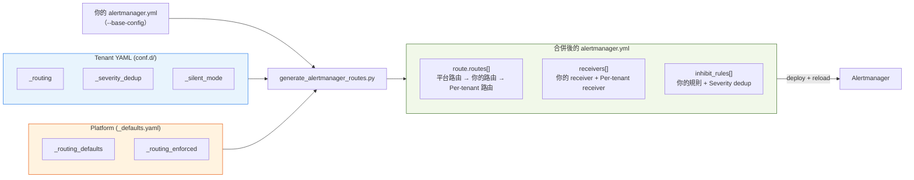
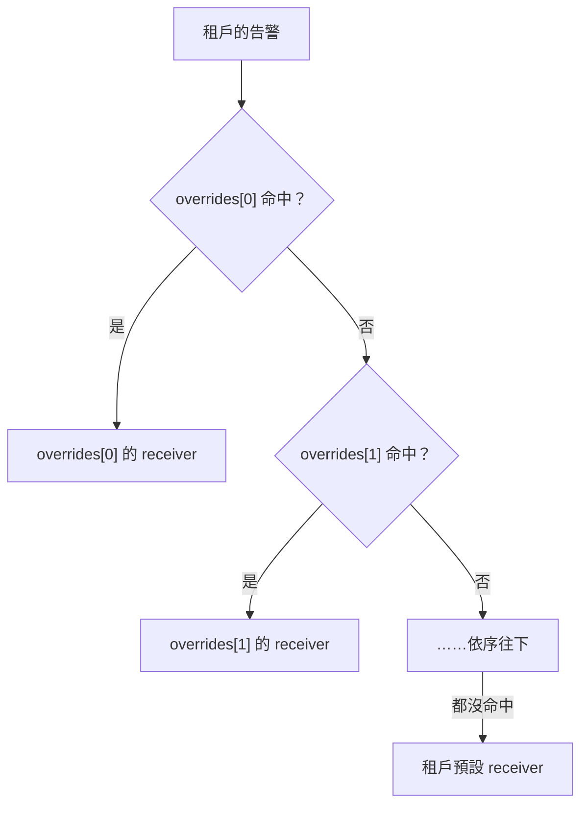

# BYO Alertmanager 整合指南

> **Language / 語言：** **中文 (Current)** | [English](./byo-alertmanager-integration.en.md)

> **版本**：v2.9.0
> **受眾**：Platform Engineers、SREs
> **前置文件**：[BYO Prometheus 整合指南](byo-prometheus-integration.md)

---

## 1. 概述

告警疲勞的四大根因與對應解法：

| 根因 | 解法 | 機制 | 配置來源 |
|------|------|------|----------|
| 備份/維護期間假陽性風暴 | **Silent Mode** | Sentinel alert → inhibit_rules 攔截通知（TSDB 有紀錄） | `_silent_mode` |
| 計畫性維護忘記關閉 | **Maintenance Mode** | `maintenance: mute` 的告警在 PromQL 層不觸發，不是全部（[範圍](../design/config-driven.md#27-三態運營模式-operational-modes)；可設 `expires` 自動失效） | `_state_maintenance` |
| Warning + Critical 重複告警 | **Severity Dedup** | 一條涵蓋所有租戶的 inhibit rule（同租戶、同 `metric_group` 配對；`disable` 的租戶在排除清單） | `_severity_dedup` |
| 通知目的地寫死在中央 | **Alert Routing** | Per-tenant route + receiver（6 種 type） | `_routing` |

Silent Mode 和 Maintenance Mode 均支援結構化物件設定，含 `expires`（RFC3339，如 `"2099-04-01T00:00:00Z"`；解析不了時印 WARN 並忽略這筆設定——不靜音、maintenance 不生效）自動失效和 `reason` 欄位，防止「設了忘記關」。

> 上表是 **BYO 整合情境的速查視角**。完整的告警最佳實務（該對什麼告警 → 通知 → 動作層冪等）見系列文章：[告警設計入門](../alerting-design-fundamentals.md) · [Actionable 之後](../alerting-best-practices.md)。

所有 Alertmanager 路由設定由 `generate_alertmanager_routes.py` 從 tenant YAML 自動產出，並合併進你自己的 Alertmanager 設定（來源），輸出另一份產物、不回寫來源：



---

## 2. 整合步驟

### Step 1: 確認 Alertmanager 的 Reload 端點可達

**不需要任何 flag。** Alertmanager 的 `/-/reload` 是**無條件啟用**的（POST；GET 回 405），沒有開關。

```yaml
args:
  - "--config.file=/etc/alertmanager/alertmanager.yml"
  - "--storage.path=/alertmanager"
```

> ⛔ **不要加 `--web.enable-lifecycle`**（本文舊版曾這樣寫，#1243 更正）。那是 **Prometheus** 的
> flag，Alertmanager 沒有；v0.33.1 實測會直接
> `alertmanager: error: unknown long flag '--web.enable-lifecycle'` 退出——加了它，
> Alertmanager 根本起不來。
>
> ⚠️ 反過來說，`/-/reload` 既然關不掉且**無認證**，就必須用 NetworkPolicy 擋掉**叢集內
> 其他 Pod** 對 9093 的存取，或用 auth proxy 擋在前面。⛔ 注意 NetworkPolicy 的作用點：
> 同 Pod 內的 sidecar 走 loopback、共用同一個 network namespace，那段流量不經
> NetworkPolicy——它保護的是 pod-to-pod，做不到「只放行本 Pod 內某個容器」。
>
> ⚠️ 同一個誤解的另一半：**Alertmanager 也沒有 `/-/quit`**（v0.33.1 實測回 404、行程續活），
> 那同樣是 Prometheus 的端點。Alertmanager 這側真正暴露的只有 `/-/reload`。

驗證：

```bash
kubectl port-forward svc/alertmanager 9093:9093 -n monitoring &
curl -sf http://localhost:9093/-/ready && echo "ready OK"
# 本步驟真正要證的是 reload 通路——/-/ready 綠不代表 /-/reload 打得通：
curl -sf -X POST http://localhost:9093/-/reload && echo "reload OK"
```

### Step 2: Ensure Prometheus is Connected to Alertmanager

```yaml
# prometheus.yml
alerting:
  alertmanagers:
    - static_configs:
        - targets:
            - "alertmanager.monitoring.svc.cluster.local:9093"
```

### Step 3: Configure Tenant Routing Config (設定 Tenant Routing)

在 tenant YAML 中定義 `_routing` section：

```yaml
# conf.d/db-a.yaml
tenants:
  db-a:
    mysql_connection_usage_percent: "70"
    _routing:
      receiver:
        type: "webhook"
        url: "https://webhook.example.com/alerts"
      group_by: ["alertname", "severity"]
      group_wait: "30s"
      repeat_interval: "4h"
```

### Step 4: 驗證 tenant 設定

```bash
# 驗證整棵 conf.d（CI 跑 --strict）
da-tools generate-routes --config-dir conf.d/ --validate --strict

# 驗證 + webhook domain allowlist 檢查
da-tools generate-routes --config-dir conf.d/ --validate --strict --policy .github/deployment-policy.yaml
```

`--validate` 不寫任何東西。產生器的輸出一律是**合併後的完整 Alertmanager 設定**，沒有「只產片段、自己貼」的模式：不帶模式旗標（只帶 `-o`、只帶 `--dry-run`）是結束碼 2。⚠️ v2.9.0 映像仍會在不帶模式旗標時輸出片段 <!-- image-caveat: v2.9.0 -->

> **為什麼不再提供片段**（[#1211](https://github.com/vencil/Dynamic-Alerting-Integrations/issues/1211)）：舊版片段的檔頭要你把它接在自己的子 route **後面**。但片段裡有 4 條平台路由（Watchdog 心跳、custom alert 隔離、synthetic probe、sentinel sink）必須排在最前面——接在後面時，你自己的 catch-all 子 route 先接走它們：Watchdog 心跳進了你的預設頻道（外部 dead-man's switch 收不到）、custom alert 與 sentinel 告警叫醒你的 NOC。改由產生器自己合併才排得對。

### Step 5: Merge into Alertmanager ConfigMap

產生器把 tenant 路由合併進**你自己的** Alertmanager 設定。三種輸出模式共用同一個合併，依部署方式選一個：

**模式 A：`--output-alertmanager`（Kubernetes 以外的 BYO Alertmanager，或 Prometheus Operator 的 configSecret）**

```bash
# 來源：你自己的設定，另外保管（例如放 git）；第一次可從現有設定複製
cp /etc/alertmanager/alertmanager.yml alertmanager.base.yml

# 先預覽
da-tools generate-routes --config-dir conf.d/ --output-alertmanager \
  --base-config alertmanager.base.yml --dry-run

# 寫出合併後的 alertmanager.yml（產物），部署到 /etc/alertmanager/ 後 reload（Step 6）
da-tools generate-routes --config-dir conf.d/ --output-alertmanager \
  --base-config alertmanager.base.yml -o alertmanager.yml
```

之後 conf.d 改了，拿同一份 `alertmanager.base.yml` 再跑；要改你自己的設定也改它，不要改部署出去的 `alertmanager.yml`。

**模式 B：`--output-configmap`（GitOps PR flow，v1.10.0）**

```bash
# 產出合併後的完整 ConfigMap YAML
da-tools generate-routes --config-dir conf.d/ --output-configmap \
  --base-config base-alertmanager.yaml -o deploy/alertmanager-configmap.yaml

# 檔案進 Git → PR review → merge → ArgoCD/Flux 自動 sync
git add deploy/alertmanager-configmap.yaml && git commit -m "update AM routes"
```

**模式 C：`--apply`（Runtime 直接操作，v1.4.0）**

```bash
# 以 ConfigMap 的 alertmanager.base.yml（來源）渲染 + apply + reload
da-tools generate-routes --config-dir conf.d/ --apply --yes
```

適合：初次部署測試、P0 緊急修復、不走 GitOps 的環境。它不讀 `--base-config`，來源在叢集上：ConfigMap 的 `alertmanager.base.yml` key 存來源，`--apply` 以它渲染，寫回 `alertmanager.yml`（產物）與 `alertmanager.base.yml`（來源）；Alertmanager 會忽略多出來的檔。第一次 `--apply`（還沒有這個 key）採用現有的 `alertmanager.yml` 當來源；它若已經是先前產生的（第一行是 `# GENERATED by da-tools generate-routes` 標記，或含 `tenant-*` receiver），結束碼 1、不套用，請先把你的來源放進 `alertmanager.base.yml`。⚠️ 升級時：舊版 `--apply` 寫進去的 `alertmanager.yml` 沒有標記行；conf.d 若沒有任何 `_routing`／`_routing_enforced`，裡面也沒有 `tenant-*` receiver，但裡面有當時產生器寫出的 per-tenant dedup 規則，第一次 `--apply` 會因此結束碼 1、不套用（訊息點名 ConfigMap 與 `alertmanager.base.yml`）——第一次跑之前先把你自己的設定（不含產生器寫出的 dedup 規則）放進 `alertmanager.base.yml`（[#3899](https://github.com/vencil/Dynamic-Alerting-Integrations/issues/3899)）。要改設定請改 `alertmanager.base.yml`，不要改 `alertmanager.yml`——下一次 `--apply` 會從來源重新渲染它。⚠️ **行為變更**：`--apply` 先前整個取代叢集上的 `route.routes`，你手加的子 route 會消失；現在與另外兩種模式是同一個合併，你的路由保留。v2.9.0 映像仍是舊行為 <!-- image-caveat: v2.9.0 -->

**合併規則**（三種模式相同；完整說明見 [CLI 參考 §generate-routes](../cli-reference.md#generate-routes)）：

- **來源與產物分開**：輸出＝合併（來源 base, conf.d）。base 是你自己的設定，不是本工具先前產生的輸出；輸出是另一份產物，不能再拿來當 base（同 Prometheus Operator：讀使用者的 Secret、寫到另一個 `<name>-generated` Secret，從不回寫）。你自己的路由、receiver、inhibit rule、`global:`、root route 原樣保留，加上這次產生的。
- **順序**：`route.routes` 變成「平台 4 條 + enforced NOC 路由（`continue: true`）」→「你的路由，原順序」→「租戶路由」。平台路由在你的路由之前，所以你的 catch-all 搶不走 Watchdog；租戶路由在你的路由之後。有 `{{tenant}}` enforced routing 時，你的路由與租戶路由收在一條送往你 root receiver 的上層路由底下（代替 root 兜底，見 [CLI 參考](../cli-reference.md#generate-routes)）。
- **可重複執行**：conf.d 改了就拿**同一份來源**再跑一次。每次都從來源重新渲染，移除的租戶不殘留。
- **base 不能是輸出**：產物第一行是 `# GENERATED by da-tools generate-routes` 註解；base 帶這一行，或出現 `tenant-*`、`platform-enforced*` receiver（只有產生器會寫的名稱）⇒ 結束碼 1、不寫檔，訊息說這看起來是本工具的輸出、請給來源；你自己的 receiver 也不要取這兩種名字。`-o` 與 `--base-config` 指向同一個檔 ⇒ 結束碼 2。四個平台 receiver 可以寫在你的 base，完整定義（例如 `watchdog-heartbeat` 接了 dead-man's switch）優先；base 裡送往它們的頂層路由視為平台的，以標準形式只輸出一次、排在最前面。
- **從 fragment 模式遷移（一次性）**：base 裡貼過 fragment 的（含 `tenant-*` receiver）會被拒收。把貼進去的部分刪掉，留下你自己原本的設定當來源。
- **Watchdog 要接出去**：你的 base 裡 `watchdog-heartbeat` 沒有 integration 時，輸出模式印 `watchdog_undelivered` WARN，加 `--strict` 時結束碼 1、不寫檔。接法見[告警平面自我存活性](alerting-plane-self-liveness.md)。⚠️ v2.9.0 映像不報這項 <!-- image-caveat: v2.9.0 -->

不提供 `--base-config` 時合併進內建 placeholder base（`resolve_timeout: 5m`、`group_by: [alertname, tenant]`、空的 `default` receiver）——那不是你的設定，BYO 部署請一律帶 `--base-config`。

⚠️ **`--base-config` 必須是 Alertmanager 收得下的完整設定**（[#3206](https://github.com/vencil/Dynamic-Alerting-Integrations/issues/3206)）：要有 `route:` 與它指名的 `receivers:`；`global:`、`inhibit_rules:` 可以省略、會補內建值。generator 以 Alertmanager 自己的載入函式（`da-read alertmanager`）讀 base，少了 `route:` 或 receivers 就拒收、結束碼 2，訊息是載入函式的原話——不會再補一個內建的 route。

⚠️ **v2.10.0 起「提供了但用不了」不再等於「沒提供」（BREAKING，[#1616](https://github.com/vencil/Dynamic-Alerting-Integrations/issues/1616)）**：上面範例的 `--base-config` 是相對路徑。舊行為是——路徑打錯、指到目錄、檔案是空的或只有註解，都**結束碼 0 並靜默改用內建預設值**，產出的 ConfigMap 與完全不提供這個旗標**逐位元組相同**；你的 `global:`（SMTP smarthost、Slack webhook）就這樣被換掉並被 ArgoCD/Flux sync 進叢集。新行為是**結束碼 2 並指名這個旗標**。⛔ 正確的處置是修路徑，不是拿掉 `--base-config`——拿掉的結果與舊的錯誤行為相同。另外 `--base-config` 只有 `--output-configmap` 與 `--output-alertmanager` 會讀它（`--validate` 會在組裝設定之前就返回，`--apply` 的 base 是叢集上的設定），用在其他模式現在也是結束碼 2 而不是被靜默忽略。

**模式比較：**

| | `--output-alertmanager` | `--output-configmap` | `--apply` |
|---|---|---|---|
| 操作方式 | 產出 `alertmanager.yml` | 產出 ConfigMap YAML 檔案 | 直接修改 K8s ConfigMap |
| base 來源 | `--base-config` | `--base-config` | ConfigMap 的 `alertmanager.base.yml`（第一次為現有的 `alertmanager.yml`） |
| 適用流程 | Kubernetes 以外的 Alertmanager | Git PR → review → GitOps sync | CLI 手動操作 / 緊急修復 |
| 是否需要 K8s 連線 | 否 | 否（純文件產出） | 是（kubectl context） |
| Alertmanager reload | 部署後自行觸發（Step 6） | GitOps sync 後由 sidecar/webhook 觸發 | `--apply` 自動觸發 |
| 可審計性 | 看你怎麼部署 | 完整 Git history | 無 Git 紀錄 |

> **注意**：三種模式（與 `--validate`）互斥，一次只能帶一個。`--namespace` / `--configmap` 只有 `--output-configmap` 與 `--apply` 讀，配 `--output-alertmanager` 是結束碼 2。

三種模式都會先把要寫出／套用的 `alertmanager.yml` 交給 Alertmanager 自己的設定載入器（`da-read`）；拒收就結束碼 1、不寫檔也不 apply，PATH 上有沒有 `amtool` 不影響結論（#3689、#3793）。`--validate` 走同一道閘門，但它組的是**內建預設 base** 而不是你的 base（#2260），所以要驗你自己的 base 仍得跑 `--output-alertmanager --base-config ... --dry-run`（或 `--output-configmap`）。`--apply` 的 reload 失敗是結束碼 2（#2219）。⚠️ v2.9.0 映像沒有 `da-read`，其 `--validate` 不經這道閘門 <!-- image-caveat: v2.9.0 -->

### Step 6: Reload Alertmanager

```bash
# HTTP reload（Alertmanager 無條件提供此端點，不需 flag）
curl -X POST http://localhost:9093/-/reload

# 驗證 reload 成功
curl -sf http://localhost:9093/-/ready && echo "Alertmanager ready"
```

---

## 3. generate_alertmanager_routes.py Tool

### 功能

讀取 `conf.d/` 所有 tenant YAML，掃描 `_routing` 和 `_severity_dedup` 設定，產出 route、receiver、inhibit rule，合併進 base 設定（你自己的設定，即來源）後輸出完整、合法的 Alertmanager 設定，見 Step 5。⚠️ Severity dedup 的 inhibit rule 由本工具產生（一條，`_severity_dedup: disable` 的租戶在它的 `tenant!~` 排除清單裡），**不要**寫進 base：base 裡若有路由產生器自己寫出的 severity dedup 規則（現在的全域形狀，或 #3899 之前的 per-tenant 形狀；比對以產生器重建後的 matcher 集合為準：matcher 的空白、順序、引號、一個元素寫多個 matcher、舊式 `*_match` 不影響，但 `tenant!~` 排除清單須是產生器的寫法（排序、去重））會被拒收（結束碼 1、不寫檔），因為它會原樣進到輸出、蓋過 conf.d 的 `_severity_dedup`（含 `disable`）。運維在 base 自己寫的 inhibit 規則屬於運維政策：dedup 守衛不判，即使它會蓋過 `_severity_dedup`（含 `disable`）；Watchdog 不得被抑制、platform 告警不得被租戶規則靜音、`equal` 標籤要有存在性 gate 等其他不變式照常適用（[#3899](https://github.com/vencil/Dynamic-Alerting-Integrations/issues/3899)）。

### 模式

模式旗標恰好一個，不帶是結束碼 2：

| Flag | 說明 |
|------|------|
| `--validate` | 驗證配置合法性（exit 0/1，適合 CI），不寫任何東西 |
| `--output-alertmanager` | 產出合併後的純 `alertmanager.yml`，適合 Kubernetes 以外的 BYO Alertmanager 或 Prometheus Operator 的 configSecret |
| `--output-configmap` | 產出合併後的完整 ConfigMap YAML，適合 GitOps PR flow |
| `--apply [--yes]` | 合併進叢集上的 Alertmanager ConfigMap + reload（`--yes` 跳過確認） |

其他旗標：

| Flag | 說明 |
|------|------|
| `--base-config FILE` | 搭配 `--output-alertmanager` / `--output-configmap`：你的 Alertmanager 設定，產生的路由合併進去 |
| `-o FILE` | 搭配 `--output-alertmanager` / `--output-configmap`：寫入指定檔案（預設 stdout） |
| `--dry-run` | 搭配 `--output-alertmanager` / `--output-configmap`：預覽輸出，不寫入檔案 |
| `--policy FILE` | 載入 `allowed_domains` 做 webhook URL 合規檢查 |
| `--strict` | 把可升級的 WARN 升為 ERROR 並結束碼 1（CI 用） |

### Timing Guardrails

平台強制的 timing 範圍，超限自動 clamp：

| 參數 | 最小值 | 最大值 | 預設值 |
|------|--------|--------|--------|
| `group_wait` | 5s | 5m | 30s |
| `group_interval` | 5s | 5m | 5m |
| `repeat_interval` | 1m | 72h | 4h |

時長的寫法以 Alertmanager 為準（`tenant-config.schema.json` 的 `definitions.duration`）：整數加單位、由大到小、每個單位最多一次（`y`、`w`、`d`、`h`、`m`、`s`、`ms`），或單獨一個 `0`——`1h30m`、`90m`、`1d` 都可以。Alertmanager 不接受的寫法（`1.5h`、`30m1h`、`1ns`）由產生器換成平台預設值並印 WARN，`generate-routes --validate` 與 `validate-config` 回 1；exporter 忽略該值（[#2490](https://github.com/vencil/Dynamic-Alerting-Integrations/issues/2490)）。

---

## 4. 動態 Reload

### 機制

透過 Alertmanager 原生、無條件啟用的 `/-/reload` 端點實現 HTTP reload（不需 flag）：

```bash
# 更新 ConfigMap 後
curl -X POST http://alertmanager:9093/-/reload
```

### 自動化選項

| 方案 | 說明 | 適用場景 |
|------|------|----------|
| **HTTP reload** | `curl -X POST /-/reload` | 最小侵入，適合自管 Alertmanager |
| **ConfigMap Watcher Sidecar** | 類似 `prometheus-config-reloader` | 全自動，適合生產環境 |
| **CI Pipeline 整合** | GitOps: `generate-routes --validate` + apply + reload | 適合 GitOps 工作流 |
| **GitOps ConfigMap 產出** | `generate-routes --output-configmap` 產出完整 ConfigMap YAML 進 Git PR flow | v1.10.0+，取代 `--apply` 直操作 |
| **Alertmanager Operator** | `generate-routes --output-alertmanager` 的輸出放進 Secret，由 Alertmanager CR 的 `spec.configSecret` 載入（Operator 自己 reload） | 適合已使用 Operator 的環境 |

---

## 5. Receiver 類型

v1.4.0 支援六種 receiver 類型。以 Webhook 為例：

```yaml
_routing:
  receiver:
    type: "webhook"
    url: "https://webhook.example.com/alerts"
    send_resolved: true  # optional: send resolved alerts
```

其他五種 receiver 類型快速參考（各類型的必填欄位以 [`tenant-config.schema.json`](../schemas/tenant-config.schema.json) 為準）：

| 類型 | 範例 |
|------|------|
| **Email** | `to: ["team@example.com"]`, `smarthost: "smtp.example.com:587"`, `from: "alertmanager@example.com"` |
| **Slack** | `api_url: "https://hooks.slack.com/..."`, `channel: "#alerts"` |
| **Microsoft Teams** | `webhook_url: "https://outlook.office.com/webhook/..."` |
| **Rocket.Chat** | `url: "https://chat.example.com/hooks/xxx/yyy"` |
| **PagerDuty** | `routing_key: "key-123"`, `severity: "critical"` |

PagerDuty 的 `routing_key` 與 `service_key` 兩個都給會被擋：Alertmanager 會走 v1 並忽略 `routing_key`。

必填欄位的值也會檢查格式（[#2180](https://github.com/vencil/Dynamic-Alerting-Integrations/issues/2180)）：Alertmanager 載入不了其中任何一個 receiver，**整份**設定就 reload 失敗。

- URL 欄位（`url`、`api_url`、`webhook_url`）必須是帶 host 的 `http://` 或 `https://` URL，不含空白。
- `smarthost` 必須是 `host:port`，port 為數字；IPv6 要加方括號，例如 `[2001:db8::1]:25`。
- `to` 寫成清單時，每一項都必須是非空字串。
- 必填欄位給了字串以外的值（清單、數字、布林）一律擋下；例外只有上一條的 `to`，可以寫成清單。
- receiver 的 `type` 必須完全等於上表的小寫名稱，不接受大小寫變化或前後空白。

格式規則以 [`tenant-config.schema.json`](../schemas/tenant-config.schema.json) 的 `receiverHttpUrl`／`receiverSmtpHostPort` 為準；哪些值 Alertmanager 實際接受或拒收，以共享表 `receiver_presence_cases.json` 的 `am` 欄為準（測試以 Alertmanager `config.Load` 實跑斷言）。

所有類型均支援 `send_resolved: true`（預設 false），控制 alert 解除時是否發送通知。

選填欄位的值也會檢查（[#2295](https://github.com/vencil/Dynamic-Alerting-Integrations/issues/2295)）：只擋 Alertmanager 會拒收、導致整份設定 reload 失敗的值，以 Alertmanager 0.34.1 的判定為準。

- `send_resolved`、email 的 `require_tls`、webhook 的 `http_config.proxy_from_environment`：只收布林與空值（視同沒設），寫成未加引號的 `true`／`false`。未加引號的 YAML 1.1 布林字 `yes`／`no`／`on`／`off` 是字串：路由產生器經 `da-guard parse-tree` 以 yaml.v3 讀，同樣拒收，請改寫成 `true`／`false`。加引號的 `"yes"`、`"true"` 以及 `maybe`、`1`、`""` 都擋，路由產生器在所有模式拒收整棵樹（[#2906](https://github.com/vencil/Dynamic-Alerting-Integrations/issues/2906)）。
- webhook 的 `http_config`：空值視同沒設，其餘必須是 mapping。可用的鍵是 Alertmanager 的 `http_config` 鍵扣掉檔案型欄位：`basic_auth`、`oauth2`、`authorization`、`bearer_token`、`tls_config`、`follow_redirects`、`enable_http2`、`http_headers`、`proxy_url`、`no_proxy`、`proxy_from_environment`、`proxy_connect_header`（[#2984](https://github.com/vencil/Dynamic-Alerting-Integrations/issues/2984)）。⚠️ **檔案型欄位一律拒收**（[#3257](https://github.com/vencil/Dynamic-Alerting-Integrations/issues/3257)）：receiver 任何一層（含 `http_config` 底下各層）以 `_file`、`_ref` 結尾的鍵，或名為 `files` 的鍵（例如 `bearer_token_file`、`basic_auth.password_file`、`tls_config.key_file`、`oauth2.client_secret_ref`、`http_headers` 的 `files`），會讓 Alertmanager 讀取它自己容器內的檔案或找它沒有的 secret manager，因此 schema 與路由產生器都拒收，產生器在所有模式下整棵樹拒收（rc 1，什麼都不寫出），tenant-api 寫入回 422。憑證請直接寫值，或改用下方的 [`secretRef`](#憑證放在-secretsecretref)。其他鍵 Alertmanager 會拒收整份設定，validate-config 的 JSON schema 擋下，路由產生器則交給 Alertmanager 的設定載入器（`da-read`）判。`follow_redirects`／`enable_http2` 原樣交給 Alertmanager，請寫不加引號的 `true`／`false`。`tls_config`、`oauth2`、`authorization`、`basic_auth`、`http_headers`、`proxy_connect_header` 的內層照 Alertmanager 的規則判（未知鍵、`oauth2` 缺 `client_id`／`token_url`、`authorization` 的 `type: basic`、保留的 header 名稱如 `Authorization`）；這一層只有 validate-config 的 JSON schema 擋，路由產生器交給 Alertmanager 的設定載入器（`da-read`），da-guard 與 tenant-api 不判。`basic_auth`、`oauth2`、`authorization`、`bearer_token` 最多只能設一個：空值與 `bearer_token: ""` 視同沒設，`basic_auth: {}` 算有設。`bearer_token`／`proxy_url`／`no_proxy` 必須是字串（YAML 會讀成布林、數字或日期的值請加引號）。`basic_auth`、`oauth2`、`authorization`、`tls_config` 底下的字串欄位也一樣：純數字的 `password`、`username`、`client_id`、`client_secret`、`credentials`，或 yaml.v3 會讀成數字、日期的值（`1e3`、`0x1F`、`2024-01-02`），請寫成 `password: "123456"` 這樣加引號。不加引號時 validate-config 的 `yaml_quoting` 列會 FAIL，逐筆列出檔名、欄位路徑和改法（例如 `quote it, without a tag: password: "123456"`），照著補上引號即可。原因是路由產生器與驗證工具（validate-config 與 conf.d 的 lint）都經 `da-guard parse-tree` 以 yaml.v3 讀 conf.d，值是什麼由它解析出的 tag 決定：未加引號的 `0x1F` 是整數 31、`1e3` 是浮點數 1000、`2024-01-02` 是日期，Alertmanager 收到的就不是你寫的那串（[#2906](https://github.com/vencil/Dynamic-Alerting-Integrations/issues/2906)）。
- `http_config.proxy_url`：必須是字串；tenant-api 只擋 Go `net/url` 解析不了的值（例如 `::x`、host 含空白、`%zz`、非法 port），路由產生器則交給 Alertmanager 的設定載入器（`da-read`）判。`proxy_from_environment: true` 不能與非空的 `proxy_url` 或 `no_proxy` 並用；`no_proxy` 需要 `proxy_url`；`proxy_connect_header` 需要非空的 `proxy_url` 或 `proxy_from_environment`。

刻意比 Alertmanager 嚴格的形狀，以共享表 [`receiver_presence_cases.json`](https://github.com/vencil/Dynamic-Alerting-Integrations/blob/main/components/threshold-exporter/app/pkg/receiverspec/testdata/receiver_presence_cases.json) 中標 `strict` 的列為準。

這些規則在 `generate_alertmanager_routes`，以及 tenant-api 的 `PUT /api/v1/tenants/{id}` 與 `POST /api/v1/tenants/{id}/validate` 都一致。tenant-api 對 PUT 回 400 `INVALID_BODY`，validate 回 `valid: false`，都只判 body 自己寫的 receiver。⚠️ 產生器的「擋」分兩種。布林欄位（`send_resolved`、`require_tls`、`proxy_from_environment`）的值型別不對時，所有模式都拒收整棵樹、rc 1、不寫出任何產出（見上方第一項）。其餘規則是印 WARN、略過該租戶的 receiver 與 route，產出照寫、rc 0（加 `--strict` 也一樣）；只有 `--validate` 會以 rc 1 結束，所以 CI 要跑 `--validate`。

### 憑證放在 Secret（`secretRef`）

下列憑證欄位可以不寫值，改寫成 Kubernetes Secret 的參照（[#1560](https://github.com/vencil/Dynamic-Alerting-Integrations/issues/1560)），各自 render 成 Alertmanager 讀檔的那個欄位：

| 欄位 | render 成 | 憑證送往 |
|---|---|---|
| webhook／Rocket.Chat 的 `url`、Slack 的 `api_url`、Teams 的 `webhook_url`、PagerDuty 的 `service_key`／`routing_key` | `<欄位>_file` | 欄位本身 |
| email 的 `auth_password` | `auth_password_file` | `smarthost` |
| webhook `http_config` 的 `basic_auth.password`、`authorization.credentials`、`bearer_token`、`tls_config.key` | `password_file`、`credentials_file`、`bearer_token_file`、`key_file` | `url` |
| webhook `http_config.http_headers.<名稱>.secrets` 的單一項目 | 移到同一個 header 的 `files` | `url` |
| webhook `http_config.oauth2` 的 `client_secret`、`client_certificate_key`、`tls_config.key` | `client_secret_file`、`client_certificate_key_file`、`key_file` | `oauth2.token_url`，以及 `url`（換到的 access token 隨每個請求送往 `url`） |

只有這些位置接參照（產生器與 schema 讀同一張表，`_lib_validation.CREDENTIAL_REF_SITES`）。email 的 `headers`、`http_config` 的其他欄位（`username`、`proxy_connect_header`、`oauth2.claims` 等）在 Alertmanager 沒有對應的 `*_file`，任何一層都不接：參照寫在別處，產生器在 render 之後掃到就擋下該 receiver（`secret_ref_unsupported_field`），不會原樣寫進 Alertmanager 設定。header 的值依 `values`、`secrets`、`files` 的順序送出，所以來自 Secret 的值排在直接寫的值之後。

參照**不寫 Secret 名稱**，只有兩種形狀：

```yaml
_routing:
  receiver:
    type: slack
    api_url: {secret: {key: slack-url}}                    # 租戶自己的 Secret：da-<tenant>
  routes:
    - match: {severity: critical}
      receiver:
        type: webhook
        url: {secret: {shared: corp-alerting, key: url}}   # 共用 Secret：別名列在部署端 policy
```

- **自己的 Secret**：`{secret: {key: <key>}}`。名稱固定是 `da-<tenant>`，由租戶 id 推導；租戶寫不出別的名稱，也就引用不到別的租戶的 Secret。`_routing_defaults` 裡的參照，對每個繼承它的租戶各自推導。`_routing_enforced` 帶 `{{tenant}}` 時，展開出的每條 receiver 也歸該租戶；不帶 `{{tenant}}` 的平台級 receiver 沒有所屬租戶，只能用共用 Secret。
- **共用的 Secret**：`{secret: {shared: <別名>, key: <key>}}`。別名必須列在部署端 policy 檔（`generate-routes --policy`，tenant-api 的 `generator.policy`）的 `shared_secrets`：

  ```yaml
  allowed_domains: ["*.example.com"]
  shared_secrets:
    corp-alerting: {secret: corp-alerting, fields: [api_url, webhook_url, url]}
    corp-smtp: {secret: corp-smtp, fields: [auth_password]}
    corp-hook: {secret: corp-hook, fields: [http_config.basic_auth.password]}
  ```

  `secret` 是實際的 Secret 名稱，不得以 `da-` 開頭（避免與租戶推導出的名稱撞名）。`fields` 列的是**完整欄位路徑**，可以填的值就是上表每一列的路徑（`_lib_validation.CREDENTIAL_REF_SITES`）：第一層欄位照寫（`api_url`、`url`、`auth_password`），`http_config` 底下的寫完整路徑（`http_config.basic_auth.password`、`http_config.oauth2.client_secret`）。header 那一列寫 `http_config.http_headers.*.secrets[]`：`*` 代表任一 header 名稱、`[]` 代表 `secrets` 的任一項，照字面寫，不填實際的 header 名稱或索引；列了它，該別名就能放在任何 header 的 `secrets` 裡。⚠️ BREAKING（[#1560](https://github.com/vencil/Dynamic-Alerting-Integrations/issues/1560) ⑤-b）：以前只比對第一層欄位名，寫一個 `http_config` 就一次開放 8 列；現在 `http_config` 不是任何一列的路徑，整份 policy 不可用（結束碼 `2`），訊息列出它底下可以填的路徑。沒有 policy 檔，或 policy 沒有 `shared_secrets`，就沒有任何共用例外。receiver 只要用了任一共用 Secret，就不能設 `http_config.proxy_url`：代理是租戶自己指定的，會看到送往共用目的地的請求（`secret_ref_proxy_url`）。`shared_secrets` 寫壞（不是 mapping、別名不是 DNS-1123 label、條目不是 `{secret, fields}`、名稱以 `da-` 開頭、`fields` 列了不是上表路徑的值）時整份 policy 不可用，結束碼 `2`。
- **送往 receiver 自填目的地的憑證**（上表「憑證送往」不是欄位本身的那幾列：`auth_password` 與 `http_config` 底下各欄）：目的地是寫 receiver 的人填的，所以
  - 租戶擁有的 receiver（租戶的 `_routing`、`_routing_defaults`、routing profile、帶 `{{tenant}}` 的 `_routing_enforced`）只能用自己的 Secret，共用 Secret 一律拒（`secret_ref_shared_confined`）：否則租戶能把平台的憑證導向自己挑的 host。**沒有所屬租戶的 `_routing_enforced`**（不帶 `{{tenant}}`，只從 conf.d 根目錄的 `_` 開頭檔讀，tenant-api 寫不到）反過來只能用共用 Secret，別名的 `fields` 要列出該欄位路徑，而且下面三條照樣適用：目的地通過 `allowed_domains`、`follow_redirects: false`、不設 `proxy_url`（不能設的是設定本身指定的 proxy，也就是 `proxy_url`；`proxy_from_environment: true` 允許：它讀的是 Alertmanager pod 的 `HTTPS_PROXY` 等環境變數，由平台部署者決定，上游也不允許它與 `proxy_url`、`no_proxy` 同時設定）。例如平台級 SMTP 密碼：

    ```yaml
    # conf.d/_routing_enforced.yaml（根目錄）
    _routing_enforced:
      enabled: true
      receiver:
        type: email
        to: [noc@example.com]
        smarthost: smtp.example.com:587
        from: alertmanager@example.com
        auth_password: {secret: {shared: corp-smtp, key: password}}
    ```

  - policy 必須設了非空的 `allowed_domains`，每個目的地的 host 都在其中（oauth2 那幾欄是 `oauth2.token_url` 與 `url` 兩個都要；URL 類目的地必須以 `http://` 或 `https://` 開頭，`smarthost` 照舊寫 `host:port`）；目的地沒寫、或本身也是參照（看不到 host）就拒（`secret_ref_destination_unconfined`）；
  - 該請求經過的 `proxy_url`（webhook 請求是 `http_config.proxy_url`，token 請求是 `http_config.oauth2.proxy_url`；oauth2 那幾欄兩個都算）不能設（`secret_ref_proxy_url`）：代理不受 `allowed_domains` 約束，`http://` 的請求它整個看得到，`https://` 的請求在同一個 receiver 設了 `tls_config.ca` 或 `insecure_skip_verify` 時它也能攔截；
  - 除了 TLS client key（`tls_config.key`）以外，`http_config` 的憑證都要求 `http_config.follow_redirects` 寫成 `false`（`secret_ref_follow_redirects`）：Alertmanager 預設跟隨 redirect；redirect 到 `url` host 的子網域時，`Authorization`（basic_auth、authorization、bearer_token、oauth2 的 access token）會再送一次，自訂 header 則照送到 redirect 指向的任何 host，兩者都可能送到 `allowed_domains` 沒放行的 host。TLS client key 不會被送出。oauth2 那幾欄要求它，是因為用它們換到的 access token 會隨 webhook 請求的 redirect 再送一次；`follow_redirects` 只管 webhook 請求本身，向 `token_url` 取 token 的請求由另一個 client 送出，不受它影響。
  - ⚠️ **oauth2 取 token 的請求會跟隨 redirect，產生器擋不了**：Alertmanager 向 `token_url` 取 token 用的是另一個 client，會跟隨重新導向；prometheus/common v0.70.1 沒有設定能關掉它，`follow_redirects` 也管不到這個請求。token 端點若回 307／308 導到別的 host，含 `client_secret` 的請求 body 會被重送過去（jwt-bearer grant 重送的是已簽章的 assertion）。這與寫法無關：`client_secret` 寫明文或寫參照風險相同，參照不會放大它，改回明文也不會縮小它。部署端要做的：`token_url` 的 host 必須是你信任、且沒有 open redirect 的 IdP；policy 的 `allowed_domains` 對這個 host 寫精確 host，不要用 wildcard。對照：Prometheus Operator 的 AlertmanagerConfig 讓 `clientSecret` 用 SecretKeySelector，同樣沒有處理這個重送行為。

產生器把參照寫成上表的檔案欄位，值是 `<root>/<secret-name>/<key>`，拿掉原欄位（header 的項目移進 `files`）；`<root>` 預設 `/etc/alertmanager/secrets`，用 `generate-routes --secret-mount-root` 改。違反上面任何一條，該 receiver 不產出，`generate-routes --validate` 非 0、`validate-config` 的 routes 列 FAIL、tenant-api 寫入回 422。URL 欄位是參照時，產生器看不到 host，`allowed_domains` 不檢查它：Secret 由 operator 或 ExternalSecrets 建立，租戶寫不到內容，也指定不了名稱。`test-notification` 讀不到 Secret，這類 receiver 一律 `SKIPPED`、不送出。

⛔ **掛載契約（BYO 必做）**：Alertmanager 容器必須把每個被引用的 Secret 掛在 `<root>/<secret-name>/`，Secret 的每個 key 是其中一個檔案。這與 Prometheus Operator 的 `spec.secrets` 掛到 `/etc/alertmanager/secrets/<name>` 的版面相同；repo 自帶的 `watchdog-heartbeat` 也掛在 `/etc/alertmanager/secrets/watchdog-heartbeat/`：這是 base 的 `url_file` 寫死的路徑，不隨 `--secret-mount-root` 改；改了 root 時，base 的 `url_file` 與這個 Secret 的掛載位置要自己一起改。產生器與 tenant-api 都沒有 Secret 讀權限，看不到 Secret 是否存在。檔案不在時何時失敗，依欄位而定：`http_config.tls_config` 的 `key_file`（與同層的 `cert_file`、`ca_file`）在 Alertmanager 載入或 reload 設定、建立 receiver 時就讀取並驗證，讀不到或內容不合法時整次 reload 失敗、沿用舊設定（啟動時則無法啟動）；其餘檔案，包括 `oauth2` 的 `client_secret_file`、`client_certificate_key_file` 與 `oauth2.tls_config.key_file`，都在送出（oauth2 是第一次取 token）那一刻才讀，失敗的只有那一次通知。`generate-routes` 交給的 Alertmanager 設定載入器（`da-read`）只載入設定、不建立 receiver，兩種都抓不到。

**要掛哪些 Secret**：`generate-routes --output-configmap`（或 `--output-alertmanager`）加 `--secret-mounts-out <檔>`，把產出的設定實際會讀的 Secret 寫成 JSON（`mounts[].name` 與各自的 `keys`，依名稱排序；只有名稱與 key，沒有值），掛載就照它列（[#1560](https://github.com/vencil/Dynamic-Alerting-Integrations/issues/1560)）。清單從產出的設定本身走訪每個 `*_file`、`http_headers` 的 `files` 與頂層 `templates`（template 的 glob 在 Secret 名稱那段時無法對應 Secret，列進 `other_files`；只在 key 那段時列名稱、不列 key），所以 base 自己的（例如 `watchdog-heartbeat`）也在內；`<root>` 以外的路徑列在 `other_files`，要另外提供。`--apply` 不寫清單：用同一份 conf.d 與來源跑一次 `--output-configmap --secret-mounts-out` 取得。格式與規則見 [cli-reference §generate-routes](../cli-reference.md#generate-routes)；Prometheus Operator 路徑另有 `operator-check --secret-mounts` 拿它比對 `spec.secrets`（[Operator 整合](operator-alertmanager-integration.md)）。

### 憑證不收明文（BREAKING）

[#1560](https://github.com/vencil/Dynamic-Alerting-Integrations/issues/1560) ⑤-b 起，產生器拒收寫出來的憑證值。判定只有一個函式（`_lib_validation.plaintext_credential_findings`），看的是**每個檔裡寫的原始值**，不是合併後的結果，所以沒有租戶綁定的 routing profile、被租戶蓋掉的 `_routing_defaults`、沒有任何 plane 讀的位置也都會判：

| 位置 | 寫出值的時候 |
|---|---|
| 上表除了 webhook `url` 以外的每一列 | 拒收，只收參照 |
| webhook `url` | 收；帶 userinfo（`user:pass@`、只有 `user@` 也算）時拒收：把憑證移到 `http_config` 的 `basic_auth`／`authorization` 並寫成參照 |
| `http_config.proxy_connect_header`、`http_config.oauth2.proxy_connect_header` | 出現就拒收，不論值 |
| `http_config.proxy_url`、`http_config.oauth2.proxy_url` | 帶 userinfo 時拒收 |
| email `headers`、`http_headers.<名稱>.values`、`oauth2.endpoint_params`、`oauth2.claims` | 收（讀取端照樣遮罩） |

代理憑證沒有參照寫法（Alertmanager 的 `proxy_connect_header` 沒有檔案形式，`proxy_url` 的 userinfo 會被 Go 轉成 `Proxy-Authorization` 送出）。需要代理認證時，平台在 Alertmanager pod 以 Secret 帶入 `HTTPS_PROXY`（例如 `env: [{name: HTTPS_PROXY, valueFrom: {secretKeyRef: {name: egress-proxy, key: url}}}]`），租戶的 receiver 只寫 `http_config.proxy_from_environment: true`。

每一處都是產生器的 finding（kind `credential_plaintext`），行內只寫檔名、位置與類別（`needs_reference`、`userinfo`、`proxy_credential`），不印值。判定讀不了的 receiver 同樣擋下（kind `credential_unjudged`）：`type` 不是已知型別（`Slack`、空字串、沒寫、不是字串）、receiver 不是 mapping、`overrides`／`routes` 不是 list、其中一項不是 mapping，以及 routing 區塊（`_routing`、`_routing_defaults`、`_routing_enforced`、`routing_profiles`）裡任何 receiver 形狀的值（`receiver` 鍵的值，或 `type` 是已知型別的 mapping）不在走訪器讀的位置上（區塊寫成 list、巢狀 `routes`、產生器不讀的鍵；reason `not_walked`）。讀不了的檔本來就讓產生器拒收整棵樹。租戶自己 `_routing` 裡的這幾種形狀錯誤，render 也會另外報（`unknown_receiver_type`、`invalid_override_entry` 等），同一處可能有兩行：寧可兩行也不要零行（被另一個檔蓋掉的 `_routing` 不會被 render）。檔案頂層的 `_routing`（沒有任何 plane 讀）也判。

- `generate-routes --validate` 結束碼 `1`；`validate-config` 的 routes 列 FAIL。只 render 的模式（`--output-configmap` 等）印出 `ERROR (credential)` 行、不改結束碼，所以 CI 要跑 `--validate`。
- tenant-api 經產生器容器判定，回 422 `GENERATOR_FINDINGS`。擋不擋看**被寫入的那個檔**：這筆寫入改到的檔裡有明文就擋（包括這筆寫入沒碰到、原本就在那個檔裡的）；其他檔裡的明文只是 NOTICE，不擋這筆寫入，交給整棵樹的 CI 擋（與 [ADR-038](../adr/038-unread-keys-judged-by-readers.md) 決定 5、6 對鍵名判決的分法相同）。

**遷移步驟**

1. 跑 `da-tools migrate-credentials --config-dir conf.d`（加 `--manifests-out <repo 外的目錄> --write` 套用）：租戶自己 `_routing` 裡的明文改寫成 `{secret: {key: …}}`，並為每個租戶寫一份 `da-<tenant>` Secret。平台位置（`_routing_defaults`、profile、平台級 `_routing_enforced`）的明文列給人決定，依上面的寫法手動改成參照。
2. 待輪替清單上的每個值都已進過 git，照 [secret-leak-remediation-sop](../internal/secret-leak-remediation-sop.md) 輪替。
3. policy 的 `shared_secrets.<別名>.fields` 改寫成完整欄位路徑（見上）。
4. 代理認證改走 Alertmanager 的 `HTTPS_PROXY`，receiver 寫 `proxy_from_environment: true`。

### 訊息模板（Go Template）

Slack、Teams、Email 的 `title` / `text` / `html` 欄位支援 Alertmanager Go template 語法。以 Slack 為例：

```yaml
_routing:
  receiver:
    type: "slack"
    api_url: {secret: {key: slack-url}}
    channel: "#db-alerts"
    title: '{{ .Status | toUpper }}: {{ .CommonLabels.alertname }}'
    text: >-
      *Tenant*: {{ .CommonLabels.tenant }}
      *Severity*: {{ .CommonLabels.severity }}
      {{ range .Alerts }}
        - {{ .Annotations.summary }}
      {{ end }}
```

Email 和 Teams 使用相同的 Go template 語法，僅欄位名稱不同：
- Email：`html` 欄位（HTML 格式）
- Teams：`text` 欄位（Markdown 格式）

**可用變數：** `.CommonLabels.alertname`, `.CommonLabels.tenant`, `.CommonLabels.severity`, `.CommonAnnotations.summary`, `.CommonAnnotations.description`, `.Status`, `.Alerts`（支援 `{{ range }}` 迴圈）。詳見 [Alertmanager 官方範本](https://prometheus.io/docs/alerting/latest/notifications/)

---

## 6. 驗證 Checklist

### 工具驗證

```bash
# 1. 預覽合併後的 alertmanager.yml（dry-run，不寫檔）
da-tools generate-routes --config-dir /data/conf.d --output-alertmanager \
  --base-config /data/alertmanager.yml --dry-run

# 2. 驗證配置合法性
da-tools generate-routes --config-dir /data/conf.d --validate

# 3. 檢查 Alertmanager 狀態
curl -sf http://localhost:9093/-/ready

# 4. 查看當前 alert 狀態
curl -sf http://localhost:9093/api/v2/alerts | python3 -m json.tool
```

> **自動化驗證**：`da-tools byo-check alertmanager` 可一鍵執行上述所有 Alertmanager 驗證項目。
>
> 其中 `alertmanager_inhibit_semantics` 檢查會分析你的 `inhibit_rules` 的**抑制語意**（非只是語法——`amtool check-config` 對語意錯誤全綠）：對每條規則，若 `equal:` 列的 label 在 source／target matcher 都未被 presence-gate（如 `metric_group=~".+"`），且該規則的 source 告警**實際不帶**該 label，就會告警。這正是 [#1132](https://github.com/vencil/Dynamic-Alerting-Integrations/pull/1132) 的坑：Alertmanager 把「兩側皆缺該 label」視為相等，會讓抑制規則失效並**靜默吃掉**不相干的通知。此檢查以你 Alertmanager 當下的**實際告警 label** 佐證，故最好在有代表性告警觸發時執行；查無佐證時只給 advisory 提示、不影響 exit code。修法：讓 source 帶該 label、從 `equal:` 移除、或在兩側 matcher 加 `<label>=~".+"` 閘門。

### 功能驗證

--8<-- "docs/includes/verify-checklist.md"

**Alertmanager 整合專項：**

- [ ] `generate-routes --validate` exit code 0
- [ ] Alertmanager 載入合併後的配置無錯誤
- [ ] Silent/Maintenance 的 `expires` 到期後自動恢復
- [ ] Severity Dedup enabled tenant 的 warning 在 critical 觸發時被抑制
- [ ] Custom routing tenant 的 alert 送達指定 receiver
- [ ] Per-rule override 的 alert 送達指定的 override receiver

---

## 7. Per-Rule Routing Overrides

在進階場景中，某些特定警報可能需要不同的路由策略。Tenant YAML 的 `_routing.overrides[]` 支援 per-alertname 或 per-metric_group 指定自訂 receiver：

### 配置範例

```yaml
# conf.d/db-a.yaml
tenants:
  db-a:
    mysql_connection_usage_percent: "70"
    _routing:
      receiver:
        type: "slack"
        api_url: {secret: {key: slack-default}}
        channel: "#db-alerts"

      # 特定警報的路由覆寫
      overrides:
        - alertname: "MariaDBHighConnections"
          receiver:
            type: "pagerduty"
            service_key: {secret: {key: pagerduty-urgent}}

        - metric_group: "mysql_replication_lag"
          receiver:
            type: "email"
            to: ["dba-team@example.com"]
            smarthost: "smtp.example.com:587"
            from: "alerting@example.com"
```

### 優先級：依列表順序，第一個命中的生效

每個 override 只能指定 `alertname` 或 `metric_group` 其中一個。`generate_alertmanager_routes.py` 把 overrides **照你寫的順序**展開成子路由，而且不帶 `continue`。所以 Alertmanager 由上往下比對時：

- **第一個命中的 override 生效**，後面的不再比對，也不會再送到租戶預設 receiver
- 用 `alertname` 還是 `metric_group` 比對，**不影響先後**，只看它在列表裡的位置
- 一個都沒命中，才走租戶預設 receiver



⚠️ 一個告警可能同時命中 `alertname` 那條與 `metric_group` 那條（它的名字對上、所屬群組也對上），這時排在前面的那條生效。**要讓某個 alertname 壓過它所屬的 metric_group，就把它寫在前面。**

這些子路由掛在租戶主 route 底下：override 沒寫的 `group_wait` / `group_interval` / `repeat_interval` / `group_by` 沿用租戶 `_routing` 的值，不是 root route 的值。

---

## 8. Platform Enforced Routing

Platform Team 可在 `_defaults.yaml` 設定強制路由，確保 NOC 必收所有 tenant 的告警（與 tenant 自訂路由並行，雙軌通知）：

**模式 A：統一 NOC 接收**

```yaml
# conf.d/_defaults.yaml
_routing_enforced:
  enabled: true
  receiver:
    type: "webhook"
    url: "https://noc.example.com/alerts"
  match:
    - 'severity="critical"'     # ⚠️ 必須是 matcher 字串的 list
```

> ⚠️ **`match` 只接受 list-of-matcher-strings**。寫成 map 形式（`match:` / `  severity: "critical"`，即 `routes[i].match` 的寫法）、單一字串、數字，或 list 裡有不是非空字串的元素（`[1]`、`[~]`、`['']`、`[{severity: critical}]`）時，產生器**不產出**這條 enforced route，印 `WARN: _routing_enforced in <檔案>: 'match' must be a list of Alertmanager matcher strings … skipping`，`--validate` 與 `validate-config` 回 1（da-guard 自 [#2904](https://github.com/vencil/Dynamic-Alerting-Integrations/issues/2904) 起不判，列為未判定；[#2989](https://github.com/vencil/Dynamic-Alerting-Integrations/issues/2989)）。⛔ render、`--output-configmap`、`--apply` 照常產出、結束碼不變，而此時**這個區塊不產出 NOC 路由**（不是收全部）——部署前務必跑 `--validate`。名稱順序上較早的根目錄 `_` 檔若已啟用 `_routing_enforced`，該區塊照常生效。先前這種寫法會被**靜默丟棄**——route 沒有任何 matcher，加上固定的 `continue: true`，成了一條 **match-all 消防水管**：所有租戶的所有告警全被雙送進該 receiver。⚠️ v2.9.0 映像仍是靜默丟棄、`--validate` 回 0 <!-- image-caveat: v2.9.0 -->。省略 `match`（或寫 null）照舊是不加 matcher。範本見 [`conf.d/_defaults.yaml`](https://github.com/vencil/Dynamic-Alerting-Integrations/blob/main/components/threshold-exporter/config/conf.d/_defaults.yaml) 的註解區塊。

**模式 B：Per-tenant 獨立通道**

當 receiver 欄位包含 `{{tenant}}` 佔位符，系統自動為每個 tenant 建立獨立的 enforced route。Platform 可藉此為各 tenant 建立專屬通知通道，tenant 無法拒絕也無法覆寫。「每個 tenant」指產生器讀到的每個租戶（`_severity_dedup` 的判定也是對這一群；但 severity dedup 的 inhibit rule 不列舉租戶，它涵蓋任何帶 `tenant` 標籤的告警，只排除設 `disable` 的租戶，所以範圍與這裡不同）：沒有 `_routing` 的租戶（只寫閾值、只設 `_silent_mode`）也有，寫 `_routing: disable` 或 `_routing` 被拒收的租戶同樣有——租戶無法用它退出這條通道；tenant id 不合法的租戶例外，產生器會整棵樹拒收。合併時其餘路由收在 enforced route 之後一條送往 root receiver 的上層路由底下，所以沒有 tenant route 的租戶，告警在你的路由都沒命中時照樣送到 root（命中你的路由時——含 `continue: true` 的——就照那條路由送，不再多送 root 一份），enforced 通道是額外多送的一份。Silent mode 由 base config 的 TenantSilent inhibit rule 壓制（內建 base 不含，需以 `--base-config` 帶入），與 route 無關。route 數因此隨租戶數線性增加（[#2519](https://github.com/vencil/Dynamic-Alerting-Integrations/issues/2519)）：

```yaml
# conf.d/_defaults.yaml
_routing_enforced:
  enabled: true
  receiver:
    type: "slack"
    api_url: {secret: {shared: noc-slack, key: url}}   # 共用 Secret：policy shared_secrets 的 noc-slack 列出 api_url
    channel: "#alerts-{{tenant}}"    # → #alerts-db-a, #alerts-db-b, ...
```

模式 A 產生單一共用 platform route；模式 B 產生 N 個 per-tenant route（各帶 `tenant="<name>"` matcher + `continue: true`）。預設不啟用。

> 上面兩個模式談的是**租戶**告警。平台**自己**的自監控告警（Prometheus / Alertmanager / exporter / tenant-api / 聯邦管線的健康）沒有 tenant 可依附，選法不同——見 [§11 平台自監控告警的投遞](#11-平台自監控告警的投遞)。

---

## 9. 一站式配置驗證

`validate_config.py` 一次跑完配置的各項檢查，檢查列與各自的判定見 [CLI 參考的 validate-config](../cli-reference.md#validate-config)：

```bash
# 一站式驗證
da-tools validate-config --config-dir conf.d/

# CI pipeline 使用 JSON 輸出 + policy 檢查
da-tools validate-config --config-dir conf.d/ --policy .github/deployment-policy.yaml --json
```

建議在 `generate-routes --apply` 前先執行 `validate-config`，確保配置完整正確。

---

## 10. 排程式維護窗口（進階）

租戶在 `_state_maintenance.recurring[]` 寫的每週維護窗口，由 threshold-exporter 自己在每次 scrape 時判斷（[#3639](https://github.com/vencil/Dynamic-Alerting-Integrations/issues/3639)）：窗口內與一次性的 `_state_maintenance` 一樣開啟維護狀態，帶 `maintenance: mute` 的規則**根本不觸發**。整條路徑不經過 Alertmanager——不建 silence，BYO 環境不需要為它開 Alertmanager API 的連線，也不需要部署任何 CronJob。

```yaml
_state_maintenance:
  recurring:
    - weekdays: [sun]          # sun mon tue wed thu fri sat
      window: "02:00-06:00"    # UTC HH:MM-HH:MM
      reason: weekly patching
```

- 時間一律 **UTC**；跨午夜的窗口（例如 `"22:00-02:00"`）算在**開始那天**。
- `expires` 不限制週期窗；開關說關（`enabled: false`／`target: disable`）時窗口內也不開。
- ⚠️ 舊寫法 `- cron: "0 2 * * 0"` + `duration: 4h` **不再接受**：整個 `_state_maintenance` 不被讀、維護**不開啟**（exporter 記一行 WARN）。請改寫成 `weekdays` + `window`。原本的 `maintenance-scheduler` 子命令與它的 CronJob 已移除。

---

## 11. 平台自監控告警的投遞

平台自己也有一份自監控 rule pack（來源 `rule-packs/rule-pack-platform.yaml`，部署為生成的 `k8s/03-monitoring/configmap-rules-platform.yaml`），監看 Prometheus / Alertmanager / threshold-exporter / tenant-api / 聯邦與投影管線的健康。**出貨預設它們不通知任何人**：`Watchdog` 走 [自我存活性](alerting-plane-self-liveness.md)的 index-0 心跳專線，其餘全部落在 root 的 `default` receiver（無 notifier）。這是刻意的出貨姿態（不預設把告警送到我們不知道的地方），**不是無解**——本節說明怎麼接上。

接的機制就是 §8 的 `_routing_enforced`，差別只在 matcher 該寫什麼。

### 主要選法：`alert_source="platform"`（正向斷言）

平台告警**沒有 tenant 可依附**，所以平台給了它們一個正向 discriminator label：除 `Watchdog` 外全部帶 `alert_source: platform`。

```yaml
# conf.d/_defaults.yaml
_routing_enforced:
  enabled: true
  receiver:
    type: "webhook"
    url: "https://noc.example.com/platform-alerts"
  match:
    - 'alert_source="platform"'
  group_by: ["alertname"]     # 平台告警無 tenant，用 root 的 [alertname,tenant] 分組沒有意義
  group_wait: "30s"
  repeat_interval: "4h"
```

這是**正向**斷言：只選有標的，語意明確、不會誤收。`alert_source` 是**保留值**——非平台規則樹不得使用，且 `Watchdog` 必須不帶（它有自己的專線，多一個 discriminator 會讓心跳被拉進第二條投遞路徑）。兩個方向都由 `tests/ops/test_generate_routes_orchestration.py::TestPlatformAlertSourceContract` 機械保證。

### 兜底：`tenant=""`（⚠️ 負向斷言，有已知陷阱且**不完整**）

除了下面 3 條，其餘都完全沒有 `tenant` label，所以 `tenant=""` 接得住它們。**這 3 條接不到**（全部 `severity: warning`）：

| 告警 | `tenant` 從哪來 |
|---|---|
| `TenantMetricsOverLimit` | rule-level `labels.tenant`（也來自 expr 結果集） |
| `FederationRejectionRateAnomaly` | expr `sum by (tenant)` 產生的 **runtime** label |
| `FederationGatewayBackendErrors` | expr `sum by (tenant)` 產生的 **runtime** label |

⚠️ 後兩條特別容易漏判：它們的 rule-level `labels:` 裡**沒有** `tenant`，只在告警實際觸發時由 expr 的聚合維度帶出來——只讀規則檔的 `labels:` 會誤以為它們無 tenant。

因此 `tenant=""` 是一個**不完整的兜底**：它確實能接住「未來漏打 `alert_source`、且結果集無 tenant」的新規則，但**接不到**任何 per-tenant 聚合形狀的平台告警——而聯邦面的告警正是這個形狀。代價還包括：它同時接住任何其他碰巧沒有 tenant 的告警。**正向的 `alert_source="platform"` 才是全部接得住的完整選法**，`tenant=""` 只適合當作額外的第二層網。

⚠️ **這裡有個反過來咬人的坑，務必記住**：Alertmanager 的官方語意是「**label 不存在 == label 值為空字串**」。因此：

| 寫法 | 實際會匹配到 |
|---|---|
| `tenant=""` | 無 `tenant` label 的告警（平台告警裡除上述 3 條以外的全部）✅ 這是兜底想要的 |
| `tenant=~".*"` | **所有告警，含全部平台告警** ⚠️ `.*` 匹配空值 |
| `tenant!=""` / `tenant=~"\S+"` | 任何帶 tenant 的告警——⚠️ **包含上表那 3 條平台告警**，不等於「只要租戶告警」 |
| `tenant!=""` ＋ `alert_source=""` | 真正的「只要租戶告警」✅ 兩個 matcher 是 AND |

也就是說，想寫「所有租戶的告警」而順手寫成 `tenant=~".*"`，會**把平台告警一起吃進租戶通道**。這是 Alertmanager 的長期已知陷阱（[alertmanager#2102](https://github.com/prometheus/alertmanager/issues/2102)）。而換成 `tenant!=""` 只解決一半——它仍會撈到那 3 條 per-tenant 聚合的平台告警；要乾淨地表達「只要租戶告警」必須**再加一個 `alert_source=""`**。平台自己出貨的 silent-mode `inhibit_rules` 就是這個組合（`tenant=~".+"` ＋ `alert_source=""`），可以當範本。

### ⛔ 誠實限制：一條 enforced route，`match` 內是 AND

四點必須先知道，否則會做出錯誤預期：

1. **`_routing_enforced` 只產生「一條」route**（模式 A）。
2. **`match` 陣列內的多個 matcher 是 AND**，不是 OR。
3. 因此**無法用一條 enforced route 同時表達「所有 critical」OR「所有平台告警」**——這兩個需求要**二選一**：
   - 選 `alert_source="platform"` → 除 `Watchdog` 外的平台自監控全部收到；租戶的 critical 走各租戶自己的 `_routing`（不進 NOC）。
   - 選 `severity="critical"` → NOC 收到所有租戶 critical，但平台自監控只涵蓋 `severity: critical` 的那些，`warning` 與 `info` 的仍然靜默。

   ⚠️ 若要在 base 設定裡手加第二條 route 補上另一個需求：重新產生時它會保留（輸出每次都從你的 base 重新渲染，[#1211](https://github.com/vencil/Dynamic-Alerting-Integrations/issues/1211)），位置在平台路由與 enforced 路由之後、租戶路由之前。所以它不帶 `continue: true` 又匹配到租戶告警時，那些告警到不了租戶自己的路由——手加的 route 請只匹配你要的告警，或加 `continue: true`。receiver 不要取名 `tenant-…`／`platform-enforced…`：那兩種名字只有產生器會寫，base 裡出現會被拒收（結束碼 1）。⚠️ v2.9.0 映像仍整段取代 `route.routes`，手加的 route 會在下一次重新產生時消失 <!-- image-caveat: v2.9.0 -->

4. **模式 B（`{{tenant}}` 展開）不能拿來收平台告警——而且它的失敗方式有兩種、方向相反**：per-tenant enforced route 硬帶 `tenant="<name>"` matcher（`scripts/tools/ops/_grar_routes.py`）。
   - **收不到**：完全沒有 `tenant` label 的那些（下一條那 3 條以外的全部）永遠匹配不到任何 per-tenant route。
   - **⚠️ 收太多（3 條）**：`TenantMetricsOverLimit` / `FederationRejectionRateAnomaly` / `FederationGatewayBackendErrors` **會**匹配到——它們帶 `tenant`（後兩者來自 expr 的 `sum by (tenant)`，只在開火時存在）。於是**平台自己的故障告警被送進該租戶的通道**，而 enforced route 是 `continue: true`，它還會繼續落到該租戶的主 route，**投遞兩次**。其中 `FederationGatewayBackendErrors` 的規則註解明說那是平台的錯、不是租戶的錯——送給租戶是錯的收件人。

   **要收平台告警只能用模式 A。** 若你因為租戶告警的需求而必須用模式 B，請理解那 3 條會外溢到租戶通道；要擋掉就在 per-tenant receiver 前加 `alert_source=""` 條件（與平台自己在 silent-mode inhibit 上用的排除條件同型）。

### 接上之後的噪音特性（先看再接）

平台告警**繞過了平台大部分的降噪機制**，因為那些機制都以 `tenant` / `metric_group` 為 key：

- **Severity dedup 不生效**：產生器的 dedup inhibit rule 兩側都要求 `metric_group=~".+"` 且 `tenant=~".+"`，而平台告警**零條有 `metric_group`**（除那 3 條外連 `tenant` 也沒有）。免疫的成因是**前者**——`metric_group` 一條都沒有，所以連帶 tenant 的那 3 條也不會被 dedup 掉。實例：`ThresholdExporterDown`（warning）與 `ThresholdExporterAbsent`（critical）在全滅時會**雙發**，不會像租戶告警那樣被壓成一則。
- **Silent mode 不生效（成因與上一條不同）**：`TenantSilentWarning` / `TenantSilentCritical` 的 inhibit target 是 `severity=<...>` + `tenant=~".+"`——上面那 3 條帶 tenant 的平台 warning **原本落在 target 內**，租戶只要開一次 `_silent_mode` 就能把平台自己的故障告警消音。本版已在這兩條 inhibit 的 `target_matchers` 加上 `alert_source=""`（語意：只針對**沒有**平台標記的租戶告警），平台告警因此免疫。⚠️ 兩條的免疫來源不同，別混記：**dedup 是「本來就沒有 `metric_group`」**，**silent mode 是「本版加了排除條件」**。
  同一個缺口曾有**第二個面**：週期維護窗以前會變成只帶 `tenant="<name>"` matcher 的 Alertmanager silence，租戶開維護窗口一樣會把那 3 條平台告警靜音。自 [#3639](https://github.com/vencil/Dynamic-Alerting-Integrations/issues/3639) 起週期窗由 exporter 判斷、不再建 silence，而平台 rule pack 不帶維護子句，所以租戶的維護狀態（一次性或週期）碰不到平台告警。⚠️ 自己手開租戶級 silence 時仍要記得：**inhibit 與 silence 是不同機制**，只帶 `tenant` matcher 的 silence 一樣會蓋到那 3 條，要加 `alert_source=""`。
- **`absent()` 型告警在元件未部署時常態 firing**：`ThresholdExporterAbsent`、`TenantExporterJobAbsent`、`FederationRevocationReconcileStale`、`FederationAuditPipelineSilent` **四條**是設計上的「東西不見了就叫」（最後兩條屬聯邦面，未啟用聯邦時必然亮燈），在 demo / 部分部署的環境會持續亮燈。接上通道前先確認這些元件都真的部署了，否則第一天就會收到穩定噪音。
  > `MassExporterOutage` **不在此列**：它的 expr 尾端是 `unless on() absent(up{job="tenant-exporters"})`，整個 job 不存在時**刻意抑制自己**，把「exporter 面整片消失」這個情境單獨留給 `TenantExporterJobAbsent` 承接。它恰恰是「元件未部署時**不**叫」的那一類。
- **⛔ 第一天必然收到的一則：`AlertmanagerWebhookNotificationsFailing`**：出貨的 `secret-watchdog-heartbeat.yaml` 是 placeholder（`REPLACE_WITH_EXTERNAL_DEAD_MANS_SWITCH_URL`），而 Watchdog route 的 `repeat_interval` 是 3m ⇒ Alertmanager 每 3 分鐘送出一次必失敗的 webhook ⇒ 該規則（`increase(...[10m]) > 0`、`for: 15m`）在**未設定外部 DMS 的環境會永久 firing**。這不是「可能」的噪音，是接上通道後 15 分鐘內**一定**會拿到的第一則。先做完[自我存活性指南①](alerting-plane-self-liveness.md)填好 Secret，再接通道。
  ⚠️ **順帶一個誤診陷阱**：`alertmanager_notifications_failed_total` **沒有 per-receiver label**（只有 `integration` / `reason`），所以你新加的 NOC webhook 若失敗，餵的是**同一個 counter**。後果有二：(a) 告警文字會指著 watchdog secret 叫你去查，實際壞的是 NOC webhook；(b)「webhook 壞了」這則告警本身會被路由到那個壞掉的 webhook。判別方式只能看 Alertmanager 自己的 log／`amtool` 而非這個指標。

建議做法：先用一個**低優先級的通道**（如專屬 Slack channel、不 page 的 webhook）接一週觀察，確認噪音收斂後再接到會叫醒人的通道。

### ⚠️ 升級註記：本次的 label 變更會擾動已在跑的告警狀態

除 `Watchdog` 外的平台規則都新增了一個 rule-level label，這會改變它們的 label set，因而有兩個**一次性**的可觀察副作用（**只影響已經把平台告警接上通知的環境**；出貨預設 `_routing_enforced` 關閉、無人接收，則感受不到）：

1. **Alertmanager fingerprint 改變**：Alertmanager 以 label set 算 alert fingerprint，label set 一變就是「新的一則告警」。已接好投遞的 operator 會看到舊 fingerprint 走完 `resolve_timeout` 後發出一輪**假 resolved**，新 fingerprint 再**重新 page** 一次。
2. **Prometheus `for:` 計時器重置**：reload 規則時，Prometheus 以「rule name + labels」配對既有的 pending/firing 狀態，配不上就當成新規則**從零重新計時**。`for: 15m` 的規則因此有最長 **15 分鐘**的偵測空窗——套用本版時如果正好有事故在燒，那段時間不會有新的 firing 通知。

建議在維護窗口套用，或至少避開已知的事故處理期間。

> 相關：[告警平面自我存活性（Operator 指南）](alerting-plane-self-liveness.md)（`Watchdog` 與外部 dead-man's-switch）· [ADR-025](../adr/025-alerting-plane-self-liveness.md)（設計決策）· [故障排查](../troubleshooting.md#平台告警沒有收到通知)

---

## Alertmanager Operator Path

> 使用 Prometheus Operator 管理 Alertmanager？路由一樣由 `generate-routes` 渲染，輸出放進 Secret、由 Alertmanager CR 的 `spec.configSecret` 載入；平台不產生 AlertmanagerConfig CRD（它的路由會被 Operator 插在全域路由之前並強制 `continue: true`）。流程見 [Operator Alertmanager 整合](operator-alertmanager-integration.md)，導覽見 [Prometheus Operator 整合手冊](prometheus-operator-integration.md)。

## 相關資源

| 資源 | 相關性 |
|------|--------|
| ["BYO Alertmanager Integration Guide"] | ⭐⭐⭐ |
| ["Bring Your Own Prometheus (BYOP) — 現有監控架構整合指南"](./byo-prometheus-integration.md) | ⭐⭐⭐ |
| ["Threshold Exporter API Reference"](../api/README.md) | ⭐⭐ |
| ["性能基準 (Performance Benchmarks)"](../benchmarks.md) | ⭐⭐ |
| ["da-tools CLI Reference"](../cli-reference.md) | ⭐⭐ |
| ["Grafana Dashboard 導覽"](../grafana-dashboards.md) | ⭐⭐ |
| ["驗證場景與平台行為"](../scenarios/verified-scenarios.md) | ⭐⭐ |
| ["Shadow Monitoring SRE SOP"](../shadow-monitoring-sop.md) | ⭐⭐ |
