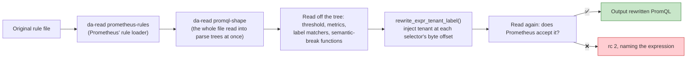

# AST Migration Engine Architecture

> **Language / 語言：** **English (Current)** | [中文](migration-engine.md)

> Related docs: [Migration Guide](migration-guide.md) · [Architecture](architecture-and-design.en.md)

---

## Architecture: read the parse tree, insert by position

An expression is read only by Prometheus' own parser (`da-read`, the same code the deployed Prometheus runs), never scanned as text: the rule file goes through the rule loader first, then every alert's expression is read into its parse tree in one run. The threshold is the right side of a root `LHS <comparison> number`; the metrics are the names each selector pins with a `__name__` equality matcher. Multi-line expressions, comments and whitespace between a name and `{` read the same, and words inside label values or string literals are never taken for metrics or functions.

**Why not re-serialize the whole tree?** Inserting `tenant=~".+"` at each selector's position in the original keeps the rest of the expression (layout, comments, parentheses) as written; the result is read again, and an expression Prometheus does not accept ends the run with rc 2, naming it, instead of falling back to the original — that would ship a recording rule with no tenant restriction.

## Core Capabilities

| Capability | Description |
|------------|-------------|
| `parse_expr()` | Splits LHS, comparison operator and threshold off the parse tree; a root that is no comparison, or a semantic-break function, makes the rule unparseable |
| `extract_label_matchers()` | The business-dimension labels each selector pins with `=` (job / instance / namespace and the like excluded) |
| `rewrite_expr_tenant_label()` | Injects `tenant=~".+"` by position: after `{` where there is one, `{tenant=~".+"}` after the name where there is not, and after `{` for a bare `{__name__="x"}` |
| `SEMANTIC_BREAK_FUNCS` | Functions that do not migrate (`absent()`, `predict_linear()`, ...); a test holds every name to one the deployed Prometheus knows |

An expression Prometheus' parser refuses ends the run with rc 2 when the rule file is read; there is no fallback path.

## Enterprise Migration Workflow

The complete migration path integrates the AST engine, Shadow Monitoring, and Triage mode:

1. **Triage**: `migrate_rule.py --triage` produces a CSV inventory, categorizing each rule's migration strategy (direct / prefix / skip)
2. **Migration execution**: the AST engine injects the tenant label. The `custom_` prefix goes only on threshold keys and recording rule names, not on source metric names: the source series come from the customer's existing exporters, so renaming them would leave the recording rule empty (issue 1818). Because the alerts read `by(tenant)` recording rules, `$labels` only carries `tenant`, so other labels the original annotations reference are rewritten: a label the original expression pins to one value with `=` gets that value, and the rest read `$labels.tenant` and are listed in the report
3. **Shadow Monitoring**: `validate_migration.py` verifies numerical consistency before and after migration (tolerance ≤ 5%)
4. **Go-live**: `scaffold_tenant.py` generates the complete tenant configuration package

> **Why 5% tolerance?** PromQL query results before and after migration cannot be perfectly identical due to three inherent sources of variance: (1) **Evaluation timing offset** — old and new rules are evaluated in different cycles, causing sampling differences for time-sensitive functions like `rate()` / `irate()`; (2) **Aggregation path change** — migrating from inline PromQL to recording rule references introduces an additional evaluation cycle of temporal offset; (3) **Floating-point precision** — different expression paths may produce minor differences in trailing decimal places. The 5% threshold is designed to be "tolerant enough to absorb these natural fluctuations, yet strict enough to detect semantic errors" (e.g., missing label filters or incorrect aggregation). If a specific scenario requires tighter or looser tolerance, use the `--tolerance` flag to adjust.

---

> This document was extracted from [`architecture-and-design.en.md`](architecture-and-design.en.md).

## Related Resources

| Resource | Relevance |
|----------|-----------|
| ["AST 遷移引擎架構"](./migration-engine.md) | ⭐⭐⭐ |
| ["Migration Guide — From Traditional Monitoring to Dynamic Alerting Platform"] | ⭐⭐ |
| ["Shadow Monitoring SRE SOP"] | ⭐⭐ |
| ["da-tools CLI Reference"] | ⭐⭐ |
| ["GitOps Deployment Guide"] | ⭐⭐ |
| ["Grafana Dashboard Guide"] | ⭐⭐ |
