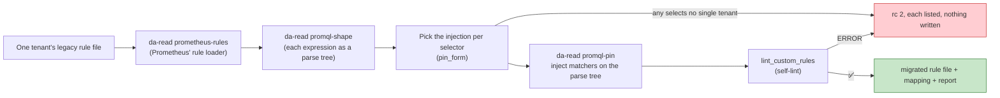

# AST Migration Engine Architecture

> **Language / 語言：** **English (Current)** | [中文](migration-engine.md)

> Related docs: [Migration Guide](migration-guide.md) · [Architecture](architecture-and-design.en.md)

---

## Architecture: keep as written, inject on the parse tree

`da-tools migrate` (`migrate_rule.py`, [#4226](https://github.com/vencil/Dynamic-Alerting-Integrations/issues/4226)) does not convert rules: each rule's expr semantics, `for`, labels, annotations and alertname are kept as written. It does three things — injects tenant isolation into every selector; adds the `tenant: <tenant>` label, and `da_migrated: "true"` on alerts (the series' own `component` is kept), and the `owner` and `expiry` annotations; and appends an expiry companion alert `MigratedRulesExpiring` (`vector(time()) > <expiry − 14 days>`, which reads no metric; it carries no `da_migrated`, so it routes as the tenant's other alerts and arrives in the shadow period too). ⚠️ Breaking ([#4355](https://github.com/vencil/Dynamic-Alerting-Integrations/issues/4355)): it used to write `component: migrated`.

Expressions are read only by Prometheus' own parser (`da-read`, the same code as the deployed Prometheus), never by scanning text. The injection is done on Prometheus' parse tree too (`da-read promql-pin`), the approach of prom-label-proxy and the Prometheus Operator's `enforcedNamespaceLabel`; each expr in the rule file is the injected expression as Prometheus prints it.

## Injection

The metric a selector reads decides (`_lib_metric_sources.pin_form`, the platform's one answer):

| Metric | Injected |
|--------|----------|
| A metric whose series carry `tenant` (including customer metrics whose source the platform does not know) | `tenant="<tenant>"` |
| kube-state-metrics series of a namespaced object (for example `kube_pod_*`), and cAdvisor's and the kubelet's infrastructure series (`container_*`, `kubelet_*`): they name the tenant by `namespace` and carry no `tenant` | `namespace="<tenant>", tenant=""` |
| kube-state-metrics series of a cluster-scoped object (for example `kube_node_*`), kube-state-metrics' own series (`kube_state_metrics_*`), Prometheus' / Alertmanager's own series, series every scrape target yields (for example `up`, `go_*`), an alert's own series (`ALERTS`) | refused: no injection selects one tenant; this is a platform-level rule |

A `tenant` / `namespace` matcher already in the expression that is not the equality above is refused; so is a selector that names no metric by equality (which series it reads is not known).

## What Is Migrated

- **Recording rules**: recording rules of the same file that the migrated alerts read (transitively) are migrated too, with a `tenant` label, renamed `migrated:<tenant>:<original name>` (the tenant's `-` written `_`), and every migrated rule reading them is rewritten with the new name — the migrated rule file is loaded on the same Prometheus as the legacy rules, and under the same name legacy alerts would read the migrated record's series, or two rules would write one set of series; reading a record the file does not define is refused (migrate it with the file that defines it); a record no migrated alert reads is not migrated and is listed in the report.
- **Golden standard**: an alert that reads a single metric for which `metric-dictionary.yaml` has a `golden_rule` is already covered by a platform Rule Pack, so no migrated rule is emitted; the report names it under "改用黃金標準" (use the golden standard). `--no-dictionary` turns the match off.
- **Multi-cluster**: a `by(...)` / `on(...)` in the original expression that names `tenant`, `instance`, `pod`, `namespace` or `node` without `da_cluster`, or a `without(...)` / `ignoring(...)` that names `da_cluster`, is flagged in the report: on a Prometheus holding several clusters' data it pairs or merges same-named series of different clusters, for a human to confirm. The tool only detects, never rewrites: whether to add `da_cluster` depends on whether both sides of the match carry the label, which the parse tree cannot tell ([ADR-006](adr/006-tenant-mapping-topologies.en.md)).

## Refusals and Self-Lint

If any rule is refused — a selector that selects no single tenant, a conflicting matcher, a record read from outside the file, a record whose new name is already taken, a vector operation whose matching the migrated record's added `tenant` would change, a `tenant` / `da_migrated` label already written with another value, `owner` / `expiry` written as labels, an `owner` / `expiry` annotation that differs from the flag, an `--owner` holding `{{` (annotations are templates), an alert whose expression keeps `da_migrated` (a matcher, `by` / `on` / `group_left`, or `label_replace` / `label_join` / `count_values` writing it), an alert or group named like the expiry companion — every reason is listed, exit 2, and no file is written. There is no fallback: falling back to the original expression would ship a rule with no tenant scope.

Before writing, the tool runs `lint_custom_rules` on its own output (tenant isolation, owner / expiry governance; `--policy` overrides the policy); any ERROR is likewise exit 2 with nothing written; WARNs go in the report. Only migrated alerts may write `da_migrated`: any other tenant rule writing it is a lint ERROR.

## Outputs and Load Point

Under `-o` (all YAML in the dot-prefixed `.migration/`, which conf.d readers skip whole):

- `.migration/migrated/<tenant>/rules.yml` — the migrated rule file. ⛔ It is loaded by **the customer's Prometheus that scrapes the raw metrics**: a single Prometheus, or the edge in a federation setup (namespace-only kube-state-metrics series are not federated to central, so loaded centrally those rules never fire). It is not mounted in the reference stack's projected volume, the same as [ADR-005](adr/005-projected-volume-for-rule-packs.en.md)'s custom alerts.
- `.migration/mapping/<tenant>.yaml` — per rule its group, alert or record, and the instant selectors before (`legacy`) and after (`pinned`) injection; a record also carries `migrated_record` (its new name), and the expiry alert carries `added: true`. ⚠️ `validate-migration` does not read it yet (it reads the old `prefix-mapping.yaml`); wiring it in is [#4227](https://github.com/vencil/Dynamic-Alerting-Integrations/issues/4227)'s scope, and until then the shadow comparison has to compare the legacy alerts with the `da_migrated="true"` ones by other means.
- `migration-report-<tenant>.txt` — the migration report (one per tenant). With no rule to migrate only the report is printed and nothing is written; if `-o` still holds that tenant's rule file or mapping from an earlier run, a `[WARN]` names them.

**Cutover**: `da_migrated="true"` alerts first go to a name-only shadow receiver in Alertmanager; once the tenant sets `_routing_migrated: active` they follow the tenant's other alerts ([`generate-routes`](cli-reference.en.md#generate-routes)). The other platform routes (Watchdog, custom isolation, synthetic probe, sentinel sink) and the source of every inhibit rule exclude `da_migrated`: a migrated alert is not taken by them and mutes no alert. The cost: after cutover a migrated alert with `component=custom` does not go through the custom isolation, and a migrated critical does not dedup the platform's warning (the other direction is kept) ([#4355](https://github.com/vencil/Dynamic-Alerting-Integrations/issues/4355)). After the shadow comparison, a human decides on promotion to platform rules or recipes.

Full flags and exit codes: [`cli-reference.en.md#migrate`](cli-reference.en.md#migrate).

---

> This document was extracted from [`architecture-and-design.en.md`](architecture-and-design.en.md).

## Related Resources

| Resource | Relevance |
|----------|-----------|
| ["AST 遷移引擎架構"](./migration-engine.md) | ⭐⭐⭐ |
| ["Migration Guide — From Traditional Monitoring to Dynamic Alerting Platform"] | ⭐⭐ |
| ["Shadow Monitoring SRE SOP"] | ⭐⭐ |
| ["da-tools CLI Reference"] | ⭐⭐ |
| ["GitOps Deployment Guide"] | ⭐⭐ |
| ["Grafana Dashboard Guide"] | ⭐⭐ |
