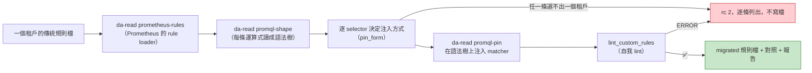

# AST 遷移引擎架構

> **Language / 語言：** | **中文（當前）** | [English](./migration-engine.en.md)

> 相關文件：[Migration Guide](migration-guide.md) · [Architecture](architecture-and-design.md)

---

## 架構：原樣保留，在語法樹上注入

`da-tools migrate`（`migrate_rule.py`，[#4226](https://github.com/vencil/Dynamic-Alerting-Integrations/issues/4226)）不轉換規則：每條規則的 expr 語意、`for`、labels、annotations、alertname 原樣保留，只做三件事——每個 selector 注入租戶隔離；labels 加 `tenant: <租戶>`、告警再加 `da_migrated: "true"`（序列自己的 `component` 原樣保留），annotations 加 `owner`、`expiry`；附一條到期伴隨告警 `MigratedRulesExpiring`（`vector(time()) > <expiry 前 14 天>`，不讀任何指標；不帶 `da_migrated`，照租戶一般的告警路由，影子期也送得到）。⚠️ Breaking（[#4355](https://github.com/vencil/Dynamic-Alerting-Integrations/issues/4355)）：以前寫的是 `component: migrated`。

運算式只由 Prometheus 自己的 parser 讀（`da-read`，與部署的 Prometheus 同一份程式碼），不掃文字。注入也在 Prometheus 的語法樹上做（`da-read promql-pin`），與 prom-label-proxy、Prometheus Operator `enforcedNamespaceLabel` 同一做法；規則檔裡的 expr 是 Prometheus 印出的注入後運算式。

## 注入方式

每個 selector 依它讀的指標決定（`_lib_metric_sources.pin_form`，全平台只有這一份答案）：

| 指標 | 注入 |
|------|------|
| 序列帶 `tenant` 的指標（含平台不認得來源的客戶指標） | `tenant="<租戶>"` |
| kube-state-metrics 有 namespace 的物件（例如 `kube_pod_*`），以及 cAdvisor 與 kubelet 的基礎設施指標（`container_*`、`kubelet_*`）：以 `namespace` 指名租戶、不帶 `tenant` | `namespace="<租戶>", tenant=""` |
| 叢集層級的 kube-state-metrics 物件（例如 `kube_node_*`）、kube-state-metrics 自己的序列（`kube_state_metrics_*`）、Prometheus／Alertmanager 自己的序列、每個抓取目標都有的序列（例如 `up`、`go_*`）、告警自己的序列（`ALERTS`） | 拒絕：沒有一種注入只選到一個租戶，這是平台層級的規則 |

原式子已有的 `tenant`／`namespace` matcher 不是上表那個等值時拒絕；selector 沒有以等值點名指標名時也拒絕（不知道它讀哪些序列）。

## 遷移的範圍

- **recording rule**：被遷移的告警讀到的同檔 recording rule（遞移地）一起遷移，加 `tenant` label，並改名為 `migrated:<租戶>:<原名>`（租戶的 `-` 寫成 `_`），讀它的 migrated 規則一併改寫——migrated 規則檔與 legacy 規則載入同一台 Prometheus，同名的話 legacy 告警會讀到 migrated record 的序列，或兩條規則寫同一組序列；讀到檔裡沒定義的 record 拒絕（要與定義它的檔一起遷移）；沒被讀到的 record 不遷移，報告列出。
- **黃金標準**：告警只讀一個指標、而該指標在 `metric-dictionary.yaml` 有 `golden_rule` 時，平台 Rule Pack 已涵蓋，不產生 migrated 規則，只在報告的「改用黃金標準」點名（`--no-dictionary` 關掉比對）。
- **多叢集**：原式子的 `by(...)`／`on(...)` 點名 `tenant`、`instance`、`pod`、`namespace`、`node` 卻沒有 `da_cluster`，或 `without(...)`／`ignoring(...)` 點名 `da_cluster` 時，在報告標出「在持有多個叢集資料的 Prometheus 上」會配對或合併不同叢集的同名序列，請人確認。工具只偵測、不改寫：該不該補 `da_cluster` 取決於配對的兩邊是否都帶這個 label，從語法樹看不出來（[ADR-006](adr/006-tenant-mapping-topologies.md)）。

## 拒絕與自我 lint

任何一條規則被拒——選不出一個租戶的 selector、衝突的 matcher、讀到檔外的 record、改名後撞名的 record、因 migrated record 帶 `tenant` 而配對方式會改變的向量運算、原規則已寫了不同值的 `tenant`／`da_migrated` label、把 `owner`／`expiry` 寫成 label、與旗標不同的 `owner`／`expiry` annotation、含 `{{` 的 `--owner`（annotation 是模板）、運算式明寫保留 `da_migrated` 的告警（matcher、`by`／`on`／`group_left`，或 `label_replace`／`label_join`／`count_values` 寫入它）、與到期伴隨告警同名的 alert 或 group——就逐條列出原因、結束碼 2、一個檔都不寫。沒有降級路徑：退回原式等於出貨一條沒有租戶限定的規則。

寫之前，工具對自己的輸出跑 `lint_custom_rules`（租戶隔離、owner／expiry 治理；`--policy` 可換政策），有 ERROR 一樣結束碼 2、不寫；WARN 列在報告。`da_migrated` 只有 migrated 告警能寫：其他租戶規則寫它，lint 回報 ERROR。

## 輸出與載入點

`-o` 底下（YAML 都在點開頭的 `.migration/`，conf.d 的讀取端整棵略過）：

- `.migration/migrated/<租戶>/rules.yml` — migrated 規則檔。⛔ 由客戶**抓取原始指標的那台 Prometheus** 載入：單一 Prometheus，或 federation 架構下的 edge（只帶 namespace 的 kube-state-metrics 序列不會被拉到中央，載入中央的話這些規則永遠不響）。它不掛進參考 stack 的 projected volume，與 [ADR-005](adr/005-projected-volume-for-rule-packs.md) 的 custom alerts 相同。
- `.migration/mapping/<租戶>.yaml` — 每條規則的 group、alert 或 record，與 selector 注入前（`legacy`）後（`pinned`）的 instant selector；record 另有 `migrated_record`（改名後的名字），到期伴隨告警帶 `added: true`。⚠️ `validate-migration` 目前還不讀這份檔（它讀的是舊的 `prefix-mapping.yaml`），接上它是 [#4227](https://github.com/vencil/Dynamic-Alerting-Integrations/issues/4227) 的範圍；在那之前影子比對要另行比較 legacy 與 `da_migrated="true"` 的告警。
- `migration-report-<租戶>.txt` — 遷移報告（每個租戶一份）。沒有要遷移的規則時只印報告、不寫檔；`-o` 裡還留著該租戶先前的規則檔或對照時印 `[WARN]` 點名它們。

**切換**：`da_migrated="true"` 的告警在 Alertmanager 先送到只有名字的 shadow receiver，租戶設 `_routing_migrated: active` 才與它的其他告警走同一條路（[`generate-routes`](cli-reference.md#generate-routes)）。其他平台路由（Watchdog、custom 隔離、synthetic probe、sentinel sink）與每條 inhibit rule 的 source 都排除 `da_migrated`：migrated 告警不會被它們攔走，也不經它們靜音別的告警（產生器的規則與 repo 自帶的 base；你自己寫在 base 的 inhibit rule 若沒排除，`--strict` 下拒絕、結束碼 1，不帶 `--strict` 時只 WARN、規則照留，仍可能靜音）；代價是切換後帶 `component=custom` 的 migrated 告警不走 custom 隔離，而 migrated critical 不 dedup 平台的 warning（反方向保留）（[#4355](https://github.com/vencil/Dynamic-Alerting-Integrations/issues/4355)）。影子比對之後，提升成平台規則或 recipe 由人決定。

完整 flag 與結束碼：[`cli-reference.md#migrate`](cli-reference.md#migrate)。

---

> 本文件從 [`architecture-and-design.md`](architecture-and-design.md) 獨立拆分。

## 相關資源

| 資源 | 相關性 |
|------|--------|
| ["AST Migration Engine Architecture"] | ⭐⭐⭐ |
| ["Migration Guide — 遷移指南"](./migration-guide.md) | ⭐⭐ |
| ["Shadow Monitoring SRE SOP"](./shadow-monitoring-sop.md) | ⭐⭐ |
| ["da-tools CLI Reference"](./cli-reference.md) | ⭐⭐ |
| ["GitOps 部署指南"](integration/gitops-deployment.md) | ⭐⭐ |
| ["Grafana Dashboard 導覽"](./grafana-dashboards.md) | ⭐⭐ |
