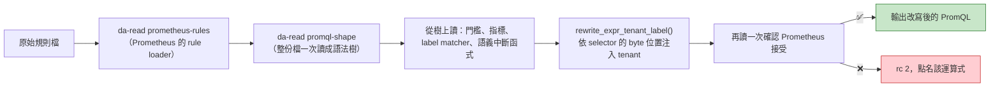

# AST 遷移引擎架構

> **Language / 語言：** | **中文（當前）** | [English](./migration-engine.en.md)

> 相關文件：[Migration Guide](migration-guide.md) · [Architecture](architecture-and-design.md)

---

## 架構：讀語法樹，依位置插入

運算式只由 Prometheus 自己的 parser 讀（`da-read`，與部署的 Prometheus 同一份程式碼），不掃文字：規則檔先過 rule loader，每條告警的運算式再一次讀成語法樹。門檻是根節點「`LHS <比較> 數字`」的右邊；指標是每個 selector 以 `__name__` 等值 matcher 釘住的名字；多行、含註解、名稱與 `{` 之間有空白的寫法都照樣讀得出來，label 值與字串常值裡的字不會被當成指標或函式。

**為什麼不重新序列化整棵樹？** 依 selector 在原式中的位置插入 `tenant=~".+"`，原式其餘部分（排版、註解、括號）原樣保留；插入後再讀一次，Prometheus 不接受就以 rc 2 結束並點名該運算式，不退回原式——退回原式等於出貨一條沒有租戶限定的 recording rule。

## 核心功能

| 功能 | 說明 |
|------|------|
| `parse_expr()` | 從語法樹切出 LHS、比較運算子與門檻；根節點不是比較、或用到語義中斷函式即判為無法解析 |
| `extract_label_matchers()` | 每個 selector 以 `=` 釘住的業務維度 label（不含 job / instance / namespace 等） |
| `rewrite_expr_tenant_label()` | 依位置注入 `tenant=~".+"`：有 `{` 插在 `{` 之後，沒有的在名稱後補上，只寫 `{__name__="x"}` 的也一樣 |
| `SEMANTIC_BREAK_FUNCS` | 語義不可轉換的函式（`absent()`、`predict_linear()` 等），每個名字都由測試對帳部署的 Prometheus 認得 |

Prometheus 的 parser 拒收的運算式，在讀規則檔那一關就以 rc 2 結束，沒有降級路徑。

## 企業遷移工作流

完整遷移路徑整合 AST 引擎、Shadow Monitoring 與 Triage 模式：

1. **Triage**：`migrate_rule.py --triage` 產出 CSV 清單，分類每條規則的遷移策略（direct / prefix / skip）
2. **遷移執行**：AST 引擎注入 tenant label。`custom_` 前綴只加在閾值 key 與 recording rule 名稱上，不改來源指標名：來源 series 是客戶既有 exporter 發的，改名後 recording rule 會是空集合（issue 1818）。產生的 recording rule 是 `<sum|max> by(tenant, da_cluster) (…)`：在收了多個叢集資料的 Prometheus 上逐叢集評估（`sum`／`max` 不再把同一個租戶的幾個叢集合在一起），告警帶 `da_cluster`；序列沒有 `da_cluster` 的單一 Prometheus 上結果與 `by(tenant)` 相同（[ADR-006](adr/006-tenant-mapping-topologies.md)；v2.9.0 映像產生的仍是 `by(tenant)` <!-- image-caveat: v2.9.0 -->）。原式子自己的聚合已經丟掉 `tenant` 的規則（`sum(rate(x))`、`sum by(instance) (…)`）不在此列，遷移前後都算不出租戶的值。原式子自己寫的 `on(...)`／`by(...)` 照抄、不改寫：點名 `tenant`、`instance`、`pod`、`namespace`、`node` 卻沒有 `da_cluster` 的，會在報告、規則檔與租戶檔的註記標出來請人確認，因為在多叢集的 Prometheus 上它會配對或合併不同叢集的同名序列（`on(instance)` 可能 many-to-many），而該不該補 `da_cluster` 取決於配對的兩邊是否都帶這個 label，工具判斷不了。告警改讀這些 recording rule 後 `$labels` 只剩 `tenant` 與 `da_cluster`，所以原 annotation 引用的其他 label 會改寫（`{{ $labels.da_cluster }}` 照留）：原式子以 `=` 釘成單一值的代入該值，其餘改讀 `$labels.tenant` 並在報告列出
3. **Shadow Monitoring**：`validate_migration.py` 驗證遷移前後的數值一致性（預設容差 `--tolerance 0.001`），新舊兩邊以（租戶、`da_cluster`）配對，只在一邊出現的叢集列為 `mismatch`
4. **上線**：透過 `scaffold_tenant.py` 產出完整的租戶配置包

> **為什麼需要容差？** 遷移前後的 PromQL 查詢結果不可能完全一致，因為存在三個天然誤差來源：(1) **時間窗口偏移**——新舊規則在不同 evaluation cycle 被評估，對 `rate()` / `irate()` 等時間敏感函數會產生取樣偏差；(2) **聚合路徑改變**——從嵌入式 PromQL 改為 recording rule 引用，多一層 evaluation cycle 的時序延遲；(3) **浮點精度**——不同 expression 路徑的浮點運算可能在末位小數產生差異。預設容差 0.001（0.1%）「嚴格到能偵測語義錯誤（漏 label filter、聚合方式錯誤），又寬鬆到容納浮點抖動」。可透過 `--tolerance` 參數調整。

---

> 本文件從 [`architecture-and-design.md`](architecture-and-design.md) 獨立拆分。

## 相關資源

| 資源 | 相關性 |
|------|--------|
| ["AST Migration Engine Architecture"] | ⭐⭐⭐ |
| ["Migration Guide — 遷移指南"](./migration-guide.md) | ⭐⭐ |
| ["Shadow Monitoring SRE SOP"](./shadow-monitoring-sop.md) | ⭐⭐ |
| ["da-tools CLI Reference"](./cli-reference.md) | ⭐⭐ |
| ["GitOps 部署指南"](integration/gitops-deployment.md) | ⭐⭐ |
| ["Grafana Dashboard 導覽"](./grafana-dashboards.md) | ⭐⭐ |
