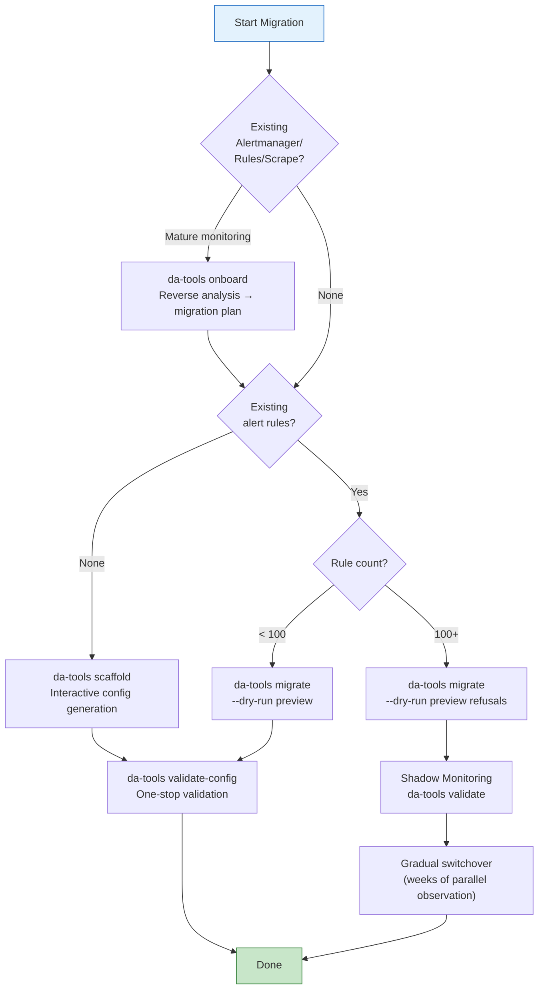

# Migration Guide — From Traditional Monitoring to Dynamic Alerting Platform

> **Language / 語言：** **English (Current)** | [中文](migration-guide.md)

> A **task-routing hub** for migrating from traditional Prometheus alerting to the dynamic multi-tenant threshold architecture. This document uses a decision table to route you to the right path; tool-level command depth lives in [cli-reference.md](cli-reference.md), and the end-to-end zero-downtime path lives in the [Incremental Migration Playbook](scenarios/incremental-migration-playbook.en.md).
>
> **First time migrating?** Start with the [Incremental Migration Playbook](scenarios/incremental-migration-playbook.en.md); multi-system simultaneous swaps (Prom→VM + rules + AM) follow the [Multi-System Migration Playbook](scenarios/multi-system-migration-playbook.en.md).
>
> **⚠️ Migration Safety Guarantee:** The flow is **incremental and rollback-friendly**. Migrated alerts written by `da-tools migrate` carry `da_migrated: "true"` and, until cutover, go only to a shadow receiver in Alertmanager that notifies no one; Projected Volume's `optional: true` lets you unmount any rule pack at any time without affecting Prometheus.
>
> **Alerts wired to automation (webhooks)?** Re-sends, replays, and dual-running during migration are double-execution risks for the **action layer** — read [Beyond Actionable §4–§5](alerting-best-practices.en.md) (idempotency gates and irreversible-action defenses) first.
>
> **Tip:** Examples below use the shorthand `da-tools <cmd>`. Before copying them, define the shell function from the [CLI Reference Docker Usage Pattern](cli-reference.en.md#docker-usage-pattern) and run from your repository root.

> **Audience**: tenant tech leads, Platform Engineers / DevOps / SREs, Domain Experts (DBAs)

**How to read this** (readers switch at any time, and often several read it together):

| You are… | Start with | Drill into |
|---|---|---|
| Tenant tech lead | [Where Are You?](#where-are-you-你在哪個階段), [§3 Generate config](#3-generate-tenant-config-da-tools-scaffold), [§9 Dimensional labels](#9-dimensional-labels--multi-db-type-support) | [§7 Verification](#7-post-migration-verification), [§12 FAQ](#12-faq) |
| Platform / DevOps | Core flow [§1–§7](#core-migration-flow-in-order) (in order) | Reference band, Advanced band |
| Enterprise / SRE (large migration) | [§2 Reverse analysis](#2-reverse-analyze-existing-monitoring-da-tools-onboard), [§13 Enterprise migration](#13-enterprise-grade-migration--large-tenant-1000-rules) | [Shadow Monitoring SOP](shadow-monitoring-sop.en.md) |
| Domain Expert (DBA) | [§8 Examples](#8-five-migration-scenario-examples), [§9 Dimensional](#9-dimensional-labels--multi-db-type-support), [§11 Extending](#11-extending-unsupported-db-types) | [§4 Migrate rules](#4-migrate-existing-rules-da-tools-migrate) |

> **Reading together**: locate yourself via the "Where Are You?" decision table, then each reader follows their own band. This doc has three bands — **Core Migration Flow (in order) / Reference (consult as needed) / Advanced & Operations**.

## Where Are You? (你在哪個階段？)

| Your Scenario | Recommended Path | Tool (`da-tools` command) | Estimated Time |
|---------------|------------------|---------------------------|----------------|
| **Brand-new tenant** — first onboarding | Interactive tenant-config generation | `da-tools scaffold` | ~5 min |
| **Existing mature monitoring** — enterprise reverse analysis | Auto-generate migration plan | `da-tools onboard` | ~10 min |
| **Have legacy alert rules** — need to migrate | Migrate verbatim into migrated rules (tenant isolation injected) | `da-tools migrate` | ~15 min |
| **Large tenant (1000+ rules)** — enterprise migration | Preview → Shadow → switchover | `da-tools migrate --dry-run` → `da-tools migrate` | ~1-2 weeks |
| **3-system simultaneous swap** (storage backend Prom→VM **plus** rules **plus** AM routing) | 5-Phase invariants-driven model | Follow the [Multi-System Migration Playbook](scenarios/multi-system-migration-playbook.en.md) | 13-week estimate (typically ~27 weeks in practice) |
| **Post-cutover rule evolution** (`custom_*` → golden, Rule Pack upgrades) | Lifecycle pattern, not a one-time event | Follow the [Staged Adoption Lifecycle](scenarios/staged-adoption-guide.en.md) | Ongoing |
| **Unsupported DB type** — need extension | Manually create Recording + Alert Rules | See [§11](#11-extending-unsupported-db-types) | ~30 min |
| **Offboarding a tenant/metric** | Safe removal | `da-tools offboard` / `da-tools deprecate` | ~5 min |
| **Migration trouble** | Symptom-keyed runbook | → [Migration Troubleshooting Checklist](integration/troubleshooting-checklist.en.md) | — |



> **3-system simultaneous swap?** Scenario invariants and the 13-week timeline: [Multi-System Migration Playbook](scenarios/multi-system-migration-playbook.en.md).

---

## Core Migration Flow (in order)

The standard path from zero to cutover: **install → reverse-analyze (if any) → generate / convert config → deploy → routing → verify**.

> **Why it's low-friction**: the platform preloads **Rule Pack ConfigMaps** (MariaDB, PostgreSQL, Kubernetes, Redis, MongoDB, Elasticsearch, Oracle, DB2, ClickHouse, Kafka, RabbitMQ, JVM, Nginx, Operational, Platform self-monitoring), distributed via **Projected Volume**. **Rule Packs without a deployed exporter produce no metrics and trigger no false alerts** — you only configure `_defaults.yaml` + tenant YAML. See [design/rule-packs.en.md](design/rule-packs.en.md).

### 1. Install the Migration Toolkit

Install the toolkit before starting. Three delivery paths (Docker / static binary 6-arch / air-gapped tar) — pick any one:

```bash
# Path A: Docker pull from ghcr.io (simplest)
docker pull ghcr.io/vencil/da-tools:v2.9.0

# Path B: Download a static binary to PATH
curl -fsSLo da-guard.tar.gz https://github.com/vencil/Dynamic-Alerting-Integrations/releases/download/tools/v2.9.0/da-guard-linux-amd64.tar.gz
tar xzf da-guard.tar.gz && sudo install -m 0755 da-guard-linux-amd64 /usr/local/bin/da-guard
```

Full command set, hash verification, air-gapped flow, cosign keyless verification: see [`migration-toolkit-installation.md`](migration-toolkit-installation.en.md).

### 2. Reverse-Analyze Existing Monitoring (da-tools onboard)

For enterprises with mature monitoring stacks, `da-tools onboard` **reverse-analyzes** Alertmanager / Prometheus rules / scrape config and produces a migration plan (skip this step if you have no existing monitoring):

- Alertmanager (`--alertmanager-config`) → `phase1-routing/routing-summary.csv` (a routing summary per tenant route), a `.onboard/conf.d/<tenant>.yaml` routing snippet, plus `onboard-hints.json` (when tenant routes are found)
- Rule files (`--rule-files <file-or-dir>...`; on the v2.9.0 image a directory selects no file, so give a quoted glob <!-- image-caveat: v2.9.0 -->) → `phase2-rules/migration-plan.csv` (per alert rule `status`: `perfect` / `complex` / `unparseable`) and `.onboard/conf.d/_defaults.yaml` (suggested platform defaults)
- Scrape config (`--scrape-config`) → `.onboard/`: `scrape-analysis.yaml` and a `<job>-relabel-suggestion.yaml` per job

Full flags, output conditions and exit codes: [`cli-reference.md#onboard`](cli-reference.md#onboard). `onboard-hints.json` feeds `scaffold --from-onboard`; rule migration is `migrate`, which reads the old rule files directly.

### 3. Generate Tenant Config (da-tools scaffold)

For brand-new tenants, the interactive generator completes setup in 30 seconds:

```bash
da-tools scaffold --tenant redis-prod --db redis,mariadb --non-interactive -o /data
```

Outputs: `.scaffold/conf.d/_defaults.yaml` + `.scaffold/conf.d/<tenant>.yaml` + `scaffold-report.txt` (+ `relabel_configs-<tenant>.txt` when `--namespaces` is specified). Full flag set, `--routing-receiver`, `--catalog`, `--from-onboard <hints>` pipeline: [`cli-reference.md#scaffold`](cli-reference.md#scaffold).

The three ConfigMap injection paths (Helm / kubectl / GitOps): [threshold-exporter README — K8s Deployment](https://github.com/vencil/Dynamic-Alerting-Integrations/blob/main/components/threshold-exporter/README.md#6-部署).

### 4. Migrate Existing Rules (da-tools migrate)

Teams with legacy Prometheus alert rules use `migrate` to move one tenant's rules **verbatim** into migrated rules (PromQL is read into Prometheus' own parse tree; a rule file its parser refuses ends the run with rc 2 — there is no fallback):

⚠️ The v2.9.0 image still ships the old conversion engine (`custom_` keys and the three-piece set); until the next da-tools image is released, run the new engine from a repo checkout. It needs three Go binaries: `da-read` (`promql-pin` pins the selectors), `da-guard` (judges the output directory before writing) and `da-crdecode` (lints its own output); `make da-read-build da-guard-build da-crdecode-build` builds them into `.build/`, and environment variables point the tool at them (every example below runs this way, from the repo root) <!-- image-caveat: v2.9.0 -->

```bash
make da-read-build da-guard-build da-crdecode-build
export DA_READ_BINARY="$PWD/.build/da-read" DA_GUARD_BINARY="$PWD/.build/da-guard" \
       DA_CRDECODE_BINARY="$PWD/.build/da-crdecode"
```

```bash
python3 scripts/tools/ops/migrate_rule.py legacy-rules.yml --tenant db-a --owner team-db --expiry 2027-03-31 --dry-run         # Preview the report
python3 scripts/tools/ops/migrate_rule.py legacy-rules.yml --tenant db-a --owner team-db --expiry 2027-03-31 -o output  # Migrate
```

- **Kept as written, tenant isolation injected**: the expr semantics, `for`, labels, annotations and alertname do not change; a tenant matcher is injected into every selector on the parse tree (`tenant="db-a"`; for kube-state-metrics series of a namespaced object and cAdvisor's / the kubelet's infrastructure series, `namespace="db-a", tenant=""`). Cluster-scoped objects (`kube_node_*`), series every scrape target yields (`up`) and Prometheus' / Alertmanager's own series have no injection that selects one tenant: those are platform-level rules, listed one by one, exit 2, nothing written
- **Marking and governance**: every alert gets the `tenant` and `da_migrated: "true"` labels and the `owner` and `expiry` annotations (the series' own `component` is kept; ⚠️ Breaking, it used to be `component: migrated`, [#4355](https://github.com/vencil/Dynamic-Alerting-Integrations/issues/4355)), plus `MigratedRulesExpiring`, which fires from 14 days before the expiry (it carries no `da_migrated`, so it routes as the tenant's other alerts and arrives in the shadow period too); before writing, the tool runs the custom rule lint on its own output and writes nothing on an ERROR
- **Golden standard**: an alert that reads a single metric for which `metric-dictionary.yaml` has a golden rule is not migrated; the report points it at the platform Rule Pack
- **Multi-cluster**: a `by(...)` / `on(...)` in the original expression that names an identity label without `da_cluster` is only flagged in the report, never rewritten
- **Output**: `.migration/migrated/<tenant>/rules.yml` (the rule file), `.migration/mapping/<tenant>.yaml` (each rule's selectors before and after injection), `migration-report-<tenant>.txt`

⛔ The rule file is loaded by **the Prometheus that scrapes the raw metrics** (a single Prometheus, or the edge in a federation setup), not mounted in the platform Rule Packs' projected volume. Alertmanager sends `da_migrated="true"` alerts to a name-only shadow receiver until the tenant sets `_routing_migrated: active` ([`cli-reference.md#generate-routes`](cli-reference.md#generate-routes)); the other platform routes and the source of every inhibit rule exclude it, so a migrated alert is not taken by a platform route and mutes no alert; after the shadow comparison a human decides whether to promote them to platform rules (the three-piece set of §8) or recipes.

Engine details (the injection table, recording rules migrated along, refusals): [`migration-engine.en.md`](migration-engine.en.md). CLI flags and exit codes: [`cli-reference.md#migrate`](cli-reference.md#migrate).

### 5. Deploy threshold-exporter

> **Config separation principle**: Neither the Helm chart nor the Docker image ships **test tenant data**. `values.yaml`'s `thresholdConfig.tenants` defaults to empty; you inject your own settings via values-override / GitOps. Development uses `environments/local/threshold-exporter.yaml` (already includes db-a / db-b samples).

Three deployment options:

- **Option A (Recommended)**: OCI Registry — `helm upgrade --install threshold-exporter oci://ghcr.io/vencil/charts/threshold-exporter --version 2.9.0 -n monitoring -f values-override.yaml`
- **Option B**: Local build — `docker build` + `kind load` + `make component-deploy`
- **Option C**: Operator CRD path — `da-tools operator-generate` produces PrometheusRule / ServiceMonitor, replacing ConfigMap mounting; alert routing is produced by `generate-routes` and loaded through the Alertmanager CR's `configSecret` (suitable when kube-prometheus-stack is already installed)

Comparison and decision guidance for the two paths: [Deployment Decision Matrix](getting-started/decision-matrix.en.md). Full Helm values, Operator CRD migration, and "Use da-tools in K8s Cluster" mode: [threshold-exporter README](https://github.com/vencil/Dynamic-Alerting-Integrations/blob/main/components/threshold-exporter/README.md#6-部署) · [Operator integration guides](integration/operator-prometheus-integration.en.md).

Deployment verification:

```bash
kubectl get pods -n monitoring -l app=threshold-exporter
curl -s http://localhost:8080/metrics | grep user_threshold
curl -s http://localhost:8080/api/v1/config | python3 -m json.tool
```

### 6. Alertmanager Routing Migration

Migrating from "instance-based dispatch" to "tenant-based dispatch": use `tenant` as the first-dimension group_by, with nested routes for severity tiering.

**Config-Driven Routing**: tenants set `_routing` in their own YAML, and the platform tooling auto-generates Alertmanager route + receiver config. Six receiver types: `webhook` / `email` / `slack` / `teams` / `rocketchat` / `pagerduty`.

```bash
da-tools generate-routes --config-dir conf.d/ --validate \
                         --policy .github/deployment-policy.yaml
# BYO Alertmanager outside K8s: merge into your own alertmanager.yml
da-tools generate-routes --config-dir conf.d/ --output-alertmanager \
                         --base-config alertmanager.yml -o alertmanager.new.yml
# K8s: merge into the cluster's ConfigMap and reload (GitOps: --output-configmap instead)
da-tools generate-routes --config-dir conf.d/ --apply --yes
```

The output modes merge the generated routing into your own config (`--base-config`, the source) and emit a separate output: your own routes, receivers and inhibit rules are kept; when conf.d changes, run it again on the same source, never with the output as the base (its `tenant-*` receivers are refused, exit 1); a run without a mode flag is exit 2. ⚠️ The v2.9.0 image has no `--output-alertmanager` and prints a fragment when no mode flag is given <!-- image-caveat: v2.9.0 -->

The platform enforces guardrails on timing parameters (`group_wait` 5s–5m, `group_interval` 5s–5m, `repeat_interval` 1m–72h); out-of-range values are auto-clamped.

Full receiver-type schema, Go template customization, Per-rule Routing Overrides, Silent / Maintenance Mode, Platform Enforced Routing: [BYO Alertmanager Integration Guide](integration/byo-alertmanager-integration.en.md). `_routing` schema and routing-profile hierarchy: [Architecture & Design §Design Concepts Overview](architecture-and-design.en.md) → Alert Routing.

> **v1.3.0 Breaking Change**: `receiver` changed from a plain URL string to a structured object (with a `type` field). The v1.2.0 format is no longer compatible.

### 7. Post-Migration Verification

```bash
da-tools validate-config --config-dir /data/conf.d         # One-stop
da-tools check-alert MariaDBHighConnections db-a           # Alert status
da-tools diagnose db-a                                     # Tenant health overview
```

Full verification checklist (YAML validation, alert state, three-state testing, routing, operational_mode, blind-spot scan): [Tenant Lifecycle §Onboarding Stage](scenarios/tenant-lifecycle.en.md#phase-12-onboarding-day-0).

**Post-migration tenant self-service scope**: three-state thresholds, `_critical` suffix, `_routing` (+ overrides), `_silent_mode`, `_state_maintenance`, `_severity_dedup`. Platform Team controls `_routing_defaults` and `_routing_enforced` in `_defaults.yaml`. Details: [GitOps Deployment Guide §7](integration/gitops-deployment.en.md#7-tenant-self-service-configuration-scope).

---

## Reference (consult as needed)

### 8. Five Migration Scenario Examples

Using Percona MariaDB Alert Rules as the template, 5 common migration patterns are showcased. Each scenario applies the same three-piece template — only the metric name and Tenant Config key change. The platform-side Alert Rule structure is always `(metric_recording) > on(tenant) group_left (threshold) unless on(tenant) (maintenance == 1)`.

**Scenario 1: Basic Numeric Comparison (Connections → Connection Usage)**

Legacy:

```yaml
- alert: MySQLTooManyConnections
  expr: mysql_global_status_threads_connected > 100
  for: 5m
  labels: { severity: warning }
```

Migrated three-piece set:

```yaml
# 1. Recording Rule (platform)
- record: tenant:mysql_connection_usage:percent
  expr: |
    max by(tenant, da_cluster) (
      100 * mysql_global_status_threads_connected
      / (mysql_global_variables_max_connections > 0)
    )

# 2. Alert Rule (platform) — group_left + unless maintenance
- alert: MariaDBHighConnections
  expr: |
    (
      tenant:mysql_connection_usage:percent
      > on(tenant) group_left
      tenant:alert_threshold:mysql_connection_usage_percent
    )
    unless on(tenant) (user_state_filter{filter="maintenance"} == 1)
  for: 5m
  labels: { severity: warning }

```

```yaml
# 3. Tenant Config (tenant)
tenants:
  db-a:
    mysql_connection_usage_percent: "80"   # the legacy rule was "> 100 connections"; the threshold is now % of max_connections (#3778): with max_connections=125, 100 connections = 80%
```

**Scenarios 2–5: Other Common Patterns (quick reference)**

| Scenario | Source Metric | Recording Rule | Tenant Config Example | Notes |
|----------|---------------|----------------|----------------------|-------|
| **Multi-tier severity** | `mysql_global_status_threads_connected` ÷ `mysql_global_variables_max_connections` | `tenant:mysql_connection_usage:percent` | `mysql_connection_usage_percent: "85"` + `mysql_connection_usage_percent_critical: "95"` | Alert Rule handles `_critical` downgrade logic automatically |
| **Replication Lag** | `mysql_slave_status_seconds_behind_master` | `max by(tenant, da_cluster) (...)` | `mysql_replication_lag: "30"` or `"disable"` | Max captures the "weakest link" (slowest slave) |
| **Rate metric** | `rate(mysql_global_status_slow_queries[5m])` | `tenant:mysql_slow_queries:rate5m`: `sum by(tenant, da_cluster) (rate(...))` | No tenant key (see ⚠️ below) | Sum reflects cluster-wide load |
| **Ratio** | `threads_connected / max_connections` | `tenant:mysql_connection_usage:percent`: divided per instance, then `max by(tenant, da_cluster) (100 * ... / (max_connections > 0))` | `mysql_connection_usage_percent: "80"` (% of max_connections) | Ratio computed in the Recording Rule (multiplied by 100, unit is %); dividing per instance and taking the fullest one, because a `sum` before dividing is diluted by idle replicas' headroom (#3778) |

> ⚠️ For the rate row, the platform MariaDB Rule Pack currently has only the recording rule and no tenant-settable threshold key: `MariaDBHighSlowQueries` judges the slow-query rate against a fixed `> 1`. To let tenants tune this kind of threshold, the platform must first declare the key and add a threshold-normalization recording rule; see "Add a metric to an existing Rule Pack" in the [Domain Expert Quick Start](getting-started/for-domain-experts.en.md). A key written into a tenant file without that declaration is not emitted, and validate-config's `routes` row reports `unread … (no_row)`.

> Scenarios 2–5 reuse the Scenario 1 three-piece template — only the metric name and Tenant Config key change; the platform-side Alert Rule structure is always identical. This assumes the key is already declared by the platform (see ⚠️ above). Rule Pack design + three-piece contract: [design/rule-packs.en.md](design/rule-packs.en.md). Actual golden alert listings: [Rule Packs ALERT-REFERENCE](rule-packs/ALERT-REFERENCE.md).

### 9. Dimensional Labels — Multi-DB Type Support

When the platform supports Redis / ES / MongoDB, the same metric can have different thresholds per "dimension". YAML keys containing `{` must be wrapped in double quotes:

```yaml
tenants:
  redis-prod:
    redis_connected_clients: "500"                                              # Global default
    "redis_connected_clients{instance=\"redis-orders:6379\"}": "200"           # Strict
    "redis_connected_clients{instance=\"redis-analytics:6379\"}": "1000"       # Loose
    "redis_connected_clients{instance=\"redis-temp:6379\"}": "disable"         # Disabled
    # Multiple labels:
    "mongodb_replication_lag{rs=\"rs-orders\",member=\"mongo-orders-dr\"}": "60"
```

> ⚠️ The shipped Rule Packs normalise thresholds with `max by(tenant)`, which drops the dimension label, so the rows above **do not take effect per instance today**: they and the base merge into one tenant threshold, and `disable` only stops that row from being served — it does not silence that one instance. And these rows are served only once the root `_defaults.yaml` `dimensions:` declares `instance` for `redis_connected_clients` (see the table below). Judging per dimension needs the Rule Pack adapted as in "Platform-team PromQL adaptation" below, then the label declared ([#3475](https://github.com/vencil/Dynamic-Alerting-Integrations/issues/3475)).

**Design constraints**:

| Constraint | Note |
|------------|------|
| YAML quoting required | Keys containing `{` must be wrapped in double quotes |
| No `_critical` suffix | Use `"value:severity"` syntax instead, e.g. `"500:critical"` |
| Defaults | A tenant's dimension key does not inherit its base's scalar default. The root `defaults:` may carry a complete dimension key: once `dimensions:` declares its labels, the exporter serves it as the default for every tenant that does not write it (#2031); undeclared, it is not served and the shared verdict reports `unread … (no_row)` |
| Labels must be declared | Every label a dimension key serves must be declared for its base under the root `_defaults.yaml` `dimensions:` (for example `dimensions: {redis_connected_clients: [instance]}`; a regex selector serves `<label>_re`, so declare `instance_re`), whichever layer writes the key; otherwise no metric is served and validate-config reports `unread … (no_row)` (`disable_noop` for a key written `disable`; a key a Policy-as-Code rule names reads `read` and serves no metric either; ADR-038 §11). The shipped `dimensions:` lists only the labels the rule packs actually keep (today `version` on container cpu/memory) |
| Three-state still applies | Value=Custom, omitted=Default (for a basic key with a platform value or a value in `defaults:` of `_defaults.yaml`, and for a complete dimension key the root `defaults:` writes — see the row above; a key with no platform value inherits nothing, so omitted=no value=silent), `"disable"`=Disabled; a base key written `"disable"` switches its dimension keys off too ([#3046](https://github.com/vencil/Dynamic-Alerting-Integrations/issues/3046)) |

**Platform-team PromQL adaptation**: the dimension label must appear in both the Recording Rule's `by()` and the Alert Rule's `on()`. Once that is in place, declare the base and label under the root `_defaults.yaml` `dimensions:` so the dimension key is served. Three-piece contract + `tenant:<metric>:<agg>` naming convention: [design/rule-packs.en.md](design/rule-packs.en.md). The shipped `conf.d/examples/` carry no dimensional keys for this reason (#3475).

### 10. LLM-Assisted Manual Conversion

`da-tools migrate` does not rewrite the rule format and emits no LLM prompt. Promoting migrated rules to platform rules (the three-piece set of §8), or handling the platform-level rules `migrate` refuses, is a manual rewrite: you can hand the original rule and the §8 template to an LLM for a draft, land the result through the steps of §11, and confirm the behaviour matches with a shadow comparison.

### 11. Extending Unsupported DB Types

The preloaded Rule Packs already cover mainstream DBs / middleware (MariaDB / PostgreSQL / Redis / MongoDB / Elasticsearch / Oracle / DB2 / ClickHouse / Kafka / RabbitMQ / JVM / Nginx / Kubernetes / Operational / Platform self-monitoring). Adding a new rule pack requires a manual normalization layer.

**Normalization naming**: `tenant:<component>_<metric>:<aggregation_function>`

**Aggregation mode** — Ask: "If one node breaches and others are fine, is that a problem?" Yes → `max by(tenant, da_cluster)` (weakest link); No → `sum by(tenant, da_cluster)` (cluster total). The grouping always carries `da_cluster`: a tenant that runs in several clusters is computed per cluster ([ADR-006](adr/006-tenant-mapping-topologies.en.md)); the threshold normalization rule stays `max by(tenant)`.

**Build steps**: Recording Rule → Threshold Normalization Rule → Alert Rule (with `group_left` + `unless maintenance`) → standalone ConfigMap → add source in projected volume → add default in `_defaults.yaml` → produce tenant config via `da-tools scaffold`.

Full Rule Pack structure (three-piece set patterns, bilingual annotation conventions, `alert_threshold:*` naming): [rule-packs/README.md](rule-packs/README.md) · [design/rule-packs.en.md](design/rule-packs.en.md).

### 12. FAQ

**Q: How long after editing threshold-config does the change take effect?**

The exporter reloads every 30 seconds; K8s ConfigMap propagation takes ~1-2 minutes. Expect 1-3 minutes total.

**Q: What needs to change to add a new metric?**

Supported DB types (with a Rule Pack): only add the default in `_defaults.yaml` + the threshold in tenant YAML. Unsupported DBs: also need a Recording Rule + Alert Rule + ConfigMap (see [§11](#11-extending-unsupported-db-types)).

**Q: Can the old and new alerts coexist during the migration window?**

Yes. `migrate` keeps the alertname, so old and new alerts share it and are told apart by label: migrated alerts carry `da_migrated: "true"` and go to a name-only shadow receiver until the tenant sets `_routing_migrated: active`, so nothing is notified twice; the recording rules they read are renamed `migrated:<tenant>:<original name>` and never read the old rules' series. Recommended: deploy the migrated rules first, observe, confirm behavioral equivalence, then remove the old rules.

**Q: Can dimension keys be set under defaults?**

Yes. A complete dimension key in the root `defaults:` (for example `"redis_queue_length{queue=\"orders\"}": 500`) whose labels `dimensions:` declares is served by the exporter as the default for every tenant that does not write it (#2031); undeclared, it is not served and the shared verdict reports `unread … (no_row)`.

```yaml
# _defaults.yaml
dimensions:
  redis_queue_length: [queue]
defaults:
  redis_queue_length: 1000
  'redis_queue_length{queue="orders"}': 500
```

A dimension key a tenant writes does not inherit its base's scalar default. See also the ⚠️ in §9: the shipped Rule Packs do not judge per dimension yet (#3475).

**Q: How do you mark a dimension key as critical?**

Use the `"value:severity"` syntax: `"redis_connected_clients{instance=\"redis-orders:6379\"}": "500:critical"`. This shows the syntax only: the shipped Redis Rule Pack reads only rows with `severity="warning"`, and `RedisHighConnections` is itself a warning alert; a critical alert needs custom Recording and Alert Rules that read `severity="critical"`.

**Q: How do you confirm hot-reload succeeded?**

```bash
kubectl logs -n monitoring -l app=threshold-exporter --tail=20
# Expected: "Config loaded (directory): X defaults, Y state_filters, Z tenants, ..."
```

---

## Advanced & Operations

### 13. Enterprise-Grade Migration — Large Tenant (1000+ rules)

Large tenants with 1000+ rules adopt a three-phase strategy: **Phase A Preview** (~1 day) → **Phase B Shadow Monitoring** (~1-2 weeks) → **Phase C Switchover & Convergence** (~1 day).

```bash
# Run the new engine from the repo root; build da-read / da-guard / da-crdecode and set the variables as in §4 first
# Phase A: preview (refused rules listed one by one, golden-standard alerts named)
python3 scripts/tools/ops/migrate_rule.py legacy-rules.yml --tenant db-a --owner team-db --expiry 2027-03-31 --dry-run

# Phase B: write the migrated rules for the edge / single Prometheus to load; alerts go to the shadow receiver first
python3 scripts/tools/ops/migrate_rule.py legacy-rules.yml --tenant db-a --owner team-db --expiry 2027-03-31 -o migration_output/
# The shadow comparison reads .migration/mapping/db-a.yaml; validate support for it comes in the follow-up #4227

# Phase C: cutover after convergence
# ⚠️ cutover does not set _routing_migrated: set `_routing_migrated: active` in the tenant's conf.d file,
#    re-run generate-routes and apply the Alertmanager config, or migrated alerts notify no one
da-tools cutover --readiness-json /data/cutover-readiness.json --tenant db-a --dry-run
da-tools cutover --readiness-json /data/cutover-readiness.json --tenant db-a
da-tools batch-diagnose && da-tools blind-spot --config-dir /data/conf.d
```

Full SOP (shadow route interception, `migration_status` label, K8s Job sample, the `shadow-verify all` shortcut, convergence detection, Metric Dictionary golden-standard match, plus `backtest` / `config-diff` / `patch-config` and other automation tools): [Shadow Monitoring SRE SOP](shadow-monitoring-sop.en.md) · [Incremental Migration Playbook](scenarios/incremental-migration-playbook.en.md). CLI deep dive: [`cli-reference.md`](cli-reference.md) under the matching command anchor.

### 14. Rule Pack Dynamic Toggle

Every Rule Pack projected-volume entry uses `optional: true`, allowing on-demand unmount / re-enable:

```bash
# Unmount (e.g. when you bring your own MariaDB rules and want the golden pack off)
kubectl delete cm prometheus-rules-mariadb -n monitoring

# Re-enable
kubectl create configmap prometheus-rules-mariadb \
  --from-file=rule-pack-mariadb.yaml=rule-packs/rule-pack-mariadb.yaml \
  -n monitoring
```

Prometheus handles this on the next reload — no pod restart needed. Typical customer-scenario decision matrix (keep all / partial unmount / fully BYO → platform self-monitoring only): [design/rule-packs.en.md](design/rule-packs.en.md). Projected Volume `optional` design rationale: [ADR-005](adr/005-projected-volume-for-rule-packs.en.md).

### 15. Offboarding Process — Tenant and Rule/Metric

```bash
da-tools offboard db-a              # Pre-check (no external dependency)
da-tools offboard db-a --state state.json --execute    # Execute after confirmation (--state: the output of kubectl exec deploy/tenant-api -c tenant-api -- tenant-api state show)

da-tools deprecate mysql_slave_lag             # Preview
da-tools deprecate mysql_slave_lag --execute   # Apply changes
da-tools deprecate mysql_slave_lag mysql_innodb_buffer_pool --execute  # Batch
```

Offboarding effects: threshold-exporter clears thresholds on next reload (30s) → Prometheus drops the vector on next scrape → related alerts resolve automatically. Pre-check details and the three-step automation (remove the metric's keys from `_defaults.yaml` → sweep tenant config residue → emit ConfigMap cleanup guidance): [`cli-reference.en.md#offboard`](cli-reference.en.md#offboard) · [`#deprecate`](cli-reference.en.md#deprecate).

---

## Related Resources

| Resource | Relevance |
|----------|-----------|
| **Advanced migration scenarios (not covered in this guide)** | |
| [Multi-System Migration Playbook](scenarios/multi-system-migration-playbook.en.md) (3-system: Prom→VM + rules + AM simultaneous swap) | ⭐⭐⭐ |
| [Incremental Migration Playbook](scenarios/incremental-migration-playbook.en.md) (four-phase zero-downtime runbook) | ⭐⭐⭐ |
| [Staged Adoption Lifecycle](scenarios/staged-adoption-guide.en.md) (post-cutover `custom_*` → golden progression) | ⭐⭐⭐ |
| [Migration Troubleshooting Checklist](integration/troubleshooting-checklist.en.md) (symptom-keyed runbook for the migration process) | ⭐⭐⭐ |
| [Shadow Monitoring SRE SOP](./shadow-monitoring-sop.en.md) | ⭐⭐⭐ |
| **Tool & Engine Reference** | |
| [`migration-toolkit-installation.md`](migration-toolkit-installation.en.md) (three delivery paths + cosign keyless verification) | ⭐⭐⭐ |
| [`cli-reference.md`](./cli-reference.md) (all `da-tools` commands + flag matrix) | ⭐⭐⭐ |
| [AST Migration Engine Architecture](./migration-engine.en.md) (Prometheus' parse tree + tenant-isolation injection + load point) | ⭐⭐ |
| [VictoriaMetrics Integration](integration/victoriametrics-integration.en.md) (VM stack integration walkthrough) | ⭐⭐ |
| **Role Quick Starts** | |
| [Tenant Quick Start](getting-started/for-tenants.en.md) | ⭐⭐ |
| [Domain Expert (DBA) Quick Start](getting-started/for-domain-experts.en.md) | ⭐⭐ |
| [Platform Engineer Quick Start](getting-started/for-platform-engineers.en.md) | ⭐⭐ |
| [Deployment Decision Matrix](getting-started/decision-matrix.en.md) (ConfigMap vs Operator CRD) | ⭐⭐ |
